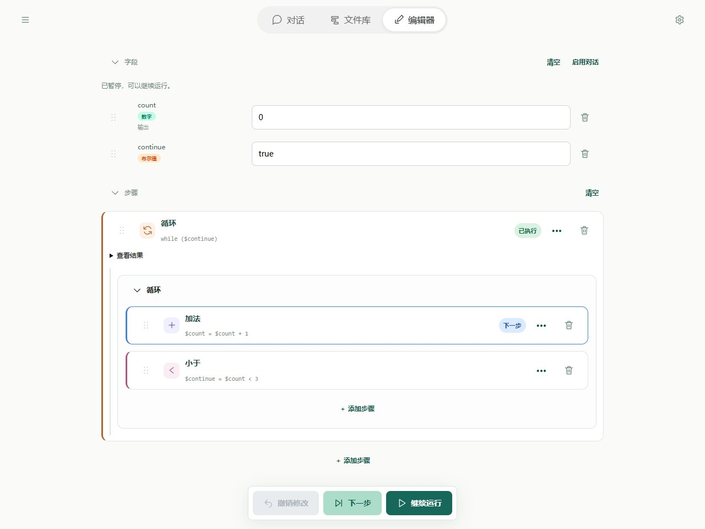

# 运行与调试

调试就是把流程一步一步运行，观察字段怎样变化，找出结果从哪一步开始不符合预期。即使文件已经保存、格式也正确，运行时仍可能遇到除数为零或网络连接失败等问题。

## 推荐顺序



底部“下一步”推进一步，“运行测试”继续执行。字段面板显示当前数据，步骤列表标记当前位置。循环和子流程可展开查看内部层级；运行中可使用步骤间暂停或取消调用。图中先进入循环，下一步才执行循环体内部节点。

1. **准备输入**：先用一组简单内容测试，例如固定的一句话或两个数字。修改过源码和脚本时，先保存。
2. **执行一步**：点击“下一步”，查看当前步骤做了什么、相关字段变成什么。
3. **找到问题**：继续到结果第一次不符合预期的位置。报错时查看高亮步骤和错误信息；调用子流程出错时，进入子流程查看具体位置。
4. **修改并重试**：修改出错步骤，重置到默认值，再用相同输入从头验证。测试时手动填写过的输入，需要重新填写。

Editor 提供单步与字段面板。暂停通常在步骤之间生效，正在等待的宿主调用不是可冻结现场。停止传播取消并清理支持的执行环境，不回滚外部效果。运行状态是实时视图，记录不是恢复快照。

测试值与默认值不同，可“重置到默认值”清除现场并重新开始。查看与修复除零例子时，先用下方导入按钮打开 broken.yaml，再检查报错的步骤和字段，而不是只观察最终输出。手机布局见[手机入门](../quick-start-mobile.md)。

## 用一个真实错误练习

本章「修复除零错误」包含 broken.yaml 和 fixed.yaml。broken 的步骤为：

```yaml
- type: divide
  left: 10
  right: 0
  output: $answer
```

运行失败为 DIVISION_BY_ZERO，位置 steps[0]。把 right 改为 2，保存重新运行，预期输出 `{answer: 5}`。不要只修改提示词或吞掉错误；应该修复实际分母。

## 常见失败

| 现象 | 检查与修复 |
| --- | --- |
| INVALID_FLOW / INVALID_YAML | 检查字段结构、缩进、重复键、未知节点和路径，定位文件解析错误 |
| 调用目标不存在 | 查当前文件 imports 和工具注册表，别名不是流程 name |
| INVALID_NUMBER | 检查引用是否读取对象、数组或不可转换值 |
| LOOP_LIMIT / FLOW_LIMIT | 循环内是否更新条件，工具请求是否持续产生；先修循环再调整限制 |
| 输出缺失 | 字段是否 output=true、映射是否正确、是否读取旧 result 属性 |
| 脚本返回 null | 是否调用 result，是否错误地只导出了函数 |
| 脚本导入失败 | 相对调用流程/模块解析，检查文件大小写及浏览器不支持的包 |
| WORKSPACE_CONFLICT | 完整重读最新文件和 revision，合并后保存 |
| AI_CONFIG / HTTP 状态错误 | 检查服务 URL、model、apiKey 与接口支持 |
| 网络错误 | 区分连接、超时、浏览器 CORS 和 SDK 处理，不能仅凭通用提示认定 CORS |
| OUTPUT_NOT_JSON | CLI 结果含 undefined、循环或特殊值；显式转换后返回 JSON |

## 进阶：嵌套调用定位

错误中的 invocationId 区分不同调用，flowName 是显示名，source 是文件来源，path 定位节点。call 事件的 childInvocationId 指向子实例，trace 的 returned 表示本步出栈的实例；多层返回可能一次有多个 returned。

Core getStack 返回实时根到栈顶视图，成功子流程出栈，不是历史列表。错误保留失败链，修复父 call 之前先查看最深的实际错误。

## CLI trace

先将[子流程示例](../flows/subflows.md)中的 main.yaml 和 add-one.yaml 保存到同一文件夹，再在这个文件夹中执行：

```powershell
soyori run ./main.yaml --trace run-001.jsonl --trace-values --json
```

trace 文件必须不存在。JSONL 记录 start、initial、step-start、step-end、end。默认不采集字段，--trace-values 显式开启有限摘要，可能包含敏感输入。可按 source/path 和 childInvocationId 检查子流程，不能从摘要恢复运行。

CLI 默认总超时 30 秒，包括流程加载、模块、模型及 trace 等待。--timeout 显式值优先于 SOYORI_TIMEOUT；超时退出 124，中断 130。它能终止执行子进程，但不能撤销网络或文件副作用。

## 进阶：助手如何验证修复

助手先读完整文件与手册，再保存、flow.inspect、flow.run。成功且 resultAvailable=true 时用真实 result 判断类型和数值；output 是有损文本，不能根据引号推断数字变成了字符串。不可 JSON 或超限时应报告 resultUnavailable，不能伪造完整结果。记录最多 100 条，应如实报告 truncated。失败工具返回和运行 status=failed 都不是成功。

助手当前只能运行已保存文件，不能读取未保存草稿、设置断点或操纵 Editor 现场。用户应保存相关文件，助手用相同输入重跑；需要人工单步时切到 Editor。接口见 [助手工具](../tools/assistant.md)。
