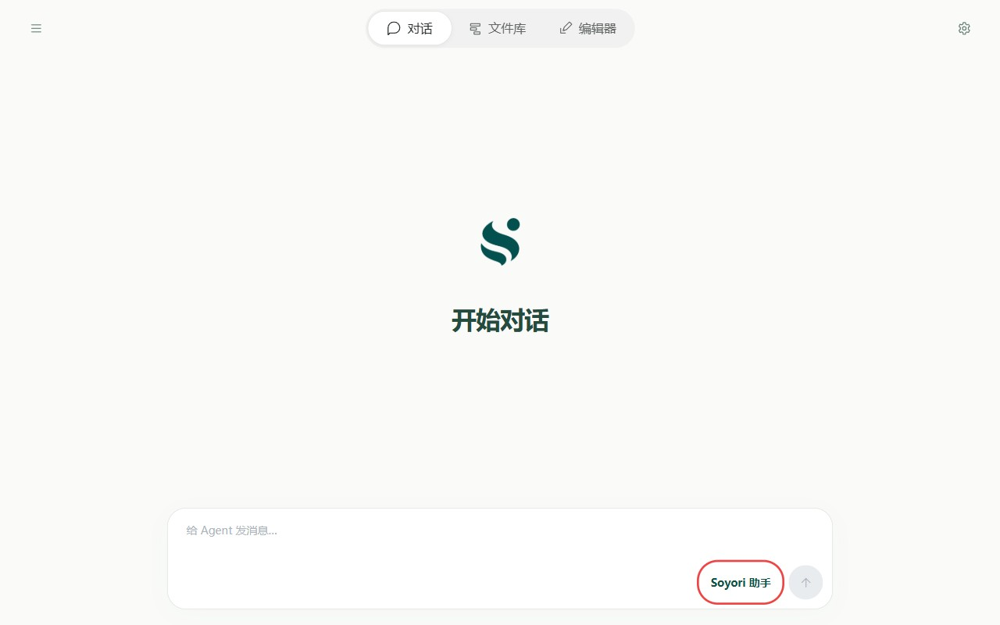
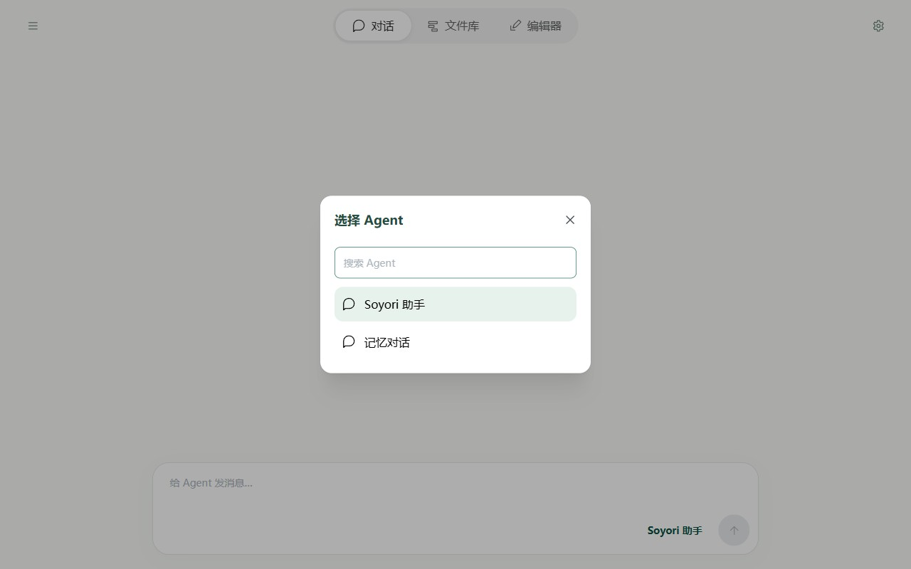
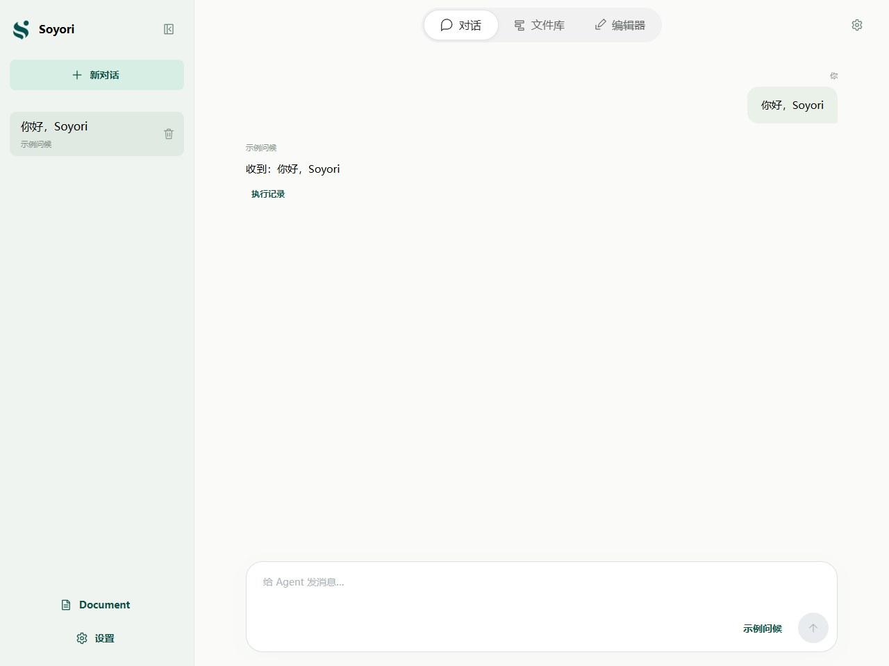
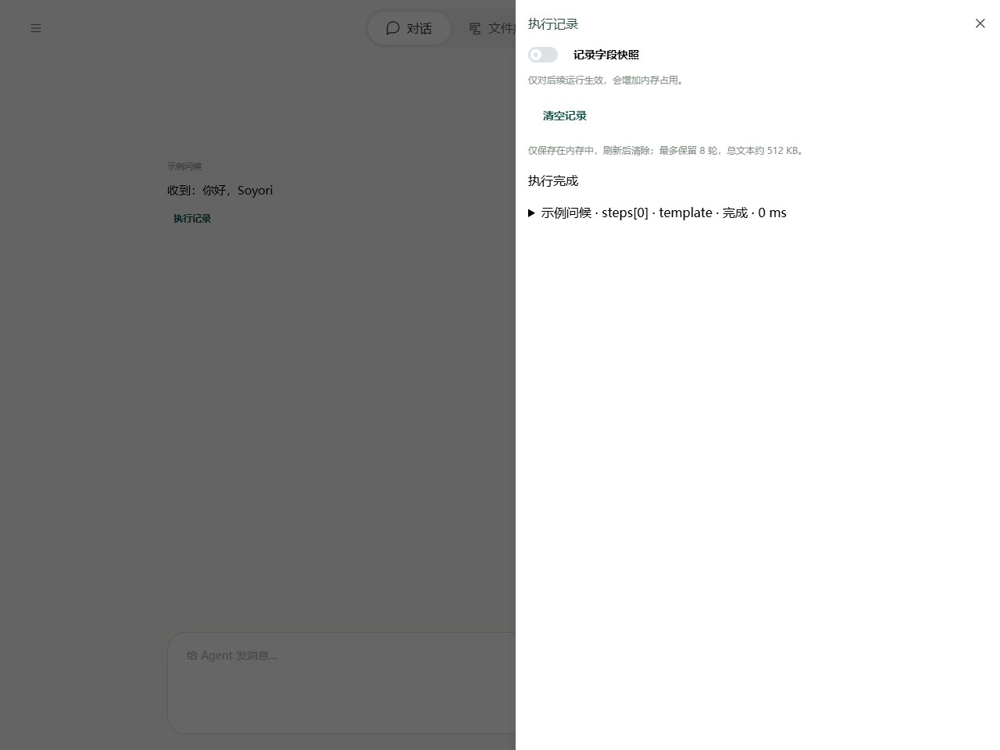

# 对话：助手、thread 与执行记录

对话页面让你通过发消息使用 AI 助手。每次发送消息，所选流程都会运行一次，再把结果作为回复显示。

## 选择助手或自己的流程

在对话页，找到**输入框右下角、发送箭头左侧的名称按钮**。下图红框中的“Soyori 助手”就是当前 Agent；如果已经切换过，这里会显示你所选流程的名称。

点击这个名称按钮，会打开“选择 Agent”弹窗：

1. 在列表中点击要使用的助手或流程，名称较多时可以用顶部的“搜索 Agent”查找。浅绿色背景表示当前选中的项。
2. 选择后弹窗关闭，输入框下方的名称更新为所选 Agent。
3. 在消息框填写任务，点击发送箭头，等待回复；执行中可以停止，也可以切换页面或查看其他对话。

**选择哪个？** 想让 AI 帮你查手册、查询工具、读写文件库、创建和测试流程，选择“Soyori 助手”；想使用自己编写的聊天流程，选择对应名称。图中的“记忆对话”是一个聊天流程示例。助手流程与新建流程模板独立，修改自己的流程不会修改内置助手。

想把自己的流程用于对话，需要将 `chatOut` 勾选为“输出”。推荐同时准备两个输入字段：`chatIn` 接收这次发送的文字，`threadId` 接收当前对话的编号。流程结束时，chatOut 里的内容就是回复。

界面上能看到历史消息，不代表 AI 自动记得它们；流程需要把历史交给模型。新建模板已包含相关步骤，原理见[存储与对话记忆](../agents/storage.md)。

## thread：一段对话

点击左上角打开抽屉，用“新对话”开始独立聊天，或点击历史条目继续。新对话最初是草稿，首次发送才生成 thread ID 并保存；刷新未发送的草稿不会保留临时环境配置。

thread 就是侧边栏中的一段对话，`threadId` 是它的唯一编号。同一段对话沿用同一个编号；点击“新对话”则开始另一段。

每次发消息，流程仍会从头运行。聊天记录用于回看消息；流程记忆用于把需要的历史交给 AI。这两份内容分别保存，删除对话不会自动删除流程自己的记忆。存储位置见[存储与对话记忆](../agents/storage.md)。

运行中的回复与错误归属发起它的原对话，切换对话不会把结果写到新对话。当前共享执行期间不能同时发送另一轮，也不能并行运行 Editor 测试。删除正在运行的对话前先停止。

## 执行记录与错误

展开回复相关的执行信息，查看实际步骤、工具调用与错误位置。失败时保留用户消息，不追加正常回复；保存成功、流程校验成功和运行成功是不同结果。

记录帮助了解本次执行，不是恢复现场。敏感字段和部分调用详情会遮挡；完整行为见[环境变量](../agents/environment.md)。需要逐步观察字段时，在 Editor 中打开相同流程，填写相同输入，按[调试说明](../debugging/guide.md)测试。

## 让助手修改与验证

可以直接描述“在文件库创建一个流程”或“检查某个已保存流程”。助手使用工具返回的路径和版本进行操作。源码草稿先保存，再让助手检查，否则它看到的是 Library 中的旧版本。助手目前不能控制你的 Editor 单步现场。

具体工具接口见[助手文件与调试工具](../tools/assistant.md)。
