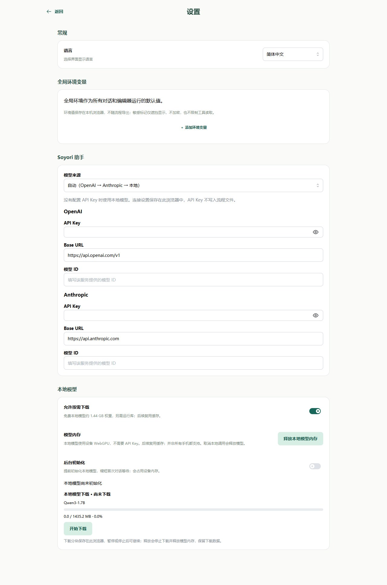

# 设置：模型连接与数据保存

从左上角打开抽屉，点击“设置”。这里配置助手模型连接、本地模型和全局环境；当前文件测试环境与对话环境使用各自顶栏入口。

## 模型连接

选择自动、OpenAI 兼容、Anthropic 或本地供应商。远程服务填写 API Key、Base URL、模型 ID；兼容服务使用该服务实际提供的值。配置完成后返回对话测试一次简单问候。

不熟悉这些名字时，可以这样理解：

| 配置 | 是什么 | 从哪里填写 |
| --- | --- | --- |
| API Key | 服务用来识别你的访问密钥 | 在模型服务的账户页面申请，再复制到这里 |
| Base URL | 发送模型请求的服务地址 | 使用服务提供的 API 地址，通常不同于打开网站的首页地址 |
| 模型 ID | 这次要使用的具体模型名称 | 从该服务支持的模型列表中选择，按原样填写 |

使用默认本地模型时，不需要申请远程服务的 API Key。

自动选择会优先使用配置完整的 OpenAI，再 Anthropic，否则本地。明确选择供应商后缺配置会报错，请求失败不会自动换供应商。步骤也能传连接参数，有效环境参与回退；具体优先级见[环境变量](../agents/environment.md)。

不要把密钥写进提示词或普通流程默认值。浏览器直接请求模型服务，服务需允许当前站点的请求；遇到失败先检查地址、模型、凭据和响应信息。

## 本地模型准备

本地固定模型为 Qwen3-1.7B-ONNX，浏览器需要 WebGPU/shader-f16 并允许下载。首次权重下载约 1.44 GB，初始化还需要等待；缓存存在不代表推理会话已加载。

可以查看下载、初始化和就绪状态，按设置中的操作停止或释放资源。后台初始化加载会话，不生成回复。手机图文布局已支持，但实际设备的本地推理兼容性和性能仍需验证。

## 数据保存与备份

| 数据 | 保存位置 | 备份与迁移 |
| --- | --- | --- |
| Library 文件和目录 | 当前站点浏览器 IndexedDB | 下载文件或 `.soyori.zip` 工程包 |
| 对话记录、流程记忆 | 浏览器中的对话索引和通用存储 | 不包含在 Library 工程包中 |
| 全局、对话、文件测试环境 | 本地环境 IndexedDB | 不随流程或工程包导出 |
| 当前运行现场 | 当前编辑会话 | 不支持刷新恢复 |

更换浏览器、站点地址或清除站点数据可能失去原数据。网页与 CLI 不自动同步；Library 不对应电脑项目目录。敏感字段导出会移除 initial，但原文件不修改。

工程上传下载见[文件库](../workspace.md)，环境操作见[Editor 环境](../environment/editor.md)。
