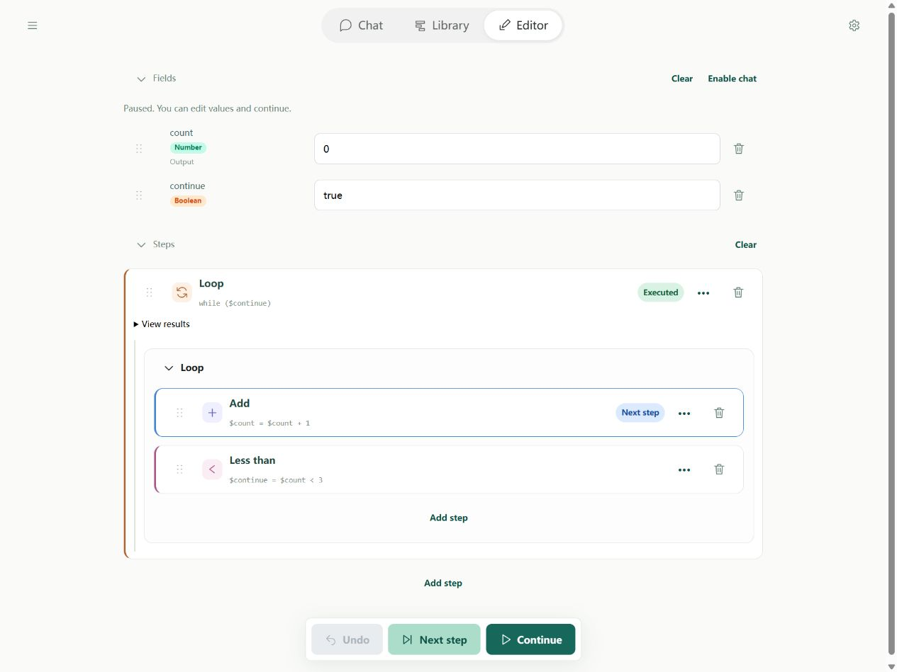

# Running and debugging

Debugging means running a flow step by step, watching field changes, and finding the first unexpected result. A saved, valid file can still fail at runtime, for example through division by zero or a network error.

## Recommended approach



**Next step** advances one step; **Run test** continues. Fields show current data and Steps marks the execution position. Expand loops and subflows to inspect children. Entering a loop takes one step; its first child runs on the next step.

1. Prepare simple inputs and save edited source or scripts.
2. Run one step and inspect its field changes.
3. Continue until the first wrong result; inspect the highlighted error and, for subflows, its actual child location.
4. Fix, reset to defaults, re-enter any temporary inputs, and verify from the beginning with the same data.

Pausing normally takes effect between steps. A pending host call cannot be frozen. Stop propagates cancellation and cleans up supported execution environments; external effects are not rolled back. Live state and records are not recovery snapshots.

## Practice with a real error

Import broken.yaml and fixed.yaml below. The broken step is:

```yaml
- type: divide
  left: 10
  right: 0
  output: $answer
```

It fails with DIVISION_BY_ZERO at steps[0]. Change right to 2, save, and rerun for `{answer: 5}`. Fix the actual denominator.

## Common failures

| Symptom | Check |
| --- | --- |
| INVALID_FLOW / INVALID_YAML | Field structure, indentation, duplicate keys, unknown steps, and paths |
| Missing target | Current file's imports and tool registry; an alias is not a flow name |
| INVALID_NUMBER | A reference may contain an object, list, or nonnumeric text |
| LOOP_LIMIT / FLOW_LIMIT | Update loop conditions and check repeated tool requests before increasing limits |
| Missing output | Output flag, result mapping, and current returned property names |
| Script returns null | Call result(value); exporting a function alone does not invoke it |
| Script import fails | Relative paths, filename case, and unsupported browser packages |
| WORKSPACE_CONFLICT | Reread the full latest file and revision, merge, then save |
| AI_CONFIG / HTTP error | Service address, model, credentials, and API support |
| Network failure | Distinguish connectivity, timeout, browser CORS, and SDK errors; a generic error alone does not prove CORS |
| OUTPUT_NOT_JSON | Explicitly convert undefined, cyclic, or special values before JSON output |

## Advanced: Locate nested failures

invocationId identifies a call; flowName labels it; source identifies its file; path identifies the step. childInvocationId links a call to its child. Trace returned lists instances popped by the step; multiple nested returns can occur together.

Core getStack is a live root-to-top view, not history. Successful children pop; failure retains the error chain. Inspect the deepest actual failure before changing the parent call.

## CLI trace

Save the [subflow example](../flows/subflows.md) files main.yaml and add-one.yaml together, then run:

```powershell
soyori run ./main.yaml --trace run-001.jsonl --trace-values --json
```

The trace filename must not already exist. JSONL contains start, initial, step-start, step-end, and end records. Field collection is off by default; --trace-values enables limited summaries that may include sensitive inputs. Use source/path and childInvocationId to follow calls. Summaries cannot resume a run.

The CLI default total timeout is 30 seconds, including loading, modules, models, and trace waits. Explicit --timeout overrides SOYORI_TIMEOUT. Timeout exits 124; interruption exits 130. Terminating a worker cannot undo network or file effects.

## Advanced: How the assistant verifies a fix

It reads complete files and documentation, saves, inspects with flow.inspect, and tests with flow.run. A completed run with resultAvailable true supplies the actual result for checking types and values. output is a lossy text display: quotes there do not prove a number became text.

Non-JSON or oversized results report resultUnavailable. Records cap at 100 and expose truncated when limited. A failed tool call or status failed is not success. The assistant works on saved files and cannot read unsaved drafts, set breakpoints, or operate your Editor session. See [assistant tools](../tools/assistant.md).
