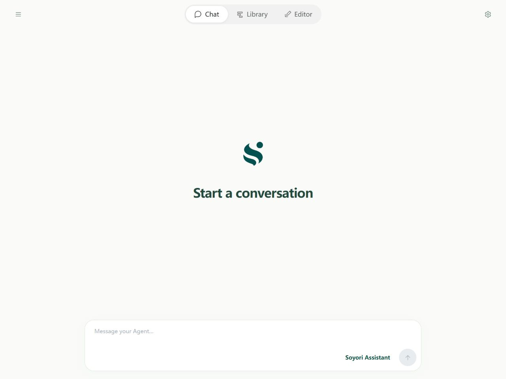
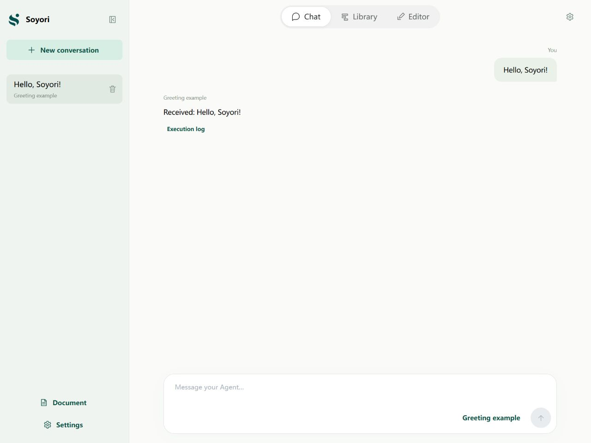
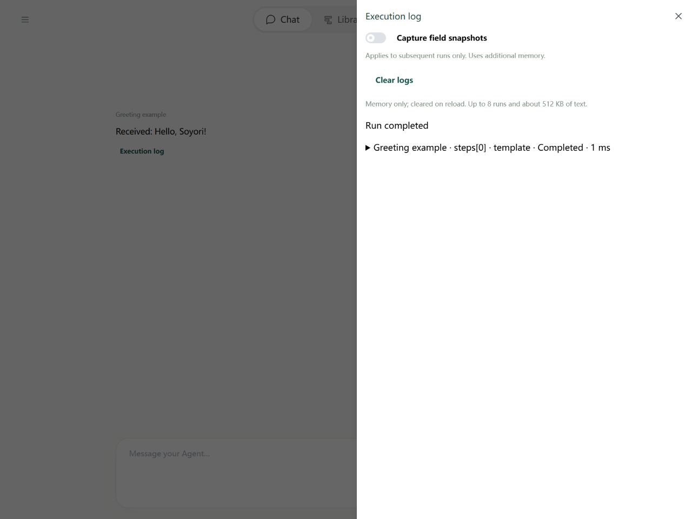

# Chat: Assistants, threads, and execution records

Use Chat to work with an assistant by sending messages. Each message runs the selected flow once and displays its result as a reply.

## Choose an assistant or your own flow

Find the **name button at the bottom right of the input, just left of the send arrow**. The screenshot below shows the current Agent, “Soyori Assistant,” in that position. After switching, it shows your selected flow's name.

Click the name to open the Agent selector:

1. Select an entry; use **Search Agents** if needed. A pale green background identifies the current selection.
2. The selector closes and the name under the input updates.
3. Enter a task and send. While waiting, you can stop the run, switch pages, or view other conversations.

Choose **Soyori assistant** to read the handbook, discover tools, manage Library files, or create and test flows. Choose your own flow to run its steps. The built-in assistant and new-flow template are independent; editing your flow does not modify the assistant.

For your own chat flow, mark chatOut as **Output**. Also prepare Input fields chatIn for the user's message and threadId for the conversation ID. The final chatOut becomes the reply. Displayed history does not automatically reach the model; your flow must supply it. The default template already includes these steps. See [storage and memory](../agents/storage.md).

## Thread: One conversation

Open the top-left drawer to start a **New conversation** or continue an earlier one. A new conversation begins as a draft. Its first sent message creates and saves a thread ID; refreshing an unsent draft discards its temporary environment settings.

A thread is one conversation, identified by threadId. Messages in it reuse that ID; a new conversation uses another. Every message still starts the flow from the beginning. Chat records and flow-managed memory are saved separately; deleting a conversation does not automatically delete its flow's memory.

Replies and errors belong to the conversation that started the run. Switching conversations does not redirect results. The shared runner cannot send another turn or run an Editor test concurrently. Stop a running conversation before deleting it.

## Execution records and errors

Expand execution information to inspect steps, tool calls, and error locations. A failure keeps the user message without adding a normal reply. File saving, validation, and successful execution are distinct outcomes.

Records explain a run; they cannot restore it. Sensitive fields and some call details are obscured; see [environment variables](../agents/environment.md). To inspect fields step by step, open the same flow in Editor with the same inputs and follow [debugging](../debugging/guide.md).

## Ask the assistant to edit and verify

Ask it to create a Library flow or inspect a saved file. It works with tool-returned paths and revisions. Save source drafts first, or it will see the older Library version. It cannot operate the Editor's live stepping session. See [assistant tools](../tools/assistant.md).
