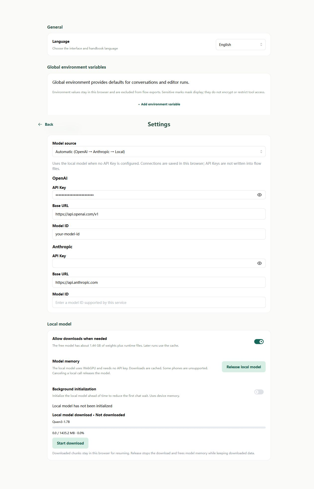

# Settings: Models and saved data

Open the top-left drawer and choose **Settings**. Configure the assistant model, local inference, and global environment here. Conversation and file-test environments have separate top-bar controls.

## Model connections

Choose Auto, OpenAI-compatible, Anthropic, or Local. For a remote service, supply its API key, Base URL, and model ID, then test a greeting in Chat.

| Setting | Meaning | Where to get it |
| --- | --- | --- |
| API key | Credential identifying your access | Your model service account |
| Base URL | Address that receives model API requests | The service's API documentation; usually different from its website homepage |
| Model ID | Exact model to use | The service's supported model list |

The default local model requires no remote API key. Auto prefers a fully configured OpenAI connection, then Anthropic, then local. An explicitly selected provider reports missing configuration; a failed request does not switch providers. Steps can supply connection parameters; see [environment priority](../agents/environment.md).

Keep keys out of prompts and ordinary defaults. Browsers request services directly, so the service must allow requests from this site. Check the address, model, credential, and response when a call fails.

## Prepare a local model

The fixed local model is Qwen3-1.7B-ONNX. Browser inference requires WebGPU/shader-f16 and download permission. Initial weights are about 1.44 GB; initialization takes additional time. Cached files do not mean an inference session is loaded.

Inspect download, initialization, and ready states in Settings, with controls to stop or release resources. Background initialization loads the session without generating a reply. Mobile UI is supported, while inference compatibility and performance still require testing on actual devices.

## Data and backups

| Data | Location | Backup or migration |
| --- | --- | --- |
| Library files and folders | This site's IndexedDB | Download files or a .soyori.zip project |
| Chat records and flow memory | Browser conversation index and general storage | Not included in Library exports |
| Global, conversation, and file-test environments | Local environment IndexedDB | Not exported with flows or projects |
| Live run state | Current editing session | Cannot restore after refresh |

Changing browser or site address, or clearing site data, can lose access to data. Web and CLI do not synchronize automatically. Library is not a disk project folder. Export removes initial values from sensitive fields without modifying the source file.

See [Library](../workspace.md) and [Editor environments](../environment/editor.md).
