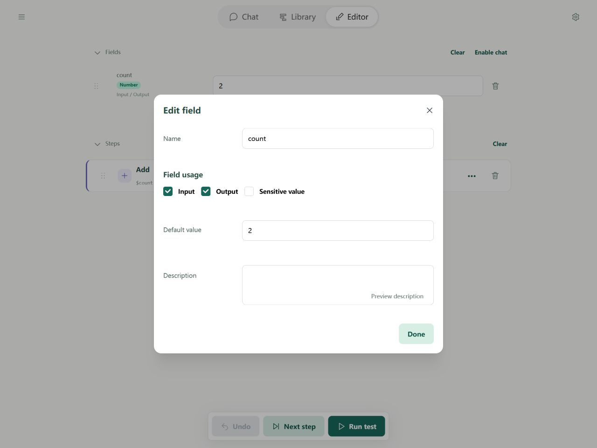
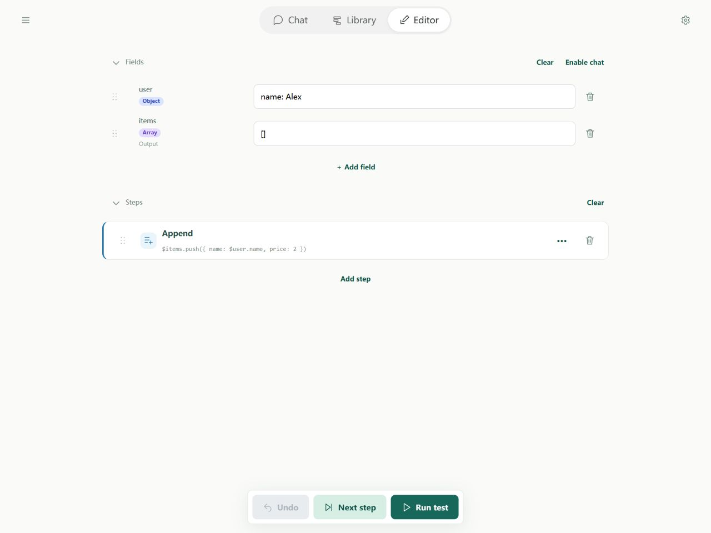

# Editing flows: Fields and current values

The Fields panel shows current data. Field settings save declarations and defaults. A new run begins with defaults and inputs; stepping shows how values change.

## Add and configure fields

1. Choose **Add field** and enter its name without a dollar sign.
2. Select Input and/or Output as needed, and enter a description and default.
3. Confirm. Click the field name later to reopen settings.

Input allows Chat, CLI, or a parent flow to supply content. Output includes the field in the final result. With neither flag, it still holds internal data.

Data types are detected automatically. The **Field type** option in settings selects an ordinary field or a group; it does not require you to choose text, number, or object. You can use fields before learning [types](../flows/types.md).

| Entry | Recognized as |
| --- | --- |
| 10 | Number |
| "10" | Text |
| true | Boolean |
| null | Explicit empty value |
| {name: Alex} | Object |
| [1, 2] | List |
| Empty default or current value | Unset (undefined) |

Unset differs from null. Dollar signs in defaults and external inputs stay literal; references such as $count are interpreted in step parameters. See [variables](../flows/variables.md).

## Edit current values

Edit the current value beside a field. Objects and lists can be inspected and changed as structured text. Test values are separate from saved defaults.

When values differ, choose **Reset to defaults** or **Set as default** to save the current persistable content. Reset also discards the current run session so execution starts over.

While paused, change values using the available controls before continuing. Some declaration editing is disabled in a live session; shared execution state cannot be changed during an active host call.

## References and sensitive values

Step references become $count or $user.name in YAML. Defaults and current values are data, so dollar signs inside them do not reference other fields. See [paths](../flows/operands.md).

Select **Sensitive value** to obscure a field. The eye control temporarily reveals it and hides it again later. This is not encryption, does not change the value, and does not automatically propagate to derived fields. Environment and field sensitivity are separate; see [Editor environments](../environment/editor.md).

Clearing fields still referenced by steps is blocked. Remove references first and avoid deleting needed data merely to tidy the panel.
