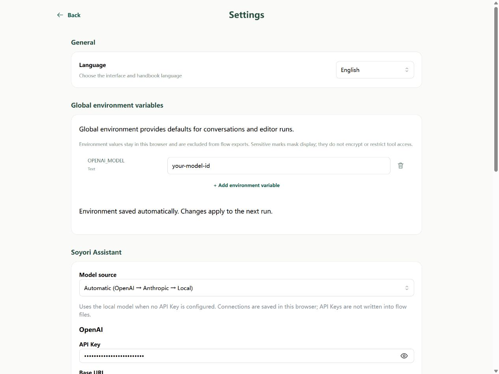
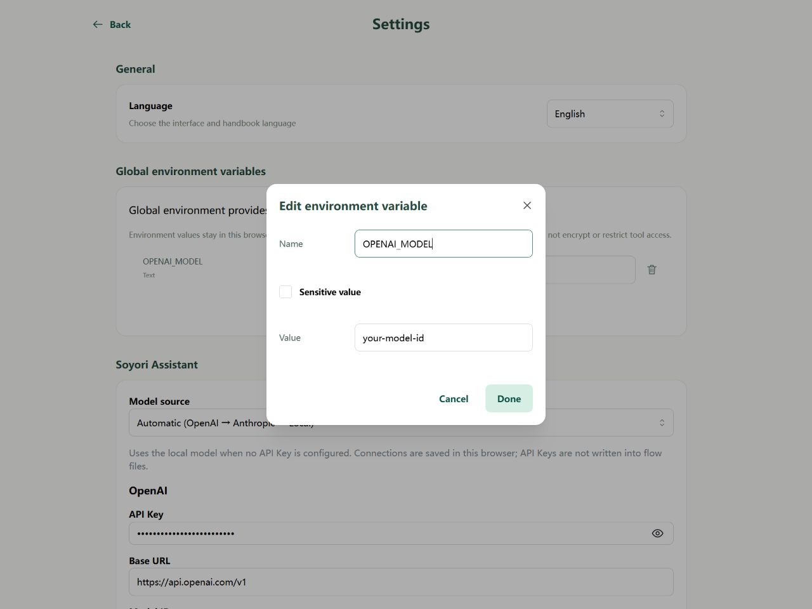
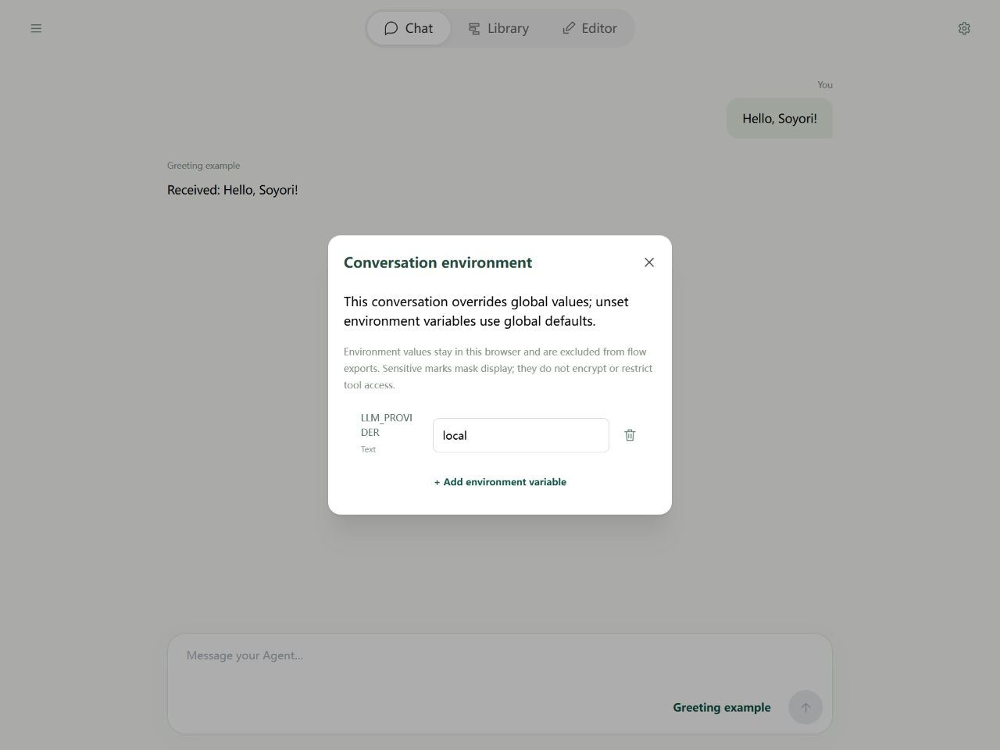
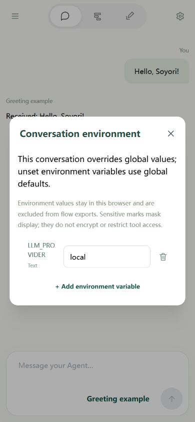
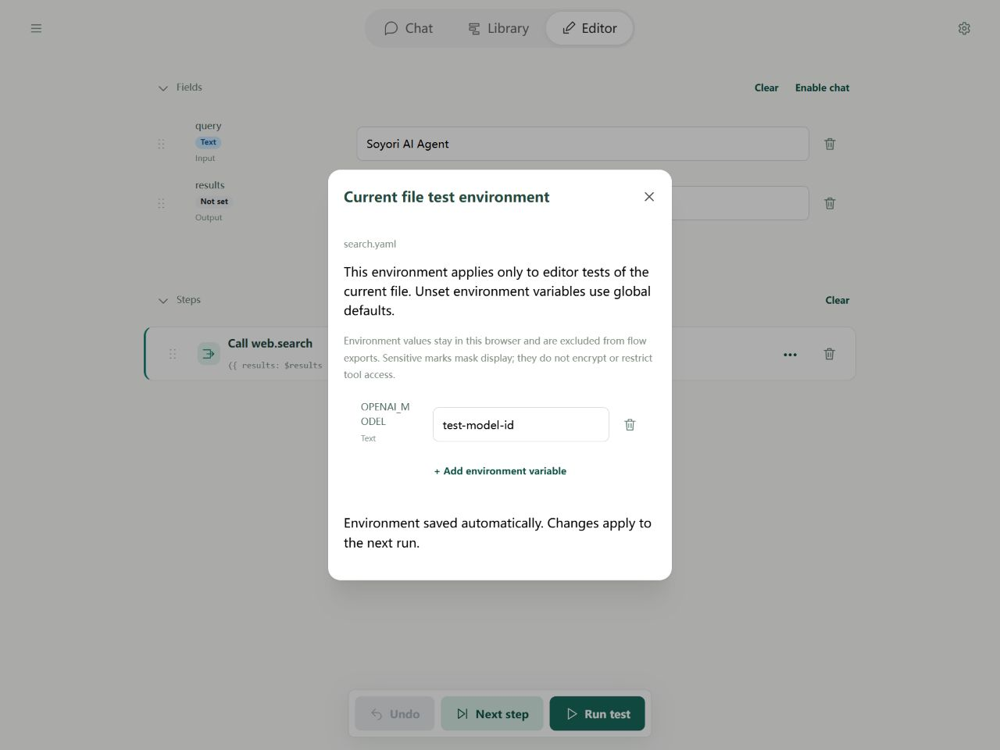
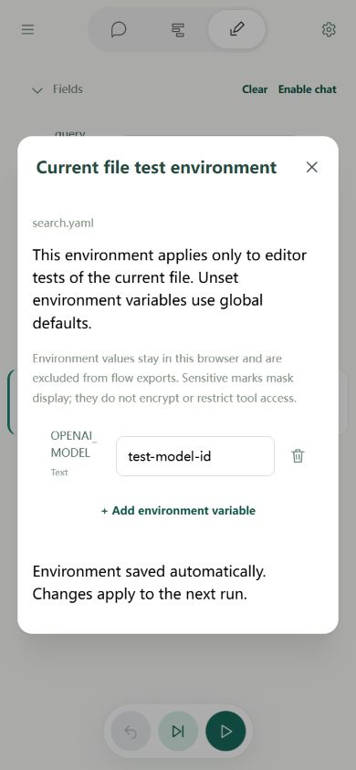

# Environment variables: Editor

Web settings have three entry points: global, current conversation, and current file test. Conversation and file settings independently override global; they do not stack on each other.

## Global defaults

Open the drawer → **Settings → Global environment variables**. Choose **Add environment variable**, enter name, string value, and Sensitive flag, then confirm. Adds, edits, and deletes save automatically.

Names are case-sensitive letters, digits, and underscores, and cannot start with a digit. Values are always strings, even 512. Mark API keys sensitive; model IDs may be ordinary values.

## Current conversation environment

Click Chat's top-right environment icon. Current conversation overrides global. Delete an override to restore global; an empty string is still an override.

You can configure a draft conversation before sending. Its first message creates the thread and saves settings; refreshing the unsent draft discards them. Assistant flow.run tests use this conversation's latest environment.

On mobile, use the same top-right control and close the dialog when done:

## Current file test environment

Click Editor's top-right environment icon. **Current file test > global** applies only to that file's runs and stepping, without changing Chat. Children inherit the starting run environment rather than reading their own test settings.

Settings are saved locally by file ID. Moves and renames retain them; copying creates a new ID without copying the environment. File/project downloads do not include these values.

The same rules apply on mobile. Check the dialog title before entering values so you edit the intended environment.

## When settings take effect and sensitivity

The next run takes a snapshot after automatic saving. Changing the UI during execution does not change that run. env.override/load affects subsequent calls in the current run without updating UI settings.

The eye temporarily reveals sensitive values. env.get does not mark its destination sensitive; mark credential fields separately with sensitive true. Prefer automatic connection lookup when available so keys need not enter fields. See [shared principles](../agents/environment.md).
