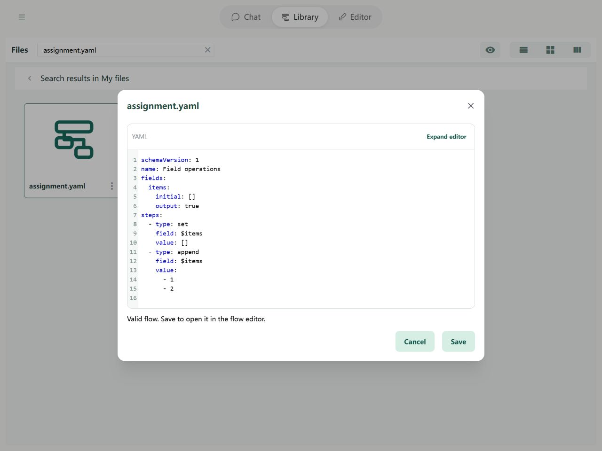

# Steps: Field operations

**Set** replaces a value. **Append** adds one item at the end of a list. Later steps can read the updated field.

## In the Editor

Add Set to initialize items to an empty list, followed by Append with value [1, 2]. A Set step replaces the previous value; Append adds one item.


Import the example below and open it in the Editor to try its fields and steps.

## YAML and basic example



```yaml
schemaVersion: 1
name: Field operations
fields:
  items:
    initial: []
    output: true
steps:
  - type: set
    field: $items
    value: []
  - type: append
    field: $items
    value:
      - 1
      - 2
```

The example produces `{items: [[1, 2]]}`: the inner list is appended as one item.

## Rules and common questions

- Append adds exactly one item: appending `[1, 2]` to `[]` produces `[[1, 2]]`. To merge lists, use `array.concat`.
- If the destination is not a list, Append replaces it with a new list before adding the item; the old scalar value is not retained.
- YAML destinations are `$` paths. They are not arithmetic expressions. Out-of-range list writes fill skipped positions with null, within the expansion limits.

See [path boundaries](operands.md) and [debugging](../debugging/guide.md).
