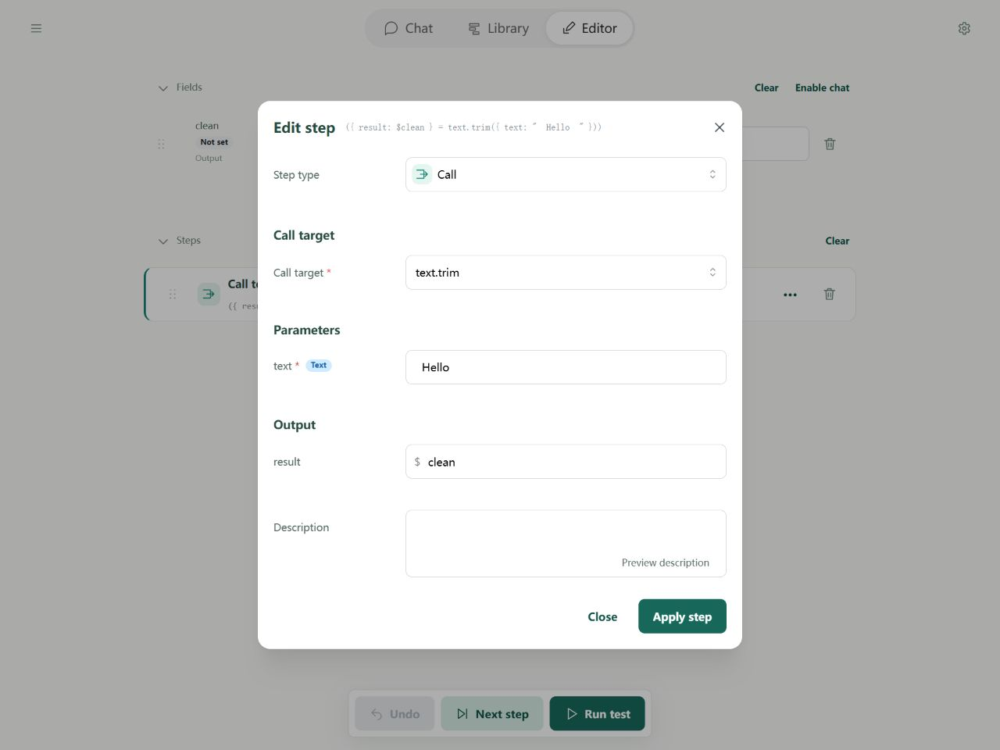
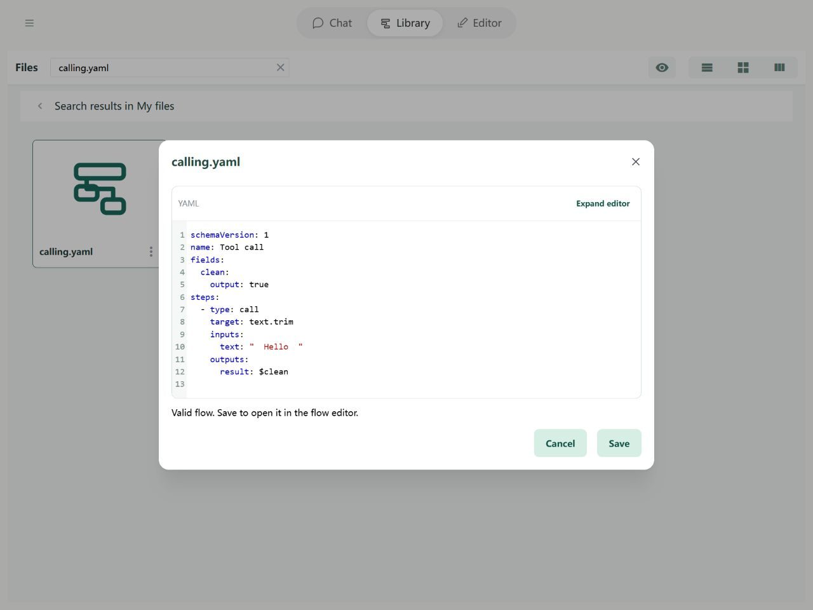

# Steps: Calls

A Call step uses a tool or a [subflow](subflows.md). Choose its target, supply inputs, and decide where to save its returned data.

## In the Editor

Add Call, choose text.trim, enter text with spaces at both ends, and map its result to clean. The target is a fixed name without a dollar sign.



Import the example below and open it in the Editor to try its fields and steps.

## YAML and basic example



```yaml
schemaVersion: 1
name: Tool call
fields:
  clean:
    output: true
steps:
  - type: call
    target: text.trim
    inputs:
      text: "  Hello  "
    outputs:
      result: $clean
```

The output is `{clean: "Hello"}`: the greeting text with surrounding spaces removed.

## Rules and common questions

- target identifies a registered tool or a local imports alias. Input names are defined by that target; values can be constants or references.
- In `outputs`, names on the left are returned properties; destinations on the right are your fields. These names need not match.
- The next step waits for the call to finish. A failed call fails the flow. An absent mapped property writes an unset value.

### Save one result or the complete return object?

Use `outputs: {result: "$clean"}` to select the direct property result. Use `output: $wholeResult` to save the whole returned object instead. These options cannot be combined. To access deeper data, save the object first and read its path in a later step.

See [path boundaries](operands.md) and [debugging](../debugging/guide.md).
