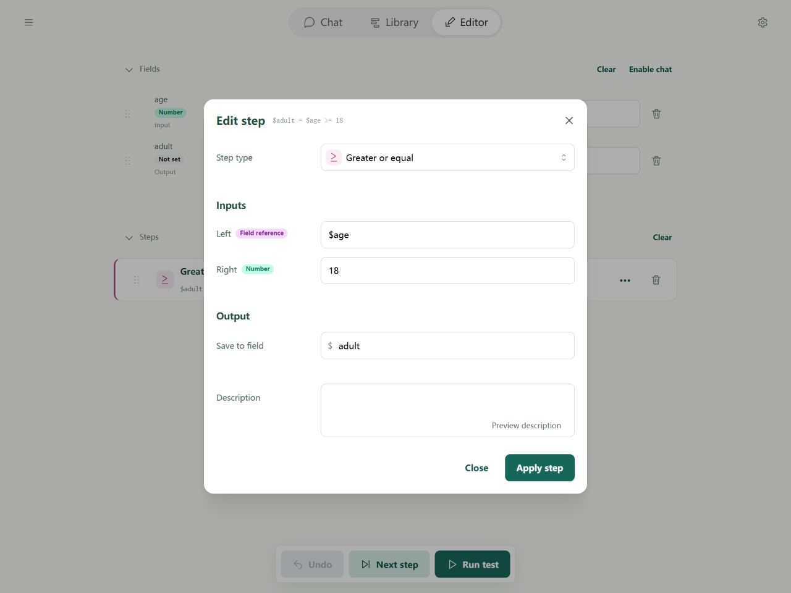
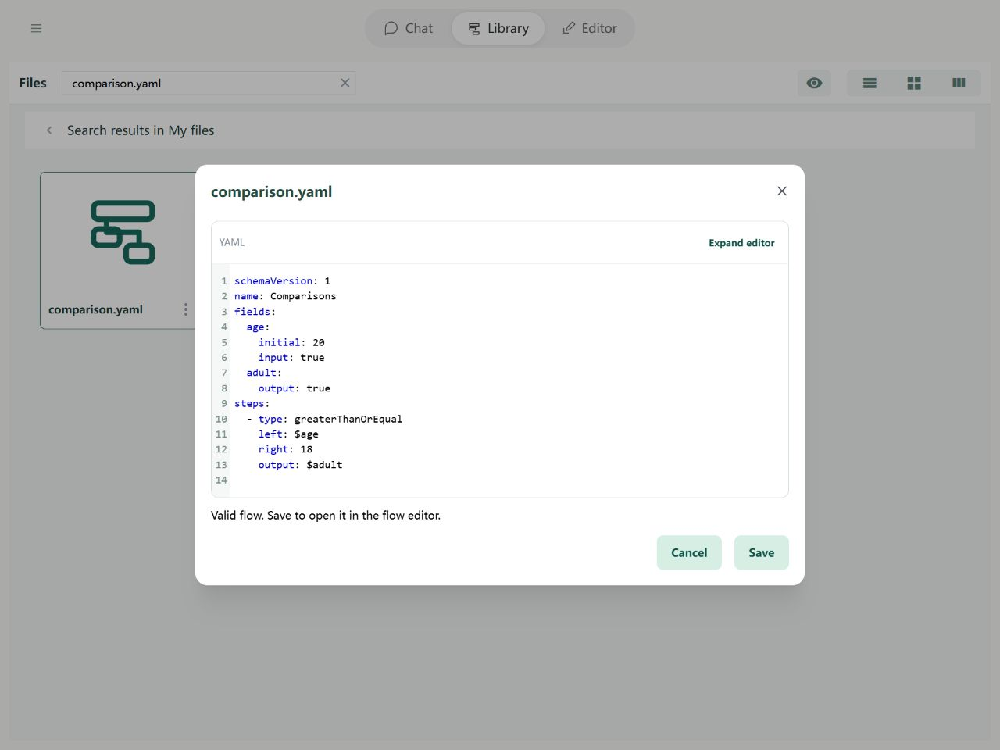

# Steps: Comparisons

A comparison checks equality or order and produces true or false. You can use its result in an If or While step.

## In the Editor

Choose Greater than or equal, compare age with 18, and save to adult. Change age and run again to see the condition change.



Import the example below and open it in the Editor to try its fields and steps.

## YAML and basic example



```yaml
schemaVersion: 1
name: Comparisons
fields:
  age:
    initial: 20
    input: true
  adult:
    output: true
steps:
  - type: greaterThanOrEqual
    left: $age
    right: 18
    output: $adult
```

With age 20, the result is `{adult: true}`.

## Rules and common questions

- Supported types: equal, notEqual, greaterThan, lessThan, greaterThanOrEqual, lessThanOrEqual.
- Ordered comparisons use numbers; unset becomes 0 without being written back. Invalid numeric conversion fails.
- Equal compares same-type primitive values by content and plain objects/lists by deep content. Mixed numeric primitive values, such as 2 and `"2"`, can compare numerically.
- Null equals only null, and undefined only undefined; neither becomes 0 for equality. Use Next step to inspect the comparison result before a branch.

See [path boundaries](operands.md) and [debugging](../debugging/guide.md).
