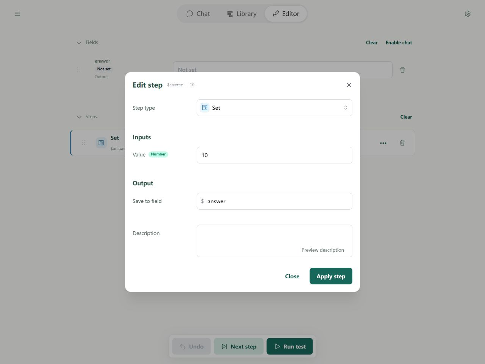
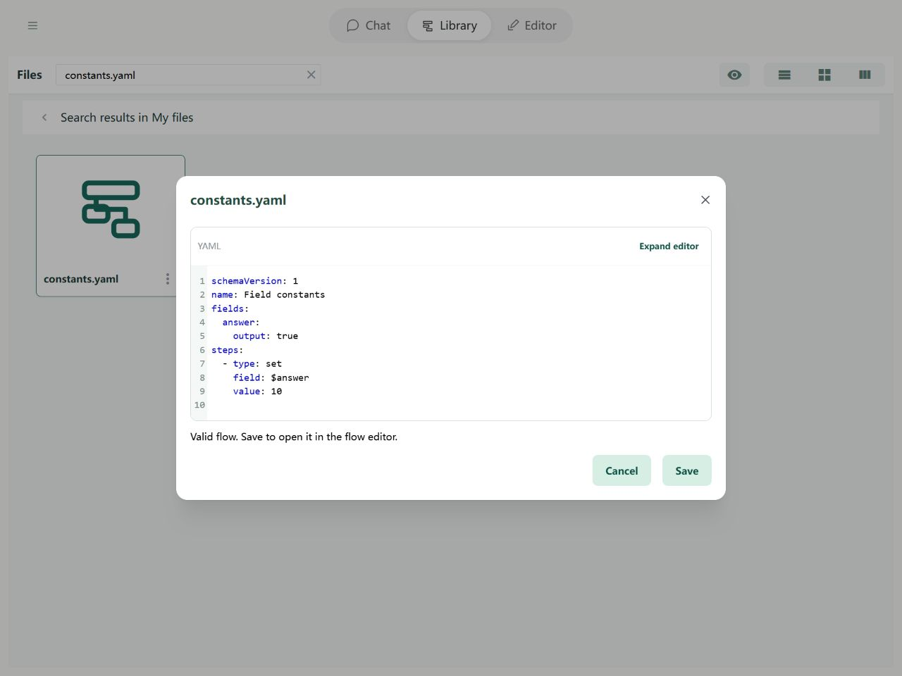

# Fields: Constants

A constant is a value written directly, such as the number `10` or the instruction “Translate into English.” A step uses that written value when it runs.

Use a constant for a translation instruction that stays the same. Use a [variable](variables.md) for source text that changes between runs.

## Where to use constants

1. **Field defaults:** start a counter at `0`, for example.
2. **Step inputs:** add a fixed `1`, or supply a standing instruction to a model.

Enter the value in its input box. Types are detected automatically: `10` is a number, `"10"` is text, `true` and `false` mean yes and no, and `null` is an explicit empty value. You do not need to choose a type first; see [types](types.md) when needed.



The corresponding step is:

```yaml
- type: set
  field: $answer
  value: 10
```

Constants can also be [objects or lists](objects.md). A field default only supplies its starting content; later steps can still change that field.

## Complete example



```yaml
schemaVersion: 1
name: Field constants
fields:
  answer:
    output: true
steps:
  - type: set
    field: $answer
    value: 10
```

The output is `{answer: 10}`. Use the import button below to try it.
