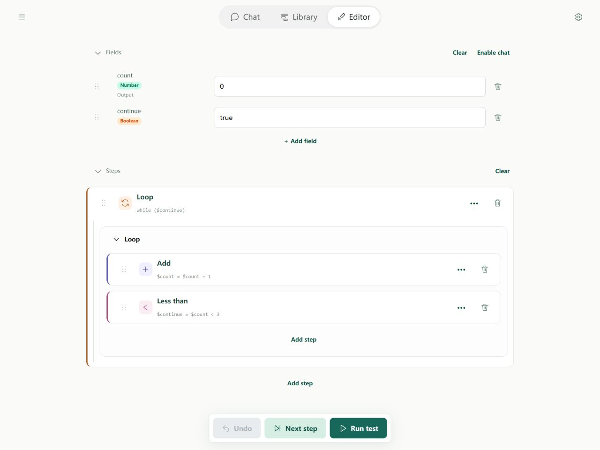
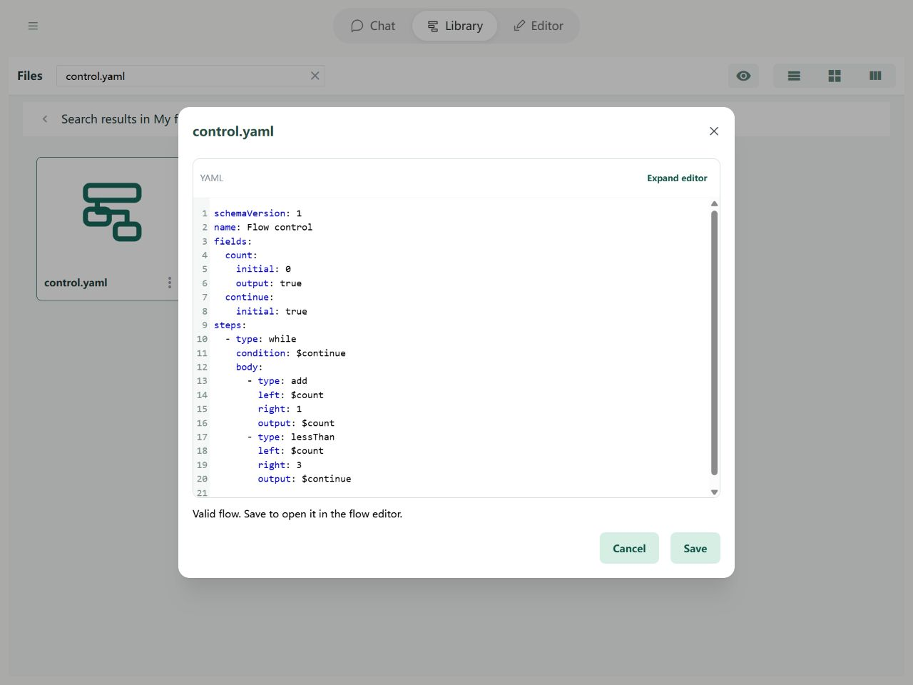

# Steps: Flow control

Steps normally run from top to bottom. **If** chooses between actions: run then when a condition is true, or else when false. **While** repeats its body while a condition is true, checking again before every repetition. A [comparison](comparison.md) can produce a true/false condition.

## In the Editor

Add While, use continue as its condition, and put an Add step followed by a Less than comparison inside its body. Save the comparison back to continue. Indentation shows which steps belong to the loop.



Import the example below and open it in the Editor to try its fields and steps.

## YAML and basic example



```yaml
schemaVersion: 1
name: Flow control
fields:
  count:
    initial: 0
    output: true
  continue:
    initial: true
steps:
  - type: while
    condition: $continue
    body:
      - type: add
        left: $count
        right: 1
        output: $count
      - type: lessThan
        left: $count
        right: 3
        output: $continue
```

The result is `{count: 3}`. After the first increment count is 1, then 2, and finally 3. The comparison `count < 3` becomes false on the third repetition, ending the loop.

### Writing an If step

Prepare passed and message fields, then place this fragment under steps:

```yaml
- type: if
  condition: $passed
  then:
    - type: set
      field: $message
      value: Passed
  else:
    - type: set
      field: $message
      value: Not passed
```

When passed is true, message becomes “Passed” (passed); otherwise it becomes “Not passed” (not passed). Omit else if no action is needed when false.

## Rules and common questions

- Update something that eventually makes the condition false. Otherwise the loop repeats until a run limit stops it.
- If the condition is false on the first check, the body runs zero times.
- `0`, empty text, null, and unset values count as false. Nonzero numbers, nonempty text, objects, and lists count as true. The text `"false"` is nonempty and therefore true. Prefer comparison results when starting out.
- If uses condition, then, and optional else. While uses condition and body.

See [path boundaries](operands.md) and [debugging](../debugging/guide.md).
