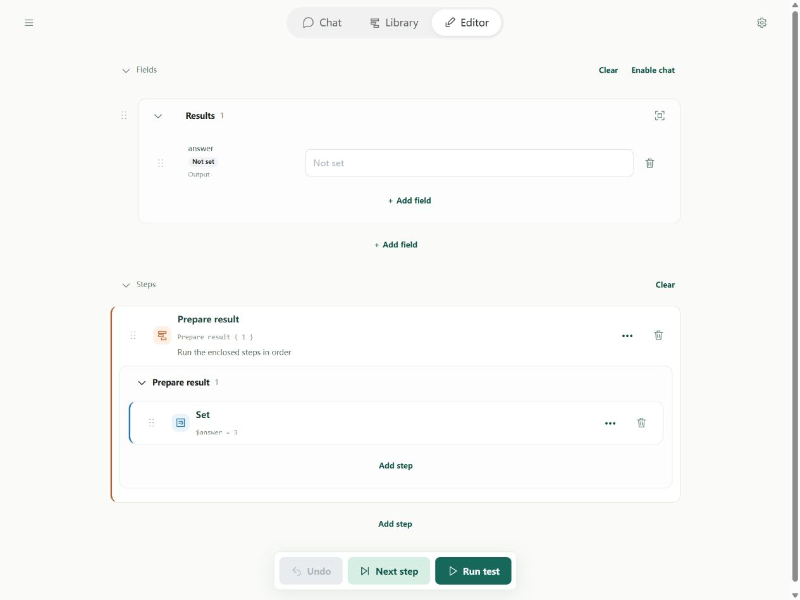
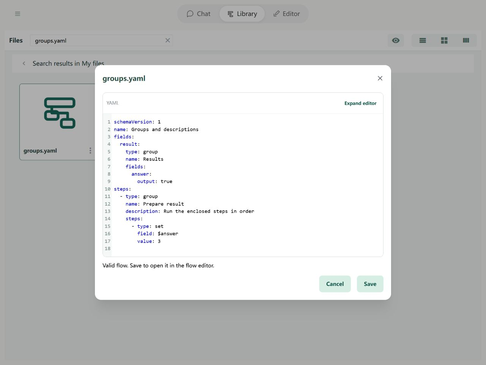

# Steps: Groups and descriptions

Put related fields or steps into a named group to find and collapse them easily. Groups can contain other groups. They organize the display; collapsing does not skip execution or hide data from other steps.

## In the Editor

Group related steps and give the group a name and description. Expand to inspect its steps. You can also group fields as inputs, settings, or results.



Import the example below and open it in the Editor to try its fields and steps.

## YAML and basic example



```yaml
schemaVersion: 1
name: Groups and descriptions
fields:
  result:
    type: group
    name: Results
    fields:
      answer:
        output: true
steps:
  - type: group
    name: Prepare result
    description: Run the enclosed steps in order
    steps:
      - type: set
        field: $answer
        value: 3
```

The result is `{answer: 3}`.

## Rules and common questions

### Field groups

A field group is recognized by `type: group` and contains another name-to-configuration fields mapping:

```yaml
fields:
  inputs:
    type: group
    name: Inputs
    collapsed: false
    fields:
      chatIn:
        input: true
      language:
        initial: English
  chatOut:
    output: true
```

The mapping key inputs identifies the group; name is its optional display label. Changing the label does not rename the key. Nested groups use the same structure.

Read the field as `$chatIn`, never `$inputs.chatIn`: field groups do not create data nesting. Ordinary field names must be unique across the entire flow. Sibling group keys and field names must also be unique.

Field order only affects presentation. Ordinary key order is preserved by the Editor; integer-like keys such as 0 and 1 follow JavaScript object key ordering, so descriptive text names are recommended. Legacy field lists with name properties remain readable; Editor saves them as mappings. Steps remain ordered lists.

### Step groups and descriptions

A step group contains steps, which execute in order. collapsed true means initially collapsed; false or omitted means expanded. A description explains a field, step, or group without changing calculations. Field groups contain fields; step groups contain steps.

See [path boundaries](operands.md) and [debugging](../debugging/guide.md).
