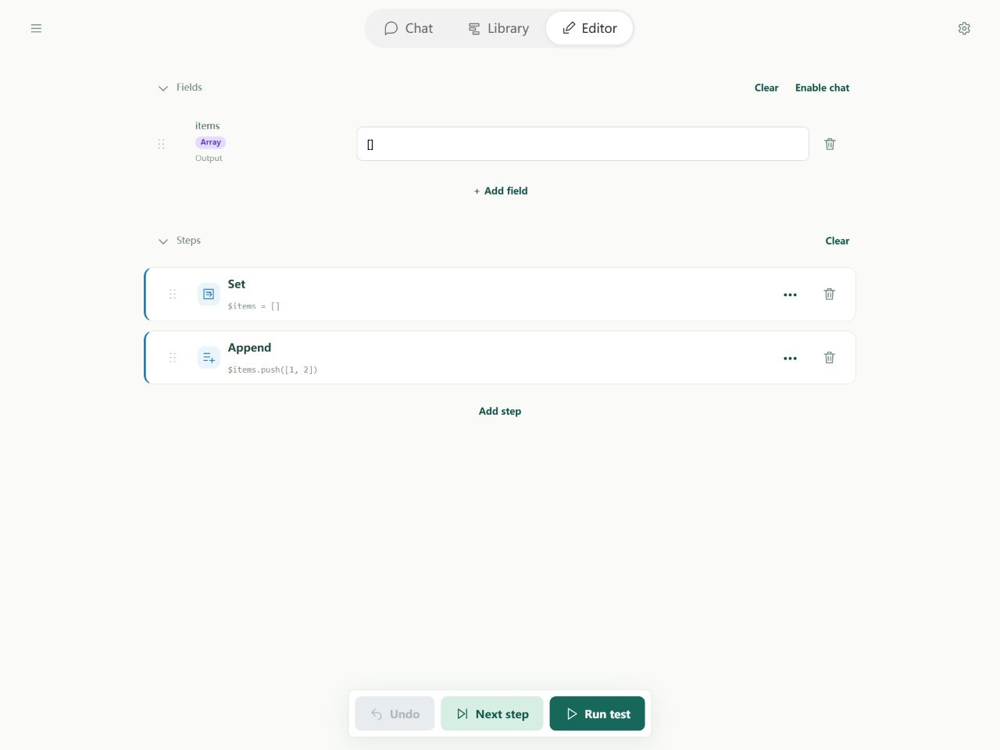

# Overview

A flow combines data and actions so you can call models, use tools, and process results in order to complete a task.

## Where to start

A flow is stored and defined in a file using [YAML](https://yaml.org/spec/1.2.2/). You can edit it in Soyori's Editor or any IDE or text editor. Its two main parts are fields and steps.

### Fields: hold the content you need

Think of fields as named compartments. They hold user input, information you have found, or a reply, so later steps can find it by name.

For a translation flow, you might prepare:

1. **Source text:** the sentence to translate.
2. **Translation:** the result after translation.

### Steps: arrange the actions to perform

Steps say what to do and in what order. Each step can read a field, perform an action, and save a result for a later step.

For the same translation flow:

1. Read the source text.
2. Ask AI to translate it into English.
3. Save the reply in the translation field.

## Editor

Use the Editor to edit a flow: prepare data in **Fields**, then add and arrange actions in **Steps**.



## YAML file

The same flow can be written as text. `schemaVersion` identifies the format, `name` names the flow, `fields` declares its data, and `steps` lists its actions. This complete flow stores 10 in answer:

```yaml
schemaVersion: 1
name: Simple flow
fields:
  answer:
    output: true
steps:
  - type: set
    field: $answer
    value: 10
```

The final result is `{answer: 10}`.
