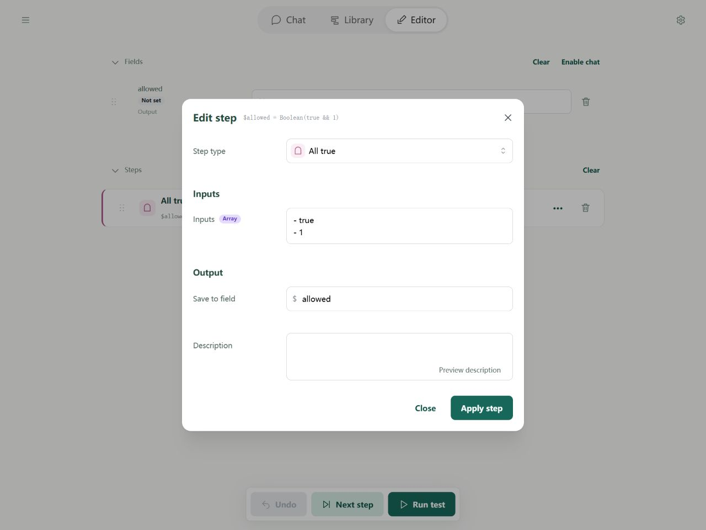
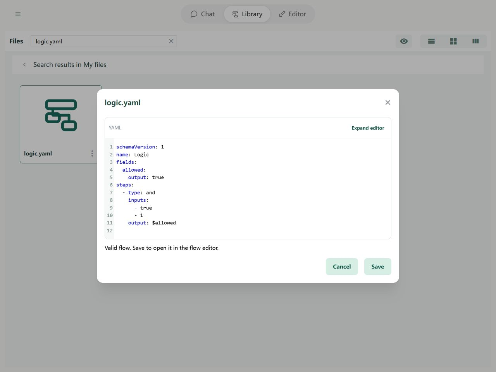

# Steps: Logic

**And** requires every condition to be true. **Or** requires at least one. **Not** reverses a condition. These steps combine comparisons into a decision.

## In the Editor

Choose And and add conditions to its inputs list. Save the result to allowed. For a real flow, use references such as $ageOk and $registered.



Import the example below and open it in the Editor to try its fields and steps.

## YAML and basic example



```yaml
schemaVersion: 1
name: Logic
fields:
  allowed:
    output: true
steps:
  - type: and
    inputs:
      - true
      - 1
    output: $allowed
```

The example uses `[true, 1]`, so the result is `{allowed: true}`.

## Rules and common questions

- And and Or take an inputs list. Not takes one input.
- Conditions use the same truth rules as If and While: zero, empty text, null, and unset are false; objects and lists are true. The text `"false"` is true.
- An empty list itself is true. To check whether it contains items, call array.length and compare the length with 0.

See [path boundaries](operands.md) and [debugging](../debugging/guide.md).
