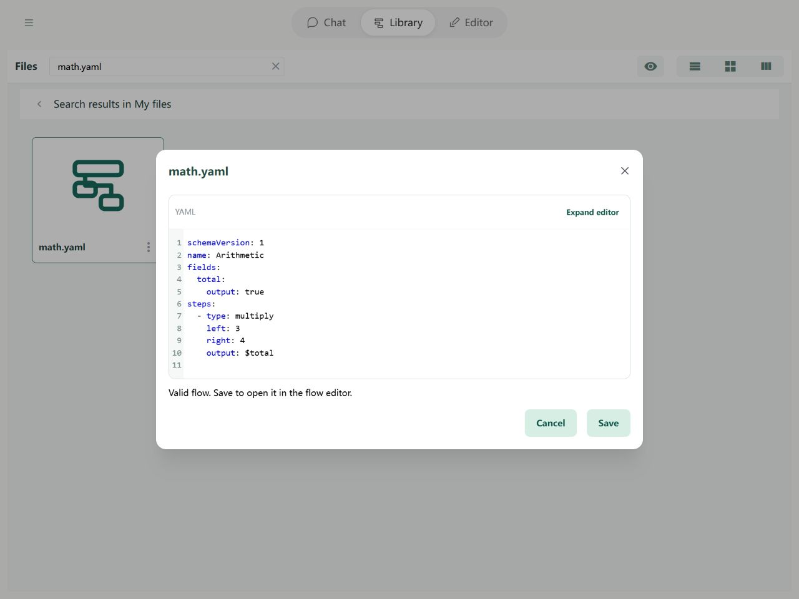

# Steps: Arithmetic

Add, subtract, multiply, and divide calculate with two values and save the result in a field. For example, multiply a unit price by a quantity.

## In the Editor

Choose Multiply, enter 3 and 4, and save to total. Other arithmetic steps use the same left, right, and output arrangement.


Import the example below and open it in the Editor to try its fields and steps.

## YAML and basic example



```yaml
schemaVersion: 1
name: Arithmetic
fields:
  total:
    output: true
steps:
  - type: multiply
    left: 3
    right: 4
    output: $total
```

The output is `{total: 12}`.

## Rules and common questions

- The four types are add, subtract, multiply, and divide. left and right can be constants or field references; output is the destination.
- An unset value becomes 0 for this calculation without changing the source field. Numeric strings can be converted; invalid numbers cause INVALID_NUMBER.
- Division by zero causes DIVISION_BY_ZERO.
- Built-in `math.*` tools have their own stricter numeric input contract; do not assume they apply all step conversions.

See [path boundaries](operands.md) and [debugging](../debugging/guide.md).
