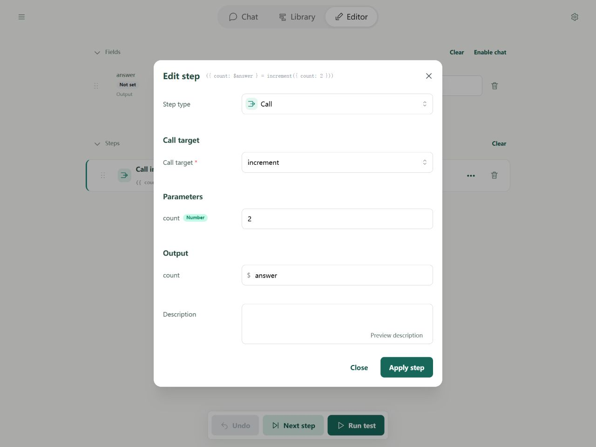
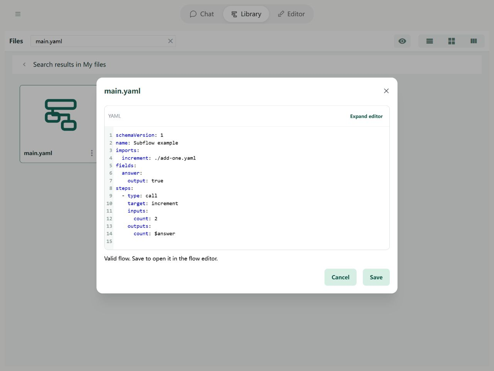

# Subflows and calls

Save reusable actions in another flow file and call it as a subflow. For example, a main flow handles a task while a translation subflow handles one text passage.

The parent passes data, waits for completion, and receives results. Each call starts at the subflow's beginning using that call's inputs.

1. Save the child file; mark accepted fields Input and returned fields Output.
2. Add its path to the parent's imports with a local alias.
3. Add a Call step targeting that alias, with inputs and output destinations.

## In the Editor

Import the two-file example below and open main.yaml. Its increment target comes from imports. Pass count 2 and save returned count to the parent's answer.



Check imports in Library's source editor. A display name differs from a call alias. Recheck relative paths after moving files.



## Complete example

Save as `add-one.yaml`:

```yaml
schemaVersion: 1
name: Add-one subflow
fields:
  count:
    input: true
    output: true
    initial: 0
steps:
  - type: add
    left: $count
    right: 1
    output: $count
```

Save `main.yaml` in the same directory:

```yaml
schemaVersion: 1
name: Call add-one
imports:
  increment: ./add-one.yaml
fields:
  answer:
    output: true
steps:
  - type: call
    target: increment
    inputs:
      count: 2
    outputs:
      count: $answer
```

Running main produces `{answer: 3}`. Import below, or save both files together and run `soyori run ./main.yaml --json`.

## Sources and scope

The increment alias exists only in main; it is not a global tool name. Each child declares its own imports. name is only a label. An imports alias conflicting with a registered tool causes a pre-run error; neither takes priority.

Editor resolves imports from Library. CLI supports local files and HTTP(S). Relative sources resolve against the importing file or final URL after redirects. Remote flows cannot import local files. Core receives an already linked LoadedFlow graph and does not read files or networks itself.

## Inputs and outputs

- `count: 2` passes 2 to the child's input field. Omitting it uses the child's default 0. You may also reference parent data.
- `count: $answer` maps the child's final count to the parent's answer; adding one produces 3.
- Only Input fields accept arguments; only Output fields are returned.

Use `output: $childResult` for the whole output object instead of outputs; never both. Missing mapped properties write undefined. Data is not automatically JSON-serialized. Parent and child field containers are separate, but referenced objects can be shared: mutations are visible through the same reference, without an implicit deep clone.

## Advanced: Stepping and the call stack

Stepping a call creates a child instance and pushes it on the stack. The next step executes inside it. Completing its last step commits outputs and pops the child; the parent waits at its call until then.

The stack runs from root to current top. Each call has a distinct invocationId, even repeated calls to one flow. source, flowName, and path identify a file and step; childInvocationId links a child call. Default maximum depth is 32 including the root.

A child failure fails waiting ancestors while retaining the actual error location and call stack. It does not automatically retry or resume. See [debugging](../debugging/guide.md).
