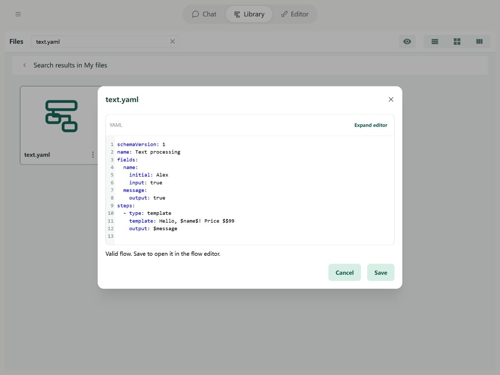

# Steps: Text processing

A Text template combines fixed words and field content into a prompt or reply. It uses paired dollar signs around a path, such as `$name$`.

## In the Editor

Add a Text template, enter its body, and choose a destination field. Insert the name field using $name$, and use $$ to write one literal dollar sign.


Import the example below and open it in the Editor to try its fields and steps.

## YAML and basic example



```yaml
schemaVersion: 1
name: Text processing
fields:
  name:
    initial: Alex
    input: true
  message:
    output: true
steps:
  - type: template
    template: Hello, $name$! Price $$99
    output: $message
```

The sample produces a greeting for Alex and a price containing a literal `$99`. The output is `Hello, Alex! Price $99`.

## Rules and common questions

- Ordinary step input `$name` reads the entire field. Text template `$name$` inserts it into surrounding text. Ordinary strings containing `$name$` are not interpolated.
- Unset values become empty text. Numbers, booleans, and null become text; plain objects and lists are rendered as YAML. Cycles, binary data, and special objects cause INVALID_TEXT.
- For trimming, splitting, or replacing text, use `text.trim`, `text.split`, and `text.replace`. The old concat step has been removed.

See [path boundaries](operands.md) and [debugging](../debugging/guide.md).
