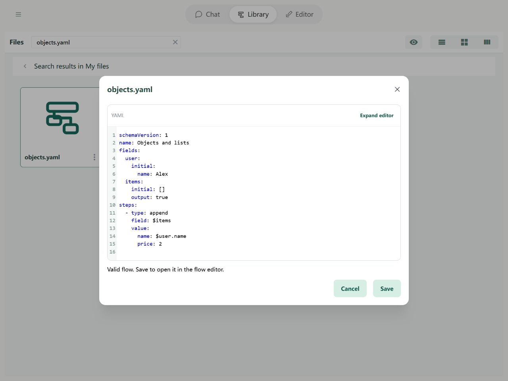

# Fields: Types

Fields can hold text, numbers, lists, and other kinds of content. These kinds are called **types**. Soyori detects them automatically. We aim to let you use fields without having to understand types first; learn the details when you need them.

## Why types exist

Different content needs different operations. You can add numbers, assemble text, or take an item from a list. Types help the Editor display values clearly and help tools check whether their input makes sense. The number `10` and the text `"10"` look similar but are different kinds of content.

## Detected automatically, without choosing a type

The Editor recognizes what you enter and shows a badge beside the current value. You do not declare a field's type separately.

| Example | Type | Meaning |
| --- | --- | --- |
| `hello` | Text | Words or a sentence |
| `10` | Number | A quantity used for calculations |
| `true`, `false` | Boolean | Yes or no |
| `[apple, banana]` | List | Several items in order |
| `{name: Alex, age: 18}` | Object | Named pieces of information about one thing |
| `null` | Null | An explicitly empty value |

An unset value (`undefined`) means no content has been supplied yet; it differs from an explicit null. A field can hold a different kind of value later: the badge describes its current content, not a permanent restriction.

## Usually, focus on what you want to enter

Enter the content naturally. If a number-like value is actually an identifier, quote it: `"001"` preserves the text and leading zeros. Use [objects and lists](objects.md) when you need several items. Tools may require a specific type; check their input description if a call fails. No extra YAML type declaration is required.
