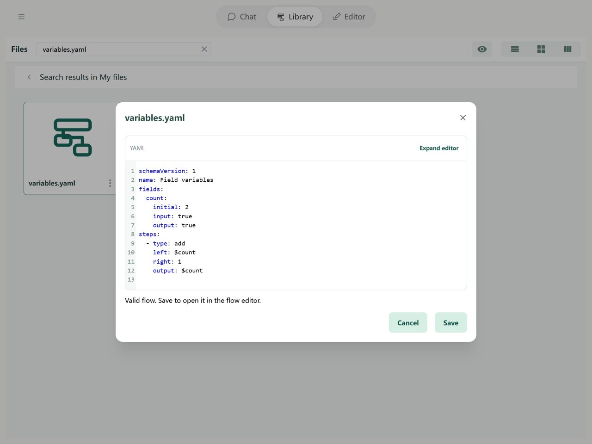

# Fields: Variables

A variable holds content during a flow run: user input, retrieved information, or an AI reply. Create a named field, then let steps use its current content by name.

## Declare a variable

Declaring means creating a field, naming it, and optionally supplying a default. Under Fields, choose **Add field**, name it count, set its default to 2, and select Output to see it in the final result.


In YAML, declarations go under fields:

```yaml
fields:
  count:
    initial: 2
    output: true
```

`count:` is the name. Do not prefix it with a dollar sign or add a separate name property. initial supplies its default. Add `input: true` to accept data from outside the flow. Types are detected from values; see [types](types.md).

## Reference a variable

A reference tells a step to fetch a field's **current content**. `$count` reads count; `count` by itself is just text.

To add one and save it back:

```yaml
- type: add
  left: $count
  right: 1
  output: $count
```

1. left reads the current count.
2. right supplies the constant 1.
3. output writes the result back to count.

Starting at 2 produces 3. To write literal text beginning with a dollar sign, escape it with another one: `$$count` produces the text `$count`. A text template uses the separate `$count$` syntax; see [text](text.md). For properties and list positions, see [paths](operands.md).

## Complete example



```yaml
schemaVersion: 1
name: Field variables
fields:
  count:
    initial: 2
    input: true
    output: true
steps:
  - type: add
    left: $count
    right: 1
    output: $count
```

With no external input, the result is `{count: 3}`.

## Rules and common questions

- **Default vs current value:** steps change the current value, not the saved default. Manual test edits behave the same way. Use **Set as default** to save a value for future opening.
- **Input and Output:** Input accepts values from Chat, CLI, or a parent flow. Output includes a field in the final result. Either, both, or neither can be selected; internal fields remain readable and writable by steps.
- **Unset vs null:** undefined means no content has been provided; null is explicitly empty.
- **Undeclared names:** names referenced by steps are recognized, but are not automatically inputs or outputs. Creating fields first makes spelling errors easier to spot.

See [path boundaries](operands.md) and [debugging](../debugging/guide.md).
