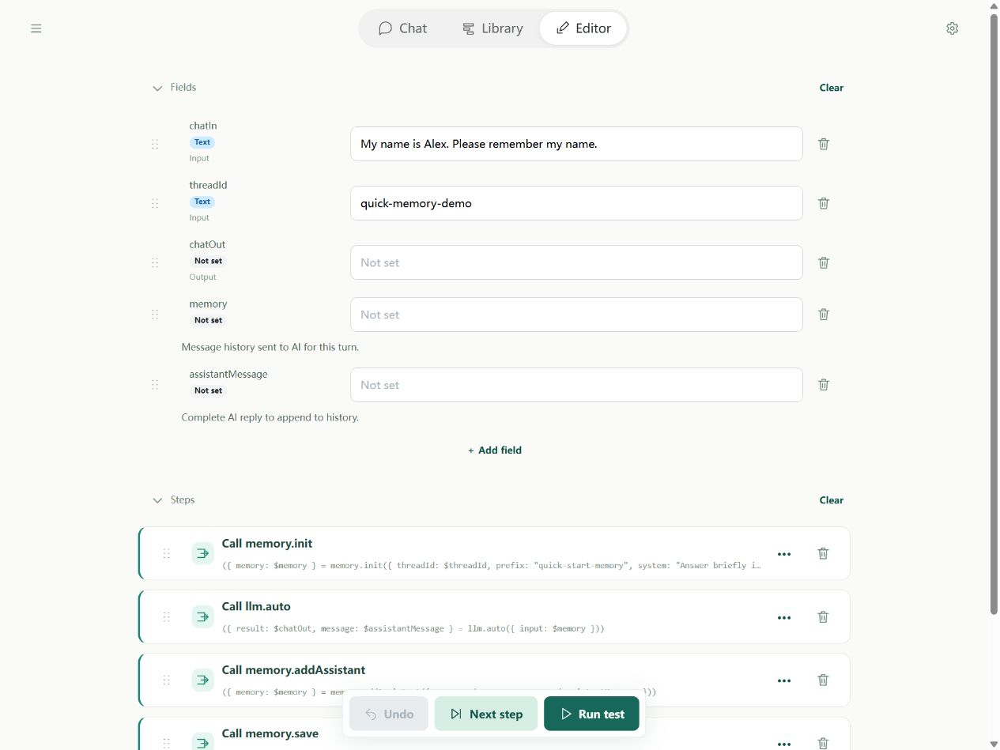
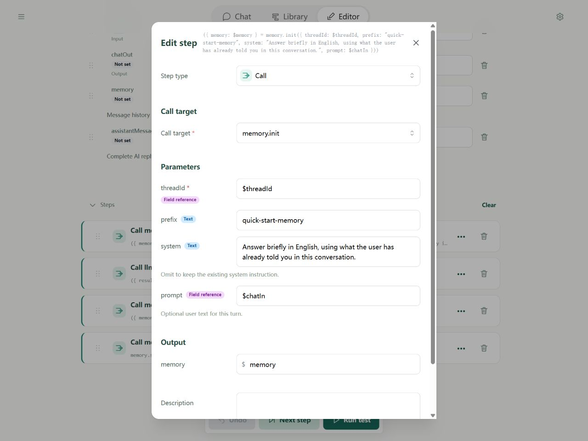
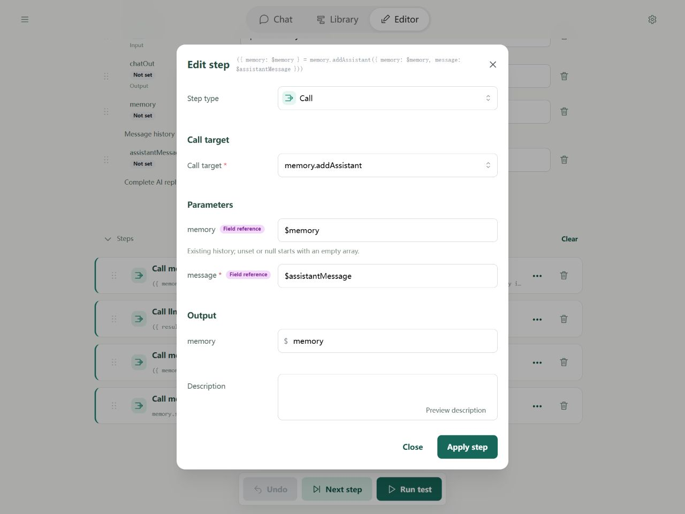
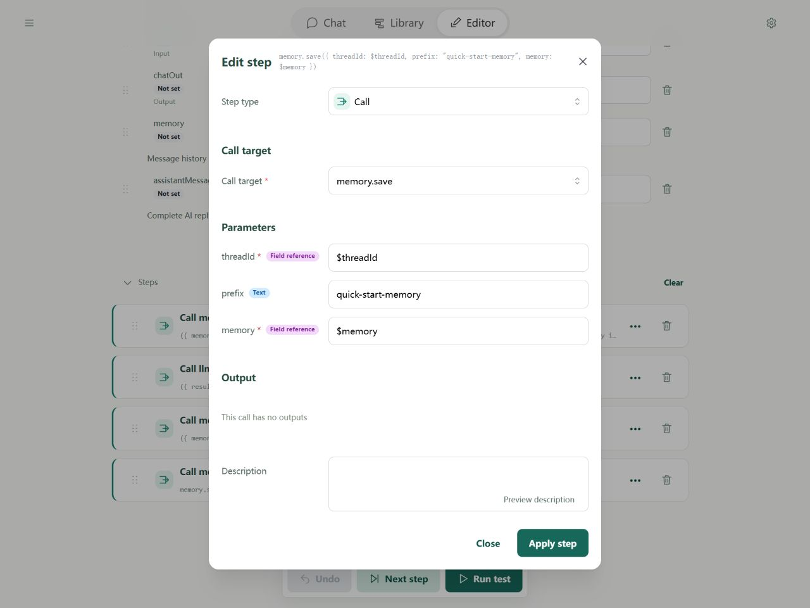
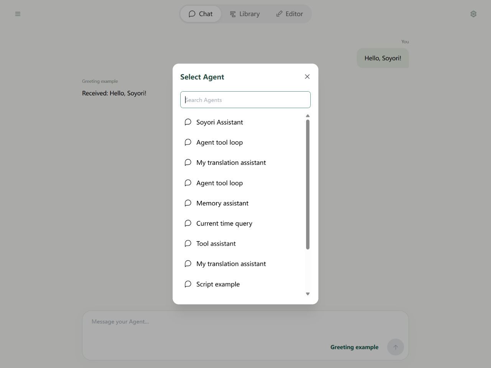

# Quick start 2: Using memory

Build an assistant that remembers your name. Tell it “My name is Alex” in one turn, then ask “What is my name?” in the next turn.

First complete the [desktop](quick-start.md), [mobile](quick-start-mobile.md), or [CLI](quick-start-cli.md) lesson and prepare a model connection. This lesson uses only memory, with no search or time tools.

## 1. Why memory needs reading and saving

Every message starts a fresh flow run. To know what you discussed, the model needs the earlier messages along with the new question:

1. Read saved history and add the current question.
2. Send the history to the model.
3. Append its complete reply to the history.
4. Save the updated history for the next turn.

Memory here is a list of messages. It does not permanently train the model. Visible Chat messages are not automatically model memory; the flow must perform these operations.

## 2. Create the flow and fields

Create a flow named **Memory assistant** in Library. Clear its steps first, then fields. The default template already includes memory; building from an empty flow makes each operation visible.

Add these fields with names exactly as shown, without a dollar sign. Leave unspecified settings empty:

| Name | Usage | Default | Holds |
| --- | --- | --- | --- |
| chatIn | Input | `My name is Alex. Please remember my name.` | Current user message: “My name is Alex; please remember it.” |
| threadId | Input | `quick-memory-demo` | Conversation ID used to find this history |
| chatOut | Output | Empty | Reply shown to the user |
| memory | Neither | Empty | Complete history sent to the model |
| assistantMessage | Neither | Empty | Complete message returned by this model call |



Think of threadId as a notebook number. The same number reads the same notebook; different numbers keep histories apart. Editor tests and CLI use the manual default here; Chat supplies its own ID.

## 3. Add four Call steps in order

For each step, choose **Add step → Call**, then search for the tool.

### Step 1: memory.init reads history and adds the question

| Form field | Value |
| --- | --- |
| threadId | `$threadId` |
| prefix | `quick-start-memory` |
| system | `Answer briefly, using what the user has already told you in this conversation.` |
| prompt | `$chatIn` |
| Outputs → memory | `memory` |

system is a standing instruction; prompt is the current question. The tool reads any saved history and adds the question. The first run starts without earlier history.



prefix and threadId determine the storage key, such as `quick-start-memory/quick-memory-demo`. The final save step must use the same prefix.

### Step 2: llm.auto reads the history

| Form field | Value |
| --- | --- |
| input | `$memory` |
| Outputs → result | `chatOut` |
| Outputs → message | `assistantMessage` |

Reuse the model connection from lesson 1 and leave **tools empty**. result is the text for the user; message retains the complete model message for the next step.

### Step 3: memory.addAssistant appends the reply

| Form field | Value |
| --- | --- |
| memory | `$memory` |
| message | `$assistantMessage` |
| Outputs → memory | `memory` |

memory is the whole history; message is this one reply. Save the updated output back into memory so the next step uses it.



### Step 4: memory.save saves the updated history

Set threadId to `$threadId`, prefix to `quick-start-memory`, and memory to `$memory`. No output mapping is needed. Without this save, the next run cannot read this turn's added messages.



## 4. Test two turns

1. Run a test with the name introduction and threadId `quick-memory-demo`.
2. Change only chatIn's **current value** to `What is my name?` and run again.
3. Inspect chatOut. The model should use the history to answer “Alex”; exact wording varies.

To inspect reading, use **Next step** in the second run to execute only memory.init. memory should contain the first question, its reply, and the second question. Check the history before judging storage from the model's answer: a model can answer incorrectly even when the correct messages were supplied.

In Chat, click the Agent name at the bottom right of the input, just left of the send arrow, and select your Memory assistant. Send both messages in the **same conversation**. Chat uses its own threadId and does not continue the Editor test's history.



A new conversation has a different ID and starts a separate history.

<a name="5-yaml-cli"></a>

## 5. YAML + CLI

This lesson uses the new `memory` interface. The published npm 0.1.0 packages still use `messages`. Until a newer release is published, build the project source with `pnpm build` and use `pnpm cli` instead of `soyori`. Set example paths to where you saved them.

Save the complete example as `memory-chat.yaml`, or import it using the button below and download it from Library. The English example asks for short English replies.

```yaml
schemaVersion: 1
name: Memory assistant
description: Read history, answer, append the complete reply, and save it for the next turn.
fields:
  chatIn:
    input: true
    initial: My name is Alex. Please remember my name.
  threadId:
    input: true
    initial: quick-memory-demo
  chatOut:
    output: true
  memory:
    description: Message history sent to AI for this turn.
  assistantMessage:
    description: Complete AI reply to append to history.
steps:
  - type: call
    target: memory.init
    inputs:
      threadId: $threadId
      prefix: quick-start-memory
      system: Answer briefly in English, using what the user has already told you in this conversation.
      prompt: $chatIn
    outputs:
      memory: $memory
  - type: call
    target: llm.auto
    inputs:
      input: $memory
    outputs:
      result: $chatOut
      message: $assistantMessage
  - type: call
    target: memory.addAssistant
    inputs:
      memory: $memory
      message: $assistantMessage
    outputs:
      memory: $memory
  - type: call
    target: memory.save
    inputs:
      threadId: $threadId
      prefix: quick-start-memory
      memory: $memory
```

Run twice with the same storage directory and threadId:

```powershell
soyori run ./memory-chat.yaml --storage-dir ./tutorial-data --set-string threadId=quick-memory-demo --set-string "chatIn=My name is Alex. Please remember my name." --timeout 10m --json
soyori run ./memory-chat.yaml --storage-dir ./tutorial-data --set-string threadId=quick-memory-demo --set-string "chatIn=What is my name?" --timeout 10m --json
```

The second chatOut should identify Alex. `--storage-dir` selects this exercise's data location. Browser memory and CLI memory do not synchronize automatically.

## 6. Start fresh and troubleshoot

- To start a separate test, change threadId, for example to `quick-memory-demo-2`, or choose **New conversation** in Chat. The old history remains stored.
- **Reset to defaults** resets current test fields; it does not delete saved memory.
- To permanently delete this CLI lesson's history, use `soyori storage delete quick-start-memory/quick-memory-demo --storage-dir ./tutorial-data`. Browser storage is separate; see [storage tools](tools/storage.md).
- If history is missing, confirm execution reached memory.save and that its memory input is `$memory`. Reading and saving must use the same prefix and ID.
- This lesson does not compress history. If it exceeds model capacity, start a new ID for practice, then design trimming or summarization as needed.

Continue with [lesson 3: tools](quick-start-tools.md). See the [memory reference](tools/memory.md) for full interfaces.
