# Quick start: Editor on mobile

Open the [official website / online Editor](https://soyori.joycows.com) in your browser; no installation is required.

Build a **single-turn translation assistant**: enter Chinese text → assemble a prompt → call a model → receive English text.

This guide uses the portrait phone layout. The steps match the [desktop guide](quick-start.md). Top navigation usually shows icons on a phone.

## 1. Prepare a model (optional)

**You can run without entering an API connection.** With no existing API configuration, Soyori uses local **Qwen3-1.7B-ONNX** (`onnx-community/Qwen3-1.7B-ONNX`). The weights are about **1.44 GB**. Browser inference requires a GPU, WebGPU, and shader-f16 support.

**Downloading and loading are separate.** The first use downloads files into the browser cache; retained files do not need downloading again. Loading reads the files into memory and initializes the model, and can take several minutes. After a refresh or reopening the page, the model loads again on its next use. Switching between Chat, Library, and Editor reuses the loaded model.

To use the local model, continue to step 2. If you disabled **Allow on-demand download**, turn it back on in Settings.

For an API model, open the top-left menu, then **Settings** at the bottom of the drawer:

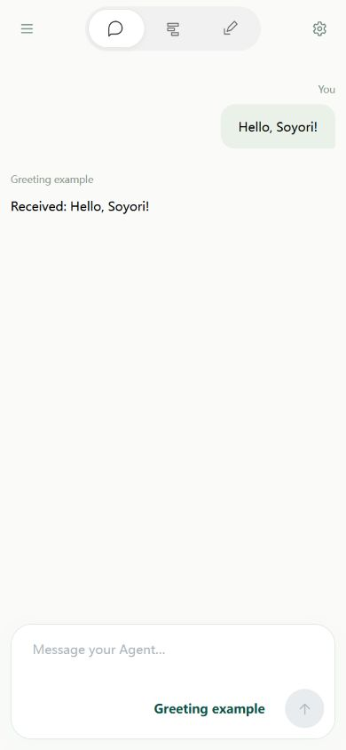

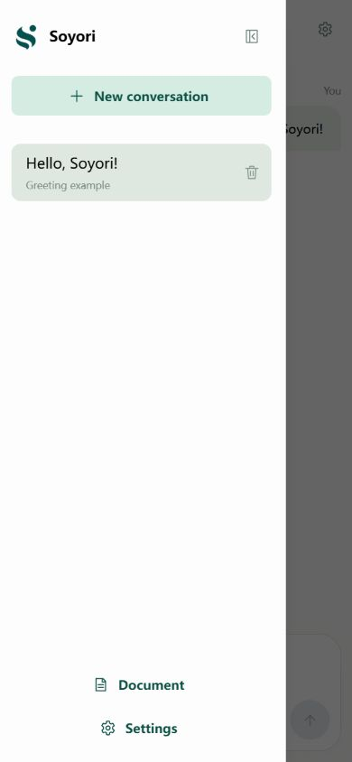

Under **Soyori assistant**, enter the **API key**, **Base URL**, and **model ID** for OpenAI or a compatible service. Changes save automatically. Use an ID actually supported by your service; an existing connection can be reused.

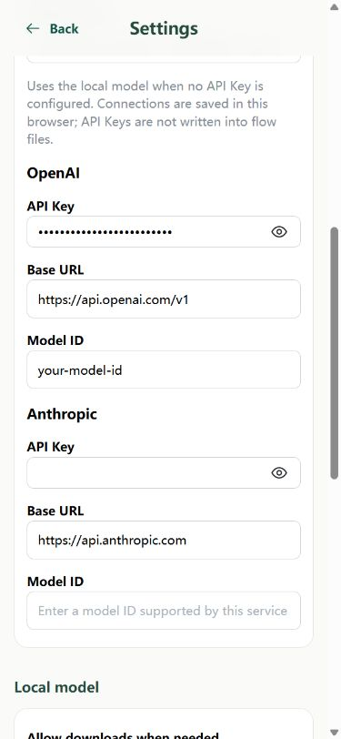

## 2. Create a flow

Tap the **Library icon** at the top center. Tap the **directory icon** beside the search box to open the directory panel.


Choose **New → New flow** in the panel. Files are created in the current directory; use **My files** for this lesson.

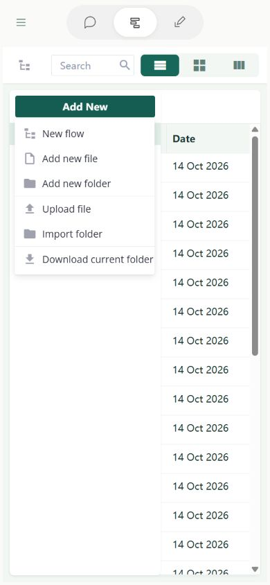

Name it **My translation assistant**. Optionally enter a description such as “Translate Chinese into English.” Click **Save** to open the Editor. The name identifies the flow in Library; the description explains its purpose.

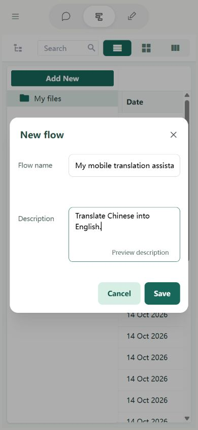

## 3. Clear the default content

New flows include memory and a tool loop. This lesson only needs one translation, so start with an empty flow.

Fields and Steps are stacked. Tap the **Fields** heading to collapse it, then scroll down if needed to reach Steps.

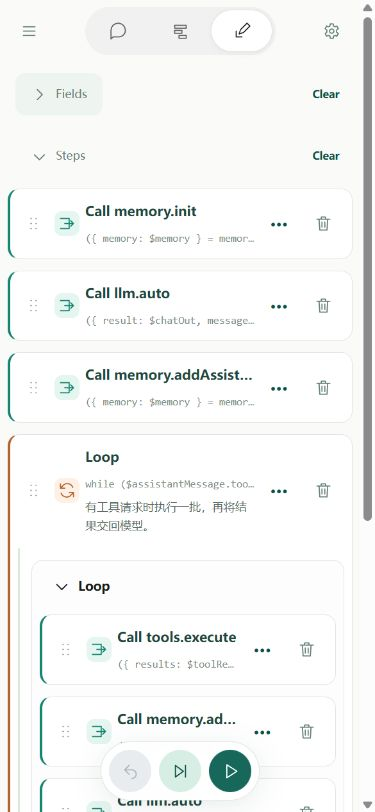

1. Beside **Steps**, click **Clear**, then **Confirm clear**.
2. Beside **Fields**, click **Clear**, then **Confirm clear**.

**Clear steps first:** fields still referenced by steps cannot be cleared directly. Only clear the flow you just created.

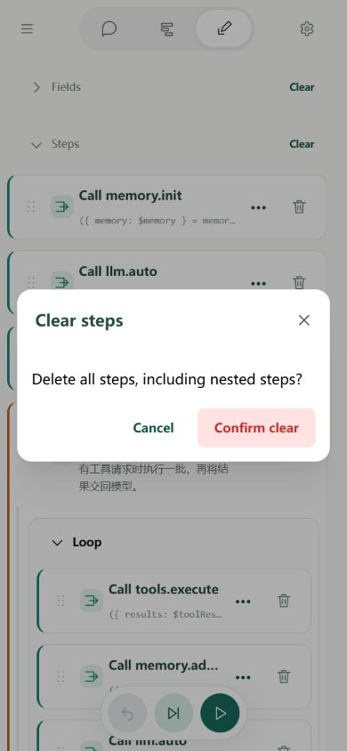

Tap Fields again to expand it. Both lists should now be empty:

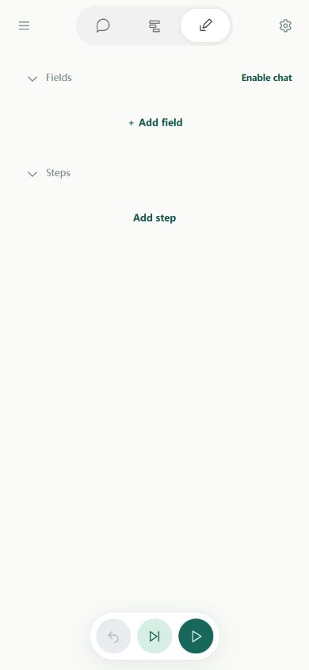

## 4. Create three fields

### 4.1 Input: chatIn

Under **Fields**, click **＋ Add field**:

- **Name:** `chatIn`.
- **Field usage:** select **Input**.
- **Default value:** `今天的天气很好。` (Chinese for “The weather is very nice today.”).

Click **Done**; scroll inside the dialog if the button is below the screen. This field holds the text to translate. Its default gives your first run something to use.

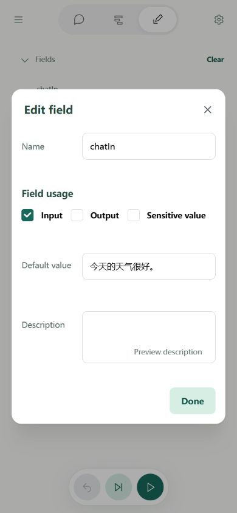

### 4.2 Intermediate value: prompt

Add another field named `prompt`. Leave Input and Output unchecked, and leave the default empty. Click **Done**. The first step will assemble a complete prompt here for the model.

### 4.3 Output: chatOut

Add `chatOut`, select **Output**, leave its default empty, and click **Done**. It will hold the model's reply. You should now have three fields:

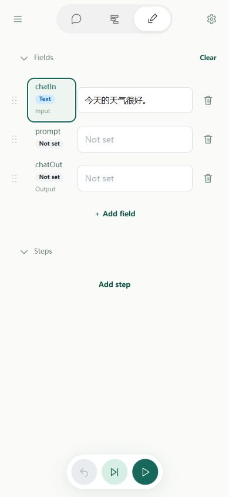

## 5. Assemble the prompt

Under **Steps**, click **＋ Add step** and select **Text template** as the step type. Enter this body. It asks the model to translate the following Chinese text into English and return only the translation:

```text
Translate the following Chinese text into English. Return only the translation:
$chatIn$
```

Set **Save to field** to `prompt`, then click **Apply step** at the bottom of the dialog; scroll down to reach it.

`$chatIn$` is replaced with the source text. The template combines the instruction and the user's text, then saves the result in `prompt`.

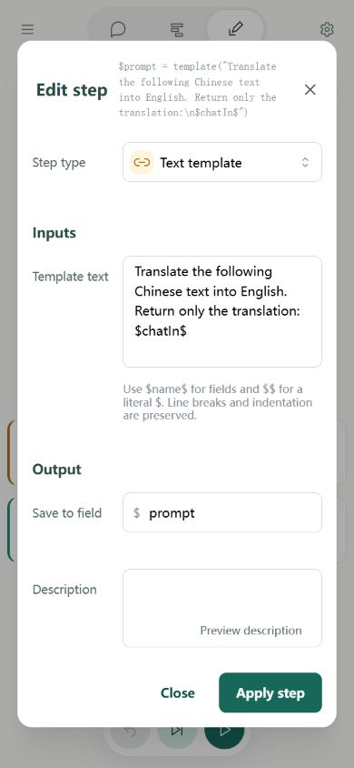

## 6. Call the model

Add a **Call** step. In **Select call target**, search for `llm.auto` and choose **llm → auto**.

- **input:** `$prompt`, to read the preceding step's prompt.
- **Outputs → result:** `chatOut`, to save the reply.

Leave model, apiKey, and other parameters empty to use the existing connection or the default local model. Click **Apply step**.

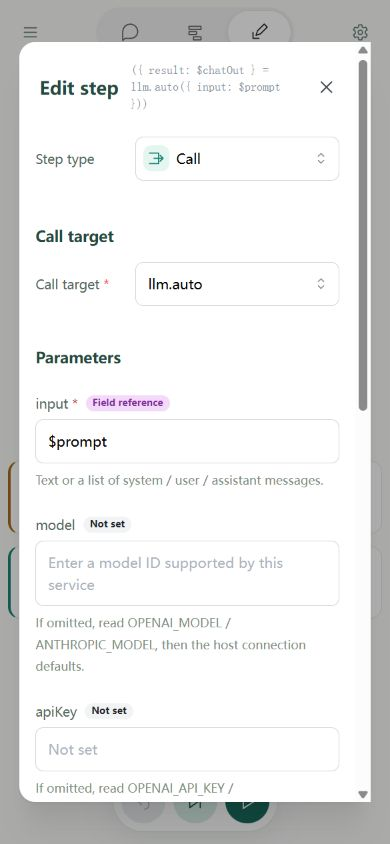

Scroll inside the dialog to reach **Outputs → result**, then scroll further to **Apply step**.

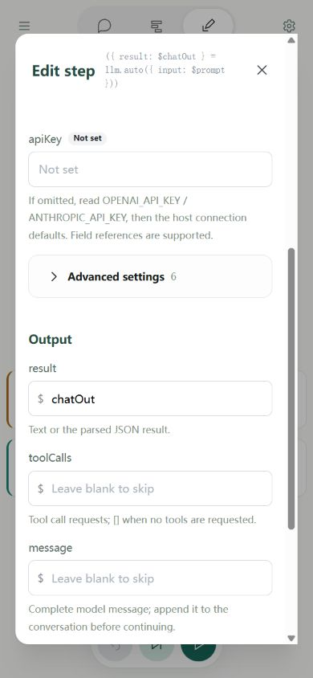

**Reference syntax:** `$chatIn$` in a text template has a dollar sign at each end. The model input `$prompt` has one at the start.

## 7. Run and inspect the result

Keep the order **Text template → Call llm.auto**. Keep chatIn set to the sample Chinese sentence, then tap the **green ▶ run icon** at the bottom right.


Expand Fields if collapsed and scroll back up. When the run finishes, `prompt` contains the full prompt, and `chatOut` contains an English translation such as `The weather is very nice today.` Model wording varies. Check the error and connection settings if it fails.

**Wait for local model loading to finish.** Retained downloads still need loading after refreshing or reopening, which can take several minutes. Download time also depends on your connection.

You can click **Next step** first to run only the template and inspect prompt before calling the model. The screenshot below shows this intermediate state: chatOut has not been generated yet.

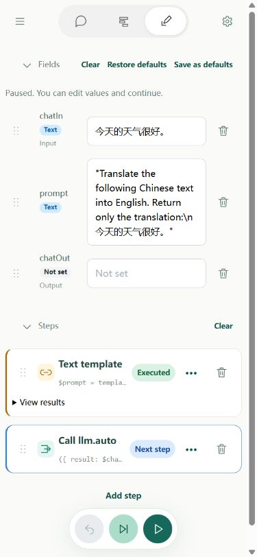

## 8. Edit and run again

Open the template step, replace `English` with `Japanese`, apply the step, and run again. chatOut should now contain Japanese, such as `今日はとてもいい天気です。` You can also change chatIn to translate a different sentence without changing the model step.

Confirmed field settings and step forms save automatically. Editing a field's current value only changes the test state; click **Set as default** if you want that value the next time you open the flow.

Continue with [lesson 2: memory](quick-start-memory.md), then [lesson 3: tools](quick-start-tools.md). The same field and step forms work on mobile; scroll down inside long dialogs to confirm.
