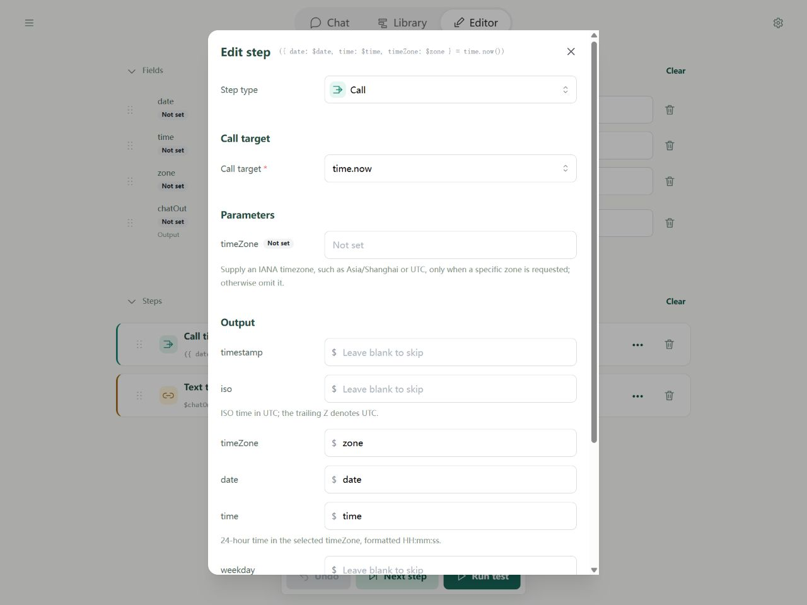
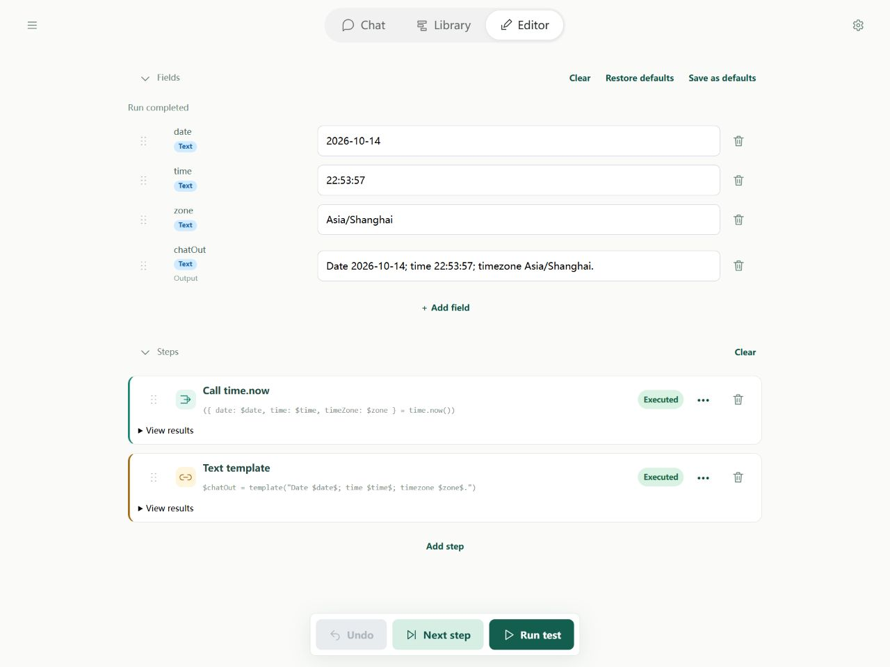
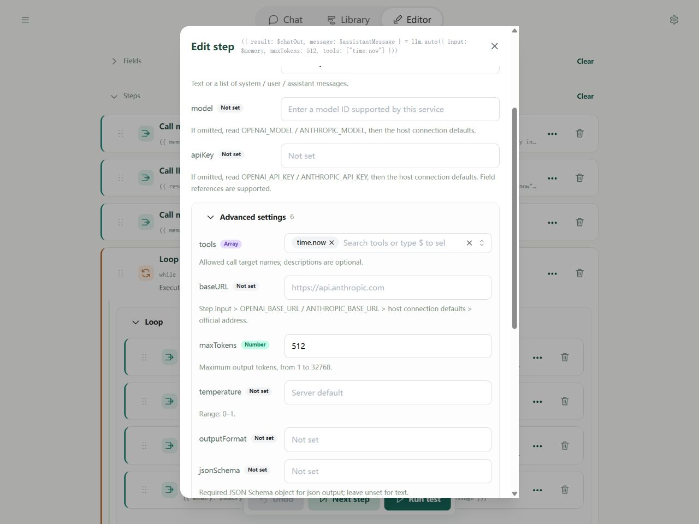
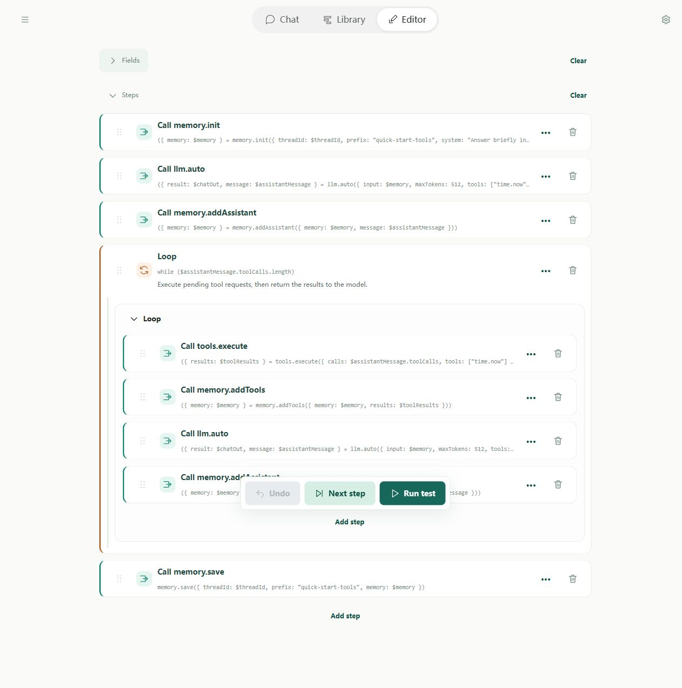

# Quick start 3: Using tools

Query the actual current date and time. First call a tool directly, then extend the [memory assistant](quick-start-memory.md) so AI can decide when to request it.

A tool performs a specific operation, such as reading data or searching. The model interprets the question and writes an answer. Asking it to “check the time” in a prompt alone does not execute a tool.

## 1. A time flow without a model

Create **Current time** in Library, clear steps, then fields. Add date, time, and zone with no usage flags or defaults. Add chatOut with **Output** selected and no default.

### Step 1: Call time.now

Add a Call step and select `time.now`. Leave timeZone empty to use the device's timezone. Map these outputs, then apply the step:

| Returned name | Save to field |
| --- | --- |
| date | `date` |
| time | `time` |
| timeZone | `zone` |

The tool defines the returned names; you choose the destination fields. Other outputs can remain unmapped.



### Step 2: Format the reply

Add a Text template, save it to chatOut, and apply. Enter this template:

```text
Date $date$; time $time$; timezone $zone$.
```

The template inserts the actual tool values into the reply.

### Run and inspect

Click **Run test**. date, time, and zone hold the actual tool outputs; chatOut combines them. Values vary with the time and device timezone.



This flow needs neither a model nor an API key. You have selected a tool, supplied inputs, saved outputs, and used them.

## 2. Complete YAML for a direct call

Save as `time-tool.yaml`, or import **Direct time query** below:

```yaml
schemaVersion: 1
name: Current time query
description: Call the time tool and display its actual date, time, and timezone. No AI model is needed.
fields:
  date: {}
  time: {}
  zone: {}
  chatOut:
    output: true
steps:
  - type: call
    target: time.now
    inputs: {}
    outputs:
      date: $date
      time: $time
      timeZone: $zone
  - type: template
    template: Date $date$; time $time$; timezone $zone$.
    output: $chatOut
```

Run in its directory:

```powershell
soyori run ./time-tool.yaml --json
```

chatOut contains the real time retrieved by this run.

## 3. Let AI choose when to call a tool

1. Give the question and allowed tool names to the model.
2. The model requests a tool. **Nothing has executed yet.**
3. Execute the request with tools.execute.
4. Add the actual results to history, then call the model again.
5. Repeat if it requests more tools; otherwise save memory and finish.

Import **AI time assistant** below and open `tool-agent.yaml` to compare. To build it yourself, copy lesson 2's flow, rename it, and make these changes.

### Change 1: Add toolResults and enable time.now

Keep the five fields and add toolResults with no default or usage flags. It holds actual execution results.

Change memory.init's system instruction to require real time queries and forbid guessing. Use this English system instruction:

```text
Answer briefly in English. For the current date or time, call time.now instead of guessing. Use actual tool results; answer other questions normally.
```

Set **both** memory prefixes to `quick-start-tools`, and threadId's default to `quick-tools-demo`.

In llm.auto keep input `$memory`, map result to chatOut and message to assistantMessage, and select only `time.now` in **Advanced settings → tools**. Your model must support tool requests.



### Change 2: Insert a loop before saving

The outer sequence is:

```text
memory.init
llm.auto
memory.addAssistant
While tool requests remain
memory.save
```

Add a While step with condition `$assistantMessage.toolCalls.length`. This reads the number of pending requests: zero skips the loop; a positive count runs its body.

Inside it, add these Call steps in order:

| Tool | Inputs | Output mapping |
| --- | --- | --- |
| tools.execute | calls: `$assistantMessage.toolCalls`; tools: only time.now | results → toolResults |
| memory.addTools | memory: `$memory`; results: `$toolResults` | memory → memory |
| llm.auto | input: `$memory`; tools: only time.now | result → chatOut; message → assistantMessage |
| memory.addAssistant | memory: `$memory`; message: `$assistantMessage` | memory → memory |



Use the **same allowed tools** in both model calls and tools.execute. tools.execute runs requests; memory.addTools turns the results into model-readable messages. Preserve that step and use real results.

### Change 3: Keep the final save

memory.save still receives `$threadId`, `$memory`, and prefix `quick-start-tools`. It saves the question, replies, and tool results for later turns.

## 4. Verify actual tool use

Select your tool assistant in Chat and ask it to use the time tool to check the date and time:

```text
Use the time tool to check the current date and time.
```

Expand the execution record and look for a time.now request **and its result**. In an Editor test, inspect toolResults. A plausible time in the reply alone does not prove the tool ran.

Then say “Thanks.” The model can answer without a tool; it chooses whether to request one, so exact behavior and wording vary.

## 5. Complete YAML for AI tool use

Save as `tool-agent.yaml`, or import the separate example below. Its system instruction requests English replies.

```yaml
schemaVersion: 1
name: Tool assistant
description: Extend the memory lesson with time queries. Execute requests and return real results to the model.
fields:
  chatIn:
    input: true
    initial: Use the time tool to check the current date and time.
  threadId:
    input: true
    initial: quick-tools-demo
  chatOut:
    output: true
  memory:
    description: Complete message history sent to the model.
  assistantMessage:
    description: Current model message, including text and tool requests.
  toolResults:
    description: Actual results or errors from this batch of tool calls.
steps:
  - type: call
    target: memory.init
    inputs:
      threadId: $threadId
      prefix: quick-start-tools
      system: Answer briefly in English. For the current date or time, call time.now instead of guessing. Use actual tool results; answer other questions normally.
      prompt: $chatIn
    outputs:
      memory: $memory
  - type: call
    target: llm.auto
    inputs:
      input: $memory
      maxTokens: 512
      tools:
        - time.now
    outputs:
      result: $chatOut
      message: $assistantMessage
  - type: call
    target: memory.addAssistant
    inputs:
      memory: $memory
      message: $assistantMessage
    outputs:
      memory: $memory
  - type: while
    condition: $assistantMessage.toolCalls.length
    description: Execute pending tool requests, then return the results to the model.
    body:
      - type: call
        target: tools.execute
        inputs:
          calls: $assistantMessage.toolCalls
          tools:
            - time.now
        outputs:
          results: $toolResults
      - type: call
        target: memory.addTools
        inputs:
          memory: $memory
          results: $toolResults
        outputs:
          memory: $memory
      - type: call
        target: llm.auto
        inputs:
          input: $memory
          maxTokens: 512
          tools:
            - time.now
        outputs:
          result: $chatOut
          message: $assistantMessage
      - type: call
        target: memory.addAssistant
        inputs:
          memory: $memory
          message: $assistantMessage
        outputs:
          memory: $memory
  - type: call
    target: memory.save
    inputs:
      threadId: $threadId
      prefix: quick-start-tools
      memory: $memory
    outputs: {}
```

This Agent uses the new memory interface, unavailable in npm 0.1.0. Use the [source-built CLI described in lesson 2](quick-start-memory.md#5-yaml-cli). The direct time example above does not have this requirement.

```powershell
soyori run ./tool-agent.yaml --storage-dir ./tutorial-data --set-string threadId=quick-tools-demo --set-string "chatIn=Use the time tool to check the current date and time." --timeout 10m --json
```

To inspect execution, add `--trace tool-run-001.jsonl --trace-values`, using a fresh filename each time. See [debugging](debugging/guide.md).

## 6. Troubleshooting

- **Missing tool:** search its exact name in the Call target selector. time.now is available in both hosts; [platform support](tools/contract.md) explains exceptions.
- **No request:** check both model tool lists, ask explicitly for a query, and confirm model support. Run the direct-call example to separate tool failures from model selection.
- **Mismatched results:** tools.execute must read `$assistantMessage.toolCalls`; memory.addTools must read `$toolResults`. Preserve complete messages and model-generated request IDs.
- **Endless loop:** call the model again inside the loop and replace assistantMessage. Reusing the first request repeats it forever; also check whether the model keeps requesting the same action.
- **More tools:** read the [reference](tools/reference.md), then add the tool to both model calls and tools.execute.

Review [memory](quick-start-memory.md) or continue to [models and tool loops](agents/models.md).
