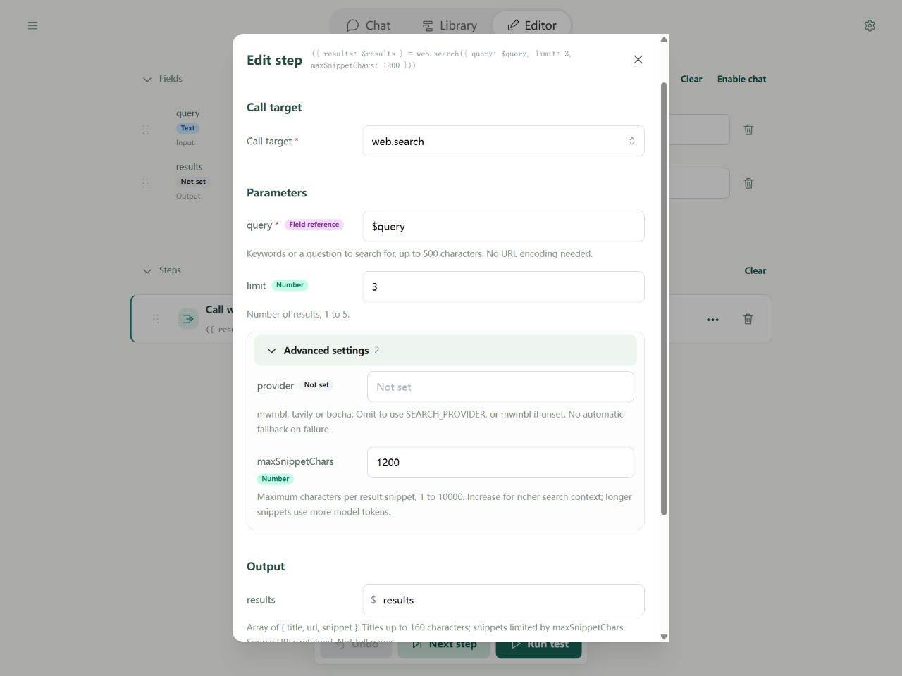

# Time and web

These tools share their interfaces between CLI and Editor; see [platform support](contract.md).

## Before you start

time.now uses the device timezone unless specified; an invalid zone causes TIME_INPUT. web.fetch defaults to GET without a body. Its timeout defaults to ten seconds (range 1–60000 ms), and request/decompressed response sizes each cap at 2 MiB. HTTP 4xx/5xx returns normally: inspect status and body. Connection and timeout failures throw.

Browser CORS and request-header rules still apply. CONNECT/TRACE/TRACK are unsupported; GET/HEAD cannot send a body. Search queries cap at 500 characters and return titles, links, and snippets rather than full pages.

Examples are step fragments: place under steps in a complete flow with an answer field. See [saving outputs](reference.md#how-to-read-tool-documentation).

## time.now

Read the current date/time. Optional **timeZone** (string) accepts an IANA name such as Asia/Shanghai or UTC. Omit it unless you need a particular zone.

Returns timestamp (Unix milliseconds), iso (UTC), timeZone, date, time (24-hour in that zone), and weekday (Monday 1 through Sunday 7). Map properties with outputs or save the object with output.

```yaml
- type: call
  target: time.now
  inputs: {}
  output: $answer
```

## web.fetch

Request an API or page source. It does not execute page scripts or turn HTML into article text.

| Parameter | Type | Requirement/default | Meaning |
| --- | --- | --- | --- |
| url | string | Required | HTTP(S) address |
| method | string | Optional, GET | HTTP method |
| headers | JSON | Optional | Object with string values; browser restrictions apply |
| body | JSON | Optional | Strings sent literally; objects/lists serialized as JSON; absent means no body |
| timeoutMs | integer | Optional, 10000 | Timeout, 1–60000 ms |

Returns url (final after redirects), status, headers, and body. JSON responses parse to data, HTML remains text, and empty responses are null. Response charset follows headers or defaults to UTF-8. Errors include WEB_NETWORK, WEB_TIMEOUT, WEB_CANCELLED, WEB_SIZE, WEB_TYPE, WEB_ENCODING, and WEB_JSON.

```yaml
- type: call
  target: web.fetch
  inputs:
    url: https://example.com
  output: $answer
```

## web.search

Search with Mwmbl, Tavily, or Bocha. The inputs are shared; provider credentials come automatically from the run environment.

| Parameter | Type | Requirement/default | Meaning |
| --- | --- | --- | --- |
| query | string | Required | Search text, at most 500 characters |
| limit | integer | Optional, 3 | Maximum results, 1–5 |
| provider | string | Optional, advanced | mwmbl, tavily, or bocha; otherwise SEARCH_PROVIDER, then mwmbl |
| maxSnippetChars | integer | Optional, 240; advanced | Maximum per-snippet characters, 1–10000; longer snippets use more model context |

Returns `{results: [{title, url, snippet}]}`. No matches gives an empty list, not failure. Freshness is not guaranteed. Map results or save the whole object.

```yaml
- type: call
  target: web.search
  inputs:
    query: Soyori
    limit: 3
  output: $answer
```

## Configure a search service

Choose one service; you need not fill every key:

| Service | SEARCH_PROVIDER | Sensitive key variable |
| --- | --- | --- |
| Bocha | bocha | BOCHA_API_KEY |
| Tavily | tavily | TAVILY_API_KEY |
| Mwmbl, key-free | mwmbl | None |

For Bocha:

1. Open your test flow and click Editor's top-right environment icon.
2. Add SEARCH_PROVIDER = bocha; it can be nonsensitive.
3. Add BOCHA_API_KEY with your real key and keep Sensitive enabled. It saves automatically.
4. Call web.search with a query and run the test. No env.get is needed; do not put the key in the query or flow fields.

For all flows, use **Settings → Global environment variables** instead. File and conversation overrides are independent; file-test configuration is not automatically used in Chat. See [Editor environments](../environment/editor.md).

A step's advanced provider overrides SEARCH_PROVIDER. Values are case-sensitive: use bocha, not a display name. Failed services do not trigger fallback to another provider.



Browsers require the service to allow cross-origin requests. Environment settings cannot bypass CORS. CLI has no browser CORS restriction.

On 2026-10-14, actual configured-key Editor tests succeeded with Bocha and Tavily using the same Node.js documentation query and three results each. This verifies that browser on that machine, not regional availability or overall search quality.

Missing keys cause SEARCH_CONFIG naming the variable. For HTTP 401/403 check credentials, permissions, or balance; for 429 check quotas/rate. Provider errors are not treated as empty results, and error bodies are not echoed with embedded credentials.

This complete flow tests the configured provider without a model. Import it below:

```yaml
schemaVersion: 1
name: Test search provider
fields:
  query:
    input: true
    initial: Soyori AI Agent
  results:
    output: true
steps:
  - type: call
    target: web.search
    inputs:
      query: $query
      limit: 3
      maxSnippetChars: 1200
    outputs:
      results: $results
```
