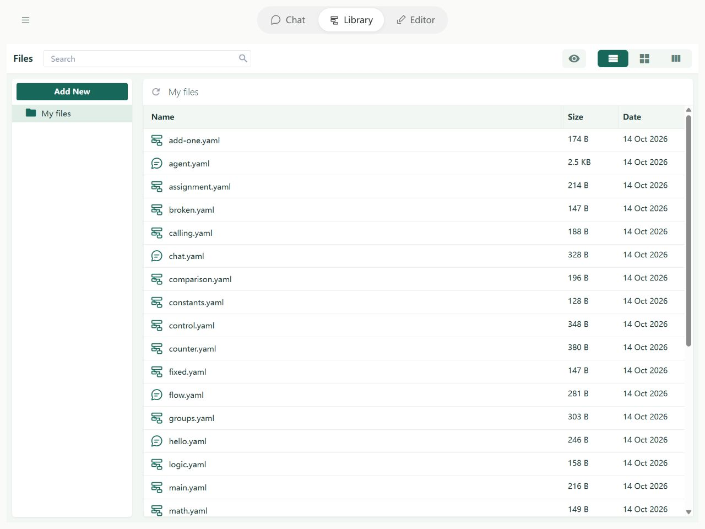
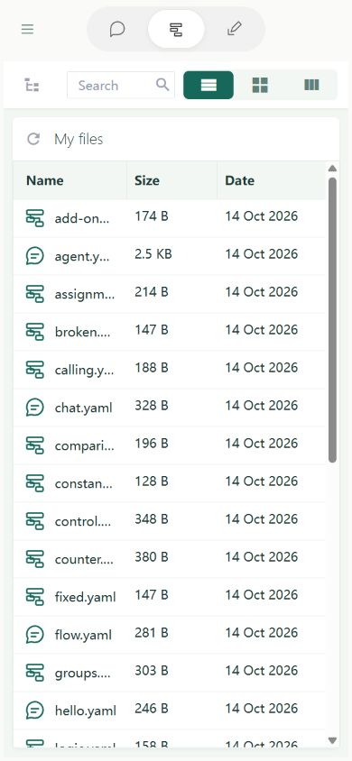
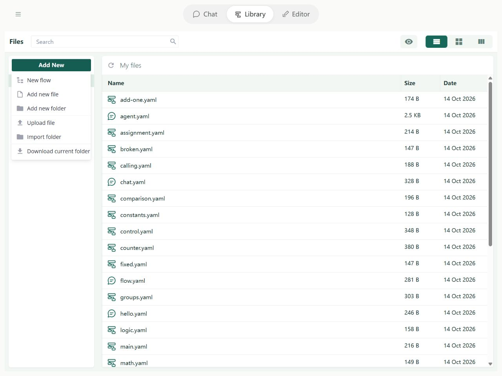

# Library: Files, uploads, and downloads

Library stores and organizes flows, scripts, and other files. A valid flow can open in Editor for editing and testing through Fields and Steps forms.

## Where files are stored

Files live in this site's browser database, **IndexedDB**. They survive refreshes but do not automatically appear in a computer folder. Clearing site data, changing browsers, or changing the site address can make earlier files unavailable. Download files or export a project for backup.

Folders organize paths such as agents/main.yaml. You can create, copy, move, rename, and delete. Copies receive a suffix on name conflict; moves reject conflicts rather than overwriting.

## Browse files and folders

Select a directory on the left and files on the right; search above to find names. On desktop use a file's right-click menu; on mobile use its action menu to open, download, copy, move, rename, or delete. Create and upload in the intended folder to retain relative paths.

On phones, directories and files use separate areas. Open the directory control at the top to change location. New and import actions use the current directory.

## Flow files

A .json, .yaml, or .yml file becomes a flow only if its contents pass the flow format checks. Invalid flows and ordinary configuration files remain stored and can be opened as source. A successful save does not prove the file can run.

Filename, flow name, and imports alias are different. Changing name does not rename the file. Moving files does not rewrite imports or script paths; check affected references yourself.

## Scripts and other files

Edit .js and .mjs as source, then import them explicitly from script.run. Saving a script does not run it. Library also stores ordinary JSON, text, and binary files. Ordinary ZIP files remain unchanged. See [scripts](scripts/development.md) for input/result and platform differences.

## Edit and run

Use forms or source for a recognized flow. Confirmed forms save to Library. Source has line numbers, highlighting, and diagnostics, but needs an explicit save. Full-screen mode edits the same draft; leaving full screen does not save it.

Editor runs its current editing session. Assistant flow.inspect and flow.run read the **saved Library file**. Save first to compare the same version. Runtime state and saved files are separate; refresh does not restore an execution session.

## Upload and import

Use the New menu to create a flow, file, folder, or import a folder. Use Library's upload control for files. Multiple files import as a batch; folder imports retain paths. New flows include memory and an explicit tool loop; clear these for a simpler lesson if needed.

## Download and export projects

A filename ending in **.soyori.zip** is extracted as a project on upload. Ordinary .zip files are stored unchanged. Downloading a folder or workspace produces a .soyori.zip archive with directory structure and file bytes retained.

A conflicting path rejects the whole import batch. Limits are 100 MiB per import, and at most 100 MiB and 5000 entries after project extraction. Unsafe paths are rejected. Extract a project to disk to run its entry flow in CLI; browser-only tools remain browser-only.

## Start a conversation with a flow

A flow with chatOut marked Output can be selected in Chat. Declare chatIn and threadId as inputs. The Chat host supplies them in its run copy without modifying the saved file. It stores the user message before running, adds a reply after success, and retains the user message on failure. Raw records live at threads/<threadId>; the flow decides what history reaches the model.

The built-in assistant is separate from your editable new-flow template. Conversations are not Library files: see [Chat](editor/chat.md) and [storage](agents/storage.md).

New exports use .soyori.zip; imports also recognize the old .agentp.zip extension. Existing browser database and cache identifiers are retained for compatibility.
