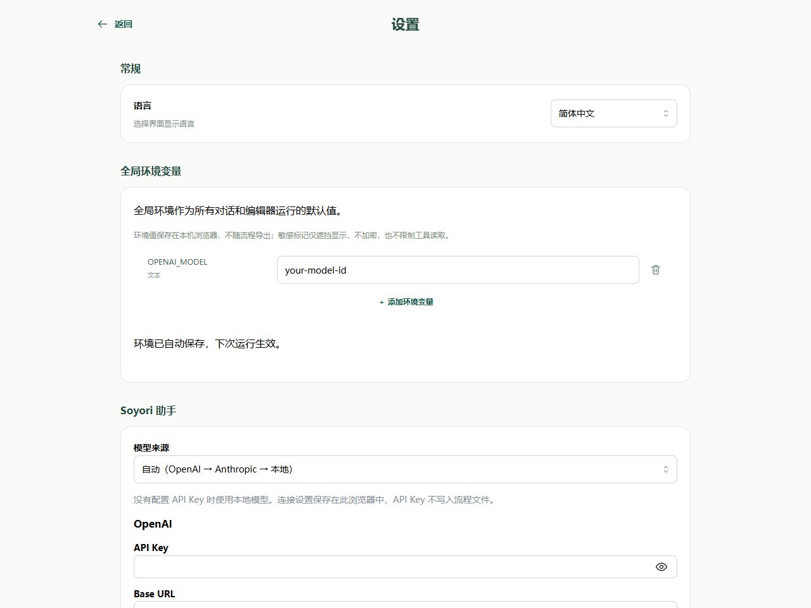
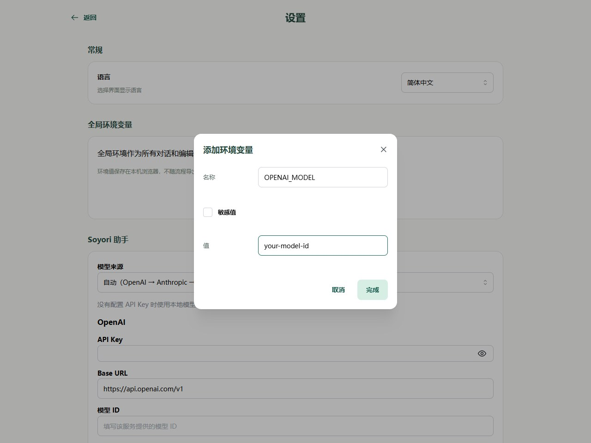
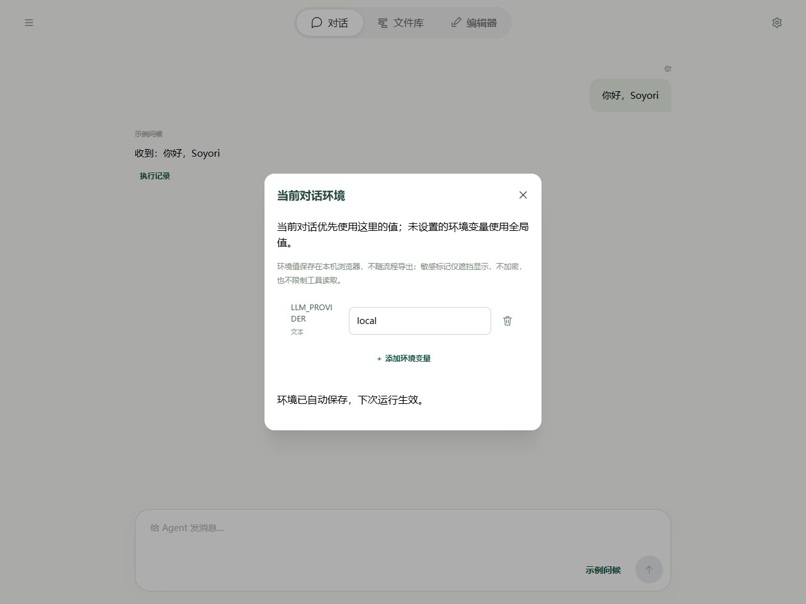
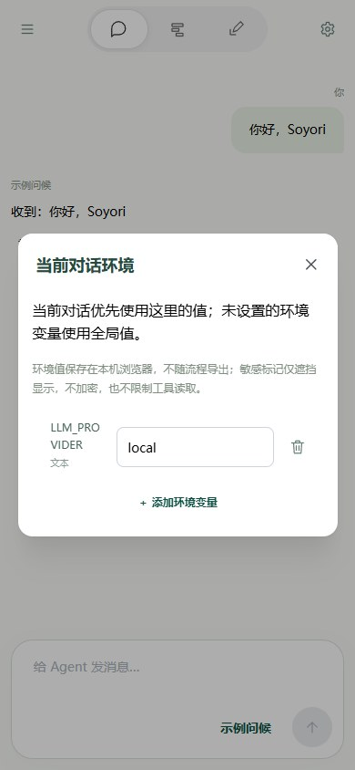
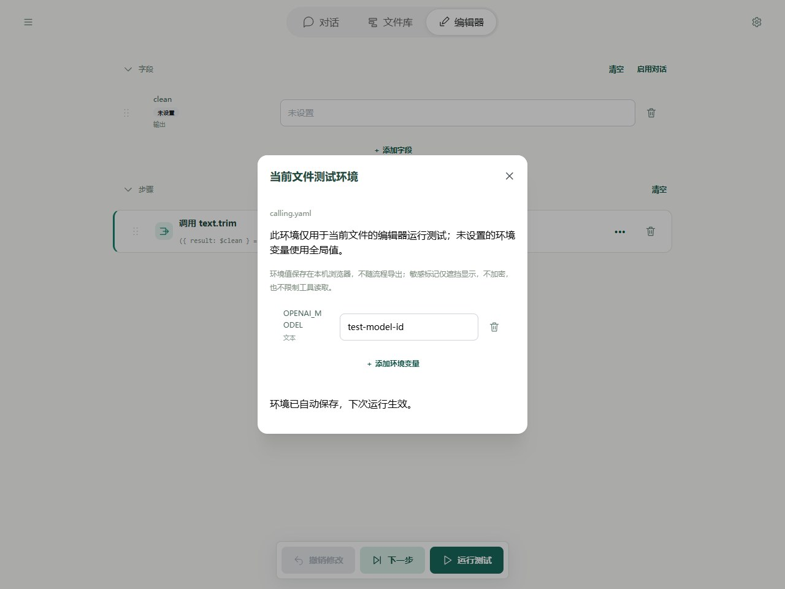
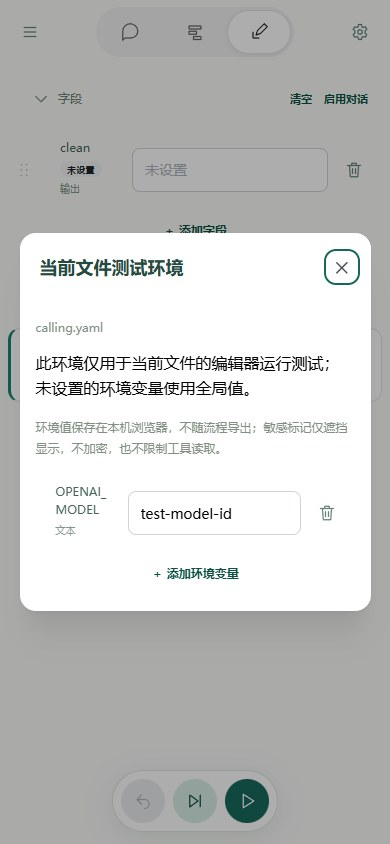

# 环境变量：Editor

网页环境分为全局、当前对话、当前文件测试三个配置入口。对话与文件测试分别覆盖全局；它们不是连续叠加的三层。

## 全局默认配置

打开抽屉 → 设置 → 全局环境变量。点击“添加环境变量”，填写名称、字符串值和敏感标记，确认后自动保存；编辑和删除同样自动保存。

名称区分大小写，使用字母、数字、下划线且不能以数字开头。值一律是字符串，例如 `512` 并不是数字类型。API Key 勾选敏感值；模型 ID 等普通配置可按需要取消勾选。

## 当前对话环境

在对话页点击右上角环境图标。覆盖项只用于当前 thread，同名选择 `当前对话 > 全局`。删除对话覆盖后恢复全局值；空字符串仍是有效覆盖。

新对话可以提前设置，首次发送才创建 thread 并保存；刷新未发送草稿会丢失临时配置。从该对话通过助手 `flow.run` 发起测试，使用这段对话的最新环境。

手机同样使用顶栏右上角的环境图标，设置完成后关闭弹窗回到对话：

## 当前文件测试环境

在 Editor 顶栏点击右上角环境图标。测试选择 `当前文件测试环境 > 全局`，仅用于该文件的运行和单步测试；不会影响对话。子流程继承发起运行的环境，不读取自己的文件测试配置。

配置按文件 ID 本地保存：移动、重命名保留，复制为新 ID 不自动复制配置。下载文件和工程包不包含这些值。

手机表单保留相同的覆盖规则，值可直接编辑并自动保存；先确认弹窗标题是“当前文件测试环境”，避免把测试配置填写到对话中。

## 生效时机与敏感标记

界面自动保存后，下次运行取得环境快照；运行中修改界面设置不改变已经开始的运行。流程内 `env.override/load` 的临时覆盖影响后续调用，不写回界面设置。

敏感值默认遮挡，可用眼睛临时查看。敏感标记不自动传递给 `env.get` 的目标字段，承接凭证的字段需另标 `sensitive: true`。LLM 连接能自动读取环境时，无需先把密钥写进字段。详细顺序见[共同原理](../agents/environment.md)。
