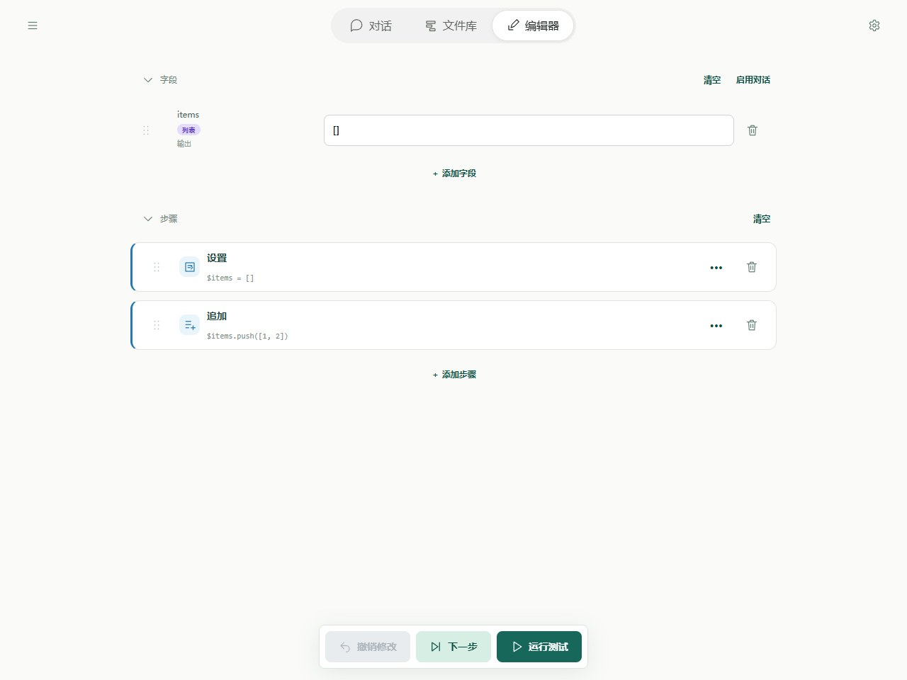
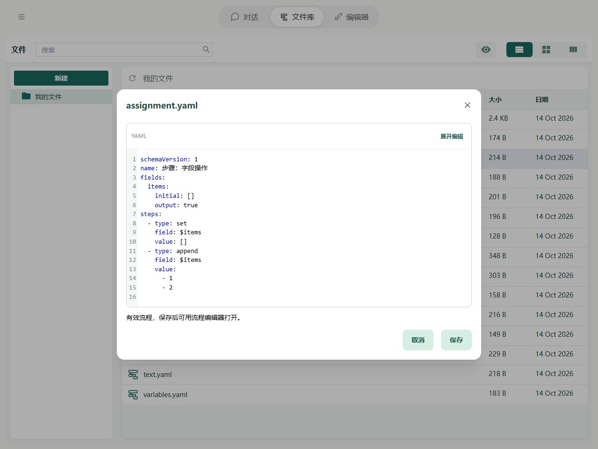

# 步骤：字段操作

字段操作用于把内容存进字段，供后面的步骤使用：

- **设置（`set`）**：把目标位置的内容换成新内容。例如把答案设为 `10`。
- **追加（`append`）**：在列表末尾增加一项。例如把一条搜索结果加入结果列表。

## 在 Editor 中操作

添加「设置」，写入内容填 `[]`；再添加「追加」，目标都选 items，追加值填 `[1, 2]`。点击下一步，观察 items 从空列表变成包含一项的列表。



图中显示本章示例的实际字段与步骤。先导入下方示例，再在 Editor 中打开；修改参数后运行或逐步观察。

## YAML 与基本示例



截图对应以下完整流程；可以复制代码，也可以使用本页末尾的导入按钮。

```yaml
schemaVersion: 1
name: 步骤：字段操作
fields:
  items:
    initial: []
    output: true
steps:
  - type: set
    field: $items
    value: []
  - type: append
    field: $items
    value:
      - 1
      - 2
```

不额外传输入时，预期输出为 `{items: [[1, 2]]}`。

## 规则与常见问题

- **追加一项还是多项？** 本例把 `[1, 2]` 作为一整项追加，所以得到 `[[1, 2]]`。要得到 `[1, 2]`，可以分两次追加 `1` 和 `2`；合并已有列表可使用 [array.concat](../tools/basic.md#array-concat)。
- **目标还不是列表？** “追加”会先将目标换成空列表，再加入这一项，原来的内容不会保留。
- **替换整个字段还是其中一项？** 设置 `$user` 会替换整个对象，设置 `$user.name` 只改姓名。
- **保存到哪里？** Editor 中选择目标字段；YAML 中填写带 `$` 的路径，例如 `$items`，不能写 `$count + 1` 这样的计算式。

完整路径边界见[字段与路径参考](operands.md)，失败定位见[运行与调试](../debugging/guide.md)。
