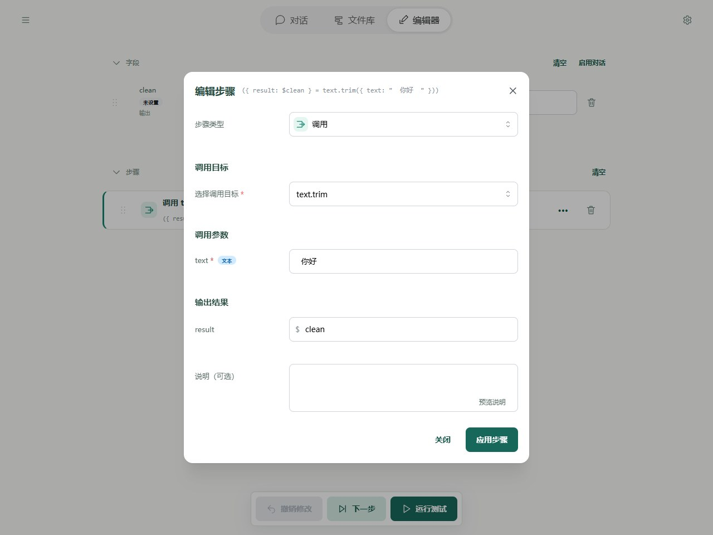
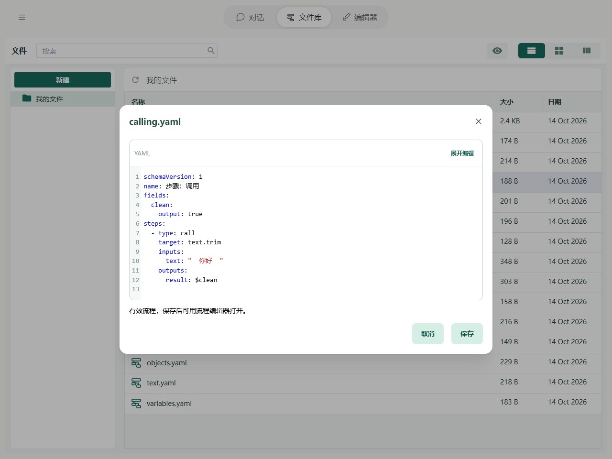

# 步骤：调用

“调用”步骤请一个工具或子流程帮你做事，例如查询时间、搜索网页或让 AI 翻译。你需要指定三个内容：

1. **调用谁**：选择工具名称，例如 `text.trim`，它可以去掉文字两端的空白。
2. **交给它什么**：填写输入，例如要处理的文字。
3. **结果放哪里**：把返回的内容保存到字段，供后面使用。不需要结果时也可以不保存。

YAML 中，调用步骤使用 `type: call`；`target` 表示调用目标，`inputs` 表示传入的内容。

## 在 Editor 中操作

添加「调用」，目标选 text.trim，text 填文字「  你好  」，将 result 保存到 clean。选择目标后根据它的接口填写参数和返回映射。



图中显示本章示例的实际字段与步骤。先导入下方示例，再在 Editor 中打开；修改参数后运行或逐步观察。

## YAML 与基本示例



截图对应以下完整流程；可以复制代码，也可以使用本页末尾的导入按钮。

```yaml
schemaVersion: 1
name: 步骤：调用
fields:
  clean:
    output: true
steps:
  - type: call
    target: text.trim
    inputs:
      text: "  你好  "
    outputs:
      result: $clean
```

不额外传输入时，预期输出为 `{clean: "你好"}`。

## 规则与常见问题

### 只保存结果，还是保存整个返回对象？

本例的工具返回 `{result: "你好"}`：

| YAML 写法 | clean 中保存什么 |
| --- | --- |
| `outputs: {result: $clean}` | 只保存 result 里的文字：`"你好"` |
| `output: $clean` | 保存整个对象：`{result: "你好"}` |

这两种写法只能选一种。`result` 是工具返回内容中的名字，`$clean` 是你自己的字段路径；不同工具的返回名字可能不同，按工具说明填写。

- `target` 填固定名称，例如 `text.trim`，不加 `$`。输入中需要读取字段时才写 `$字段名`。
- 调用完成后才执行下一个步骤；调用失败时，流程也会失败，可以在执行记录中查看原因。
- 返回属性不存在时，目标字段会变为未设置。检查工具说明中的返回名字，避免沿用其他工具的写法。

子流程如何准备和传递内容，见[子流程与调用](subflows.md)；更多返回映射规则见下面的路径参考。

完整路径边界见[字段与路径参考](operands.md)，失败定位见[运行与调试](../debugging/guide.md)。
