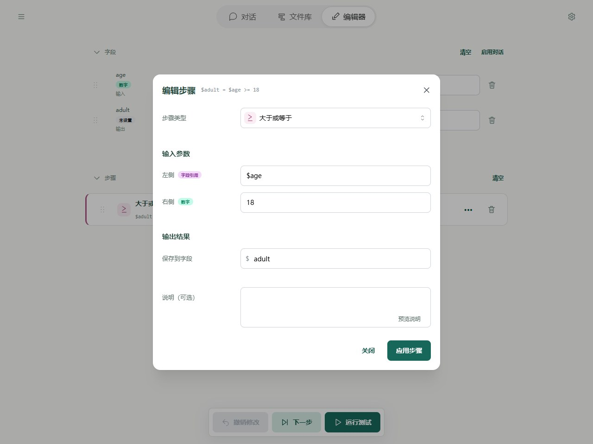
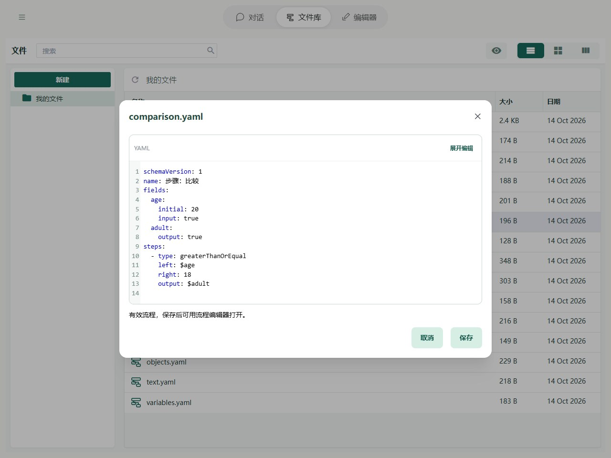

# 步骤：比较

比较步骤用来回答一个“是或否”的问题，例如“年龄是否达到 18 岁”。它把判断结果保存到字段：`true` 表示“是”，`false` 表示“否”。后面的条件或循环步骤可以使用这个结果。

| 判断 | YAML 类型 | 例子与结果 |
| --- | --- | --- |
| 相等 | equal | 2 和 2 → true |
| 不相等 | notEqual | 2 和 3 → true |
| 大于 | greaterThan | 20 和 18 → true |
| 小于 | lessThan | 20 和 18 → false |
| 大于或等于 | greaterThanOrEqual | 18 和 18 → true |
| 小于或等于 | lessThanOrEqual | 18 和 18 → true |

## 在 Editor 中操作

添加「大于或等于」，左值选 age，右值填数字 18，保存到 adult。随后可以添加条件步骤，以 adult 决定分支。



图中显示本章示例的实际字段与步骤。先导入下方示例，再在 Editor 中打开；修改参数后运行或逐步观察。

## YAML 与基本示例



截图对应以下完整流程；可以复制代码，也可以使用本页末尾的导入按钮。

```yaml
schemaVersion: 1
name: 步骤：比较
fields:
  age:
    initial: 20
    input: true
  adult:
    output: true
steps:
  - type: greaterThanOrEqual
    left: $age
    right: 18
    output: $adult
```

不额外传输入时，预期输出为 `{adult: true}`。

## 规则与常见问题

- **比较大小**：用于可转换成数字的内容。未设置值按 `0` 比较，不能转换的值会报错。
- **比较是否相等**：同类型的文字按内容比较；普通对象和列表也按内容比较。数字 `2` 和文字 `"2"` 这类不同类型的基本值，可转换成数字时会按数字比较。
- **空值**：`null` 只与 `null` 相等，未设置值只与未设置值相等。

不确定判断是否符合预期时，先用“下一步”执行比较，查看结果字段，再执行条件或循环。

完整路径边界见[字段与路径参考](operands.md)，失败定位见[运行与调试](../debugging/guide.md)。
