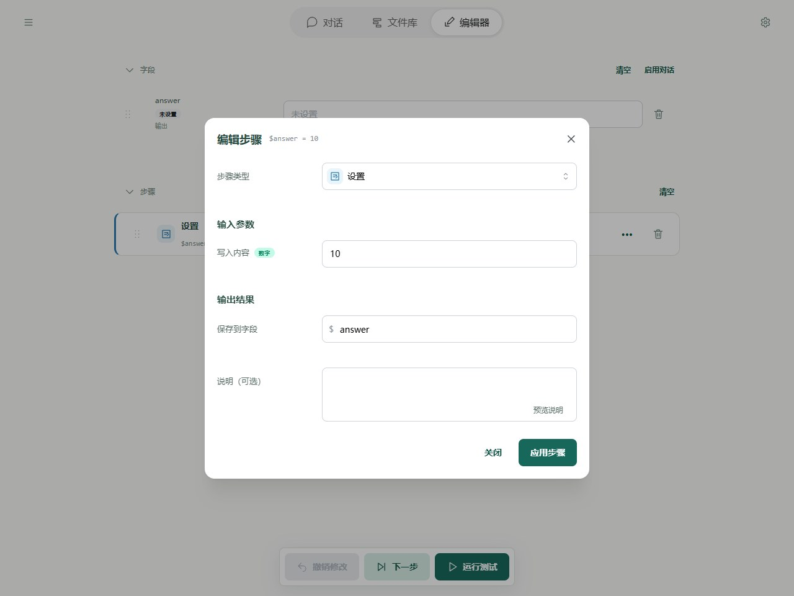
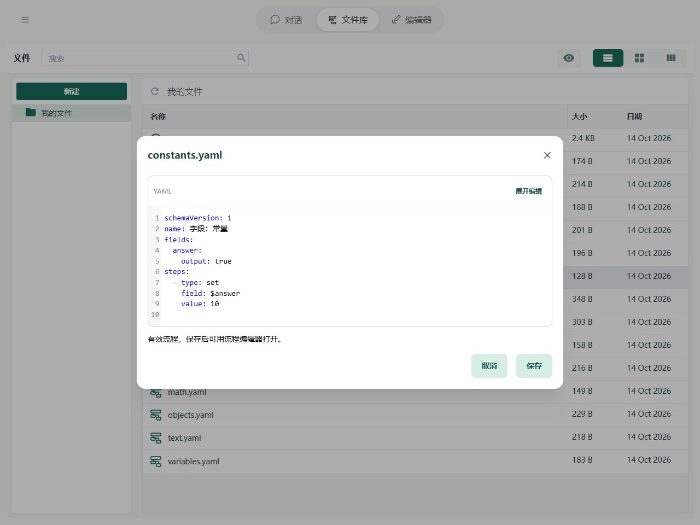

# 字段：常量

常量是直接写好的内容，例如数字 `10`、文字“请翻译成英文”。步骤执行时，就使用这里写好的值。

例如，每次都要求 AI 翻译成英文，就可以把“请翻译成英文”直接填在步骤里。每次要翻译的原文不同，则可以放在[变量](variables.md)中。

## 在哪里使用

常量可以写在字段的默认值里，也可以直接填在步骤的输入中：

1. **字段默认值**：例如给计数字段填 `0`，让流程从零开始计数。
2. **步骤输入**：例如加法每次加 `1`，或给 AI 填写固定的翻译要求。

在编辑器中，直接在对应输入框填写内容即可。输入框会识别类型：`10` 是数字，`"10"` 是文字；`true` 是布尔值，表示“是”，`false` 表示“否”；`null` 表示空值。

不需要先选择类型；识别方式和用途见[字段类型](types.md)，可以在需要时再了解。



图中的“设置”步骤，将固定数字 `10` 写入 `answer` 字段。对应的 YAML 步骤如下：

```yaml
- type: set
  field: $answer
  value: 10
```

其中 `value: 10` 是直接写入的常量。常量也可以是[对象或列表](objects.md)。

给字段填写默认值，只是准备它开始时的内容；后面的步骤仍然可以修改这个字段。

## 完整示例



```yaml
schemaVersion: 1
name: 字段：常量
fields:
  answer:
    output: true
steps:
  - type: set
    field: $answer
    value: 10
```

运行后得到 `{answer: 10}`。可以使用本页末尾的按钮导入示例。
