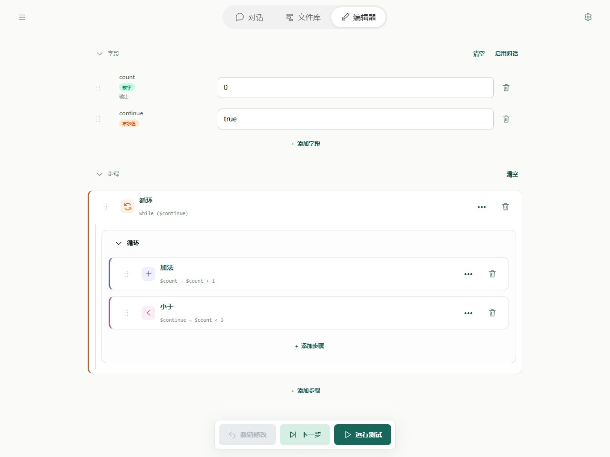
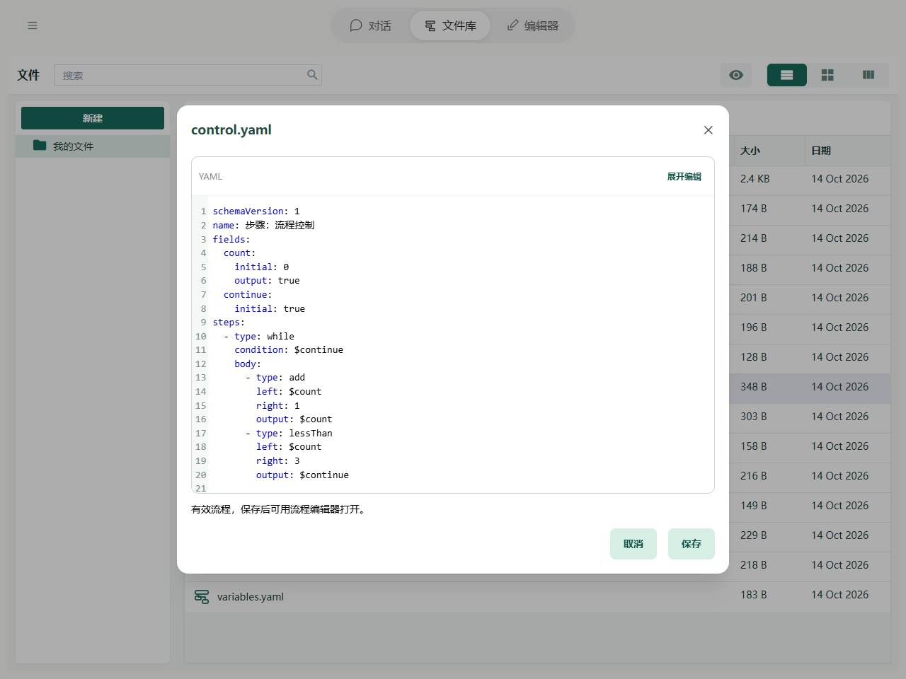

# 步骤：流程控制

通常，步骤会从上到下依次执行。需要“根据情况做不同的事”或“重复做一件事”时，可以使用流程控制：

- **条件（`if`）**：条件成立，执行“那么”里的步骤；不成立，执行“否则”里的步骤。例如，分数达到 60 就显示“通过”，否则显示“未通过”。
- **循环（`while`）**：先检查条件，成立就执行里面的步骤，然后再次检查；不成立就结束循环，继续后面的步骤。

条件可以引用保存“是 / 否”的字段。`true` 表示成立，`false` 表示不成立；[比较步骤](comparison.md)可以生成这样的结果。

## 在 Editor 中操作

添加「循环」，条件选 continue；在循环体中添加加法和小于比较。比较结果写回 continue。嵌套块的缩进表示执行关系，可逐步观察 count 和 continue。



图中显示本章示例的实际字段与步骤。先导入下方示例，再在 Editor 中打开；修改参数后运行或逐步观察。

## YAML 与基本示例



截图对应以下完整流程；可以复制代码，也可以使用本页末尾的导入按钮。

```yaml
schemaVersion: 1
name: 步骤：流程控制
fields:
  count:
    initial: 0
    output: true
  continue:
    initial: true
steps:
  - type: while
    condition: $continue
    body:
      - type: add
        left: $count
        right: 1
        output: $count
      - type: lessThan
        left: $count
        right: 3
        output: $continue
```

不额外传输入时，预期输出为 `{count: 3}`。执行过程如下：

| 第几轮 | count 加 1 后 | count 是否小于 3 | 接下来 |
| --- | --- | --- | --- |
| 1 | 1 | 是，continue 为 true | 再执行一轮 |
| 2 | 2 | 是，continue 为 true | 再执行一轮 |
| 3 | 3 | 否，continue 为 false | 结束循环 |

### 条件步骤的写法

下面是步骤片段，放在完整流程的 `steps` 下；先准备 `passed` 和 `message` 两个字段：

```yaml
- type: if
  condition: $passed
  then:
    - type: set
      field: $message
      value: 通过
  else:
    - type: set
      field: $message
      value: 未通过
```

`passed` 为 `true` 时，message 得到“通过”；为 `false` 时得到“未通过”。不需要处理“不成立”的情况时，可以省略 `else`。

## 规则与常见问题

- **循环为何停不下来？** 如果条件始终成立，就会不断重复，直到达到运行限制。本例在循环里更新 count，再把比较结果写回 continue，使条件最终变为 false。
- **第一次检查就不成立？** 循环内的步骤一次也不会执行。
- **条件不一定是 true / false？** `0`、空文字、`null` 和未设置值都按不成立处理；非零数字、非空文字、对象和列表按成立处理。文字 `"false"` 仍是非空文字，会被当作成立。初学时推荐使用比较结果，避免直接拿文字或列表作条件。
- **YAML 中的名字**：条件步骤用 `condition`、`then` 和可选的 `else`；循环用 `condition` 和 `body`。

完整路径边界见[字段与路径参考](operands.md)，失败定位见[运行与调试](../debugging/guide.md)。
