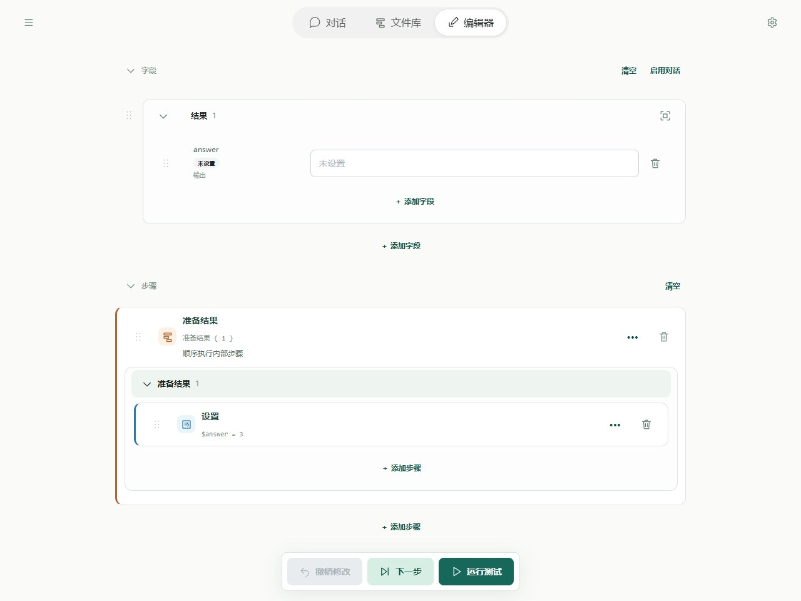
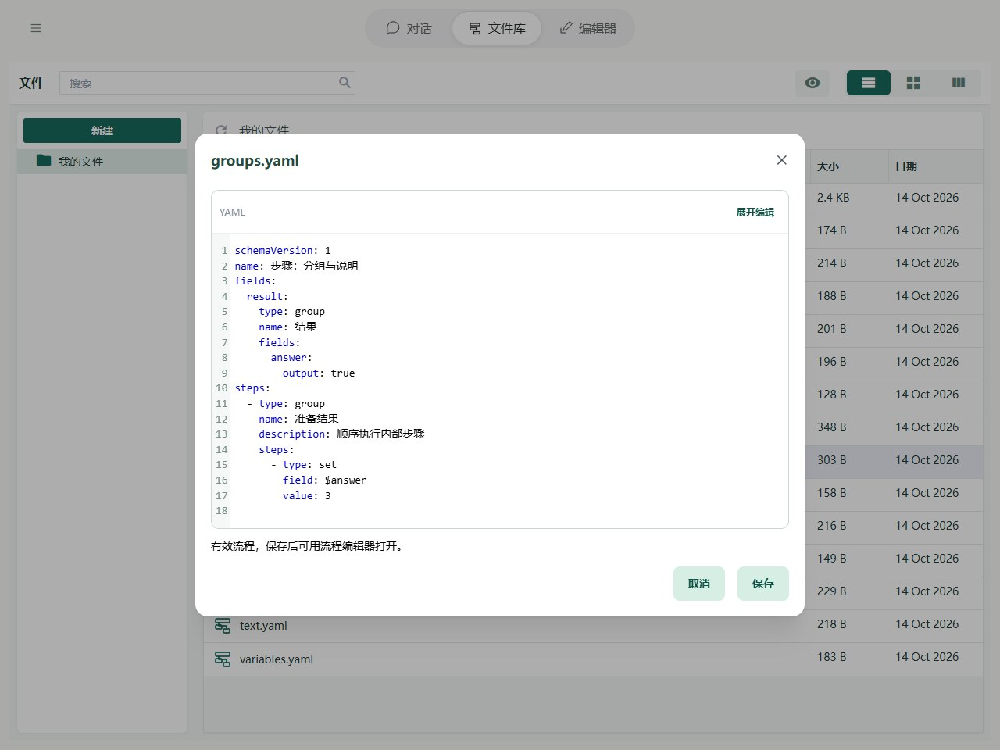

# 步骤：分组与说明

流程较长时，可以把相关字段或步骤收进一个有名字的分组，像把文件放进文件夹一样，方便查找和折叠。

分组只是整理展示：折叠后，里面的步骤仍会照常执行，字段也仍然可以使用。分组里还可以继续放分组。

## 在 Editor 中操作

将相关步骤放入分组，设置名称和说明。展开查看内部步骤，折叠只改变展示。字段也能分组，适合整理输入、配置和结果。



图中显示本章示例的实际字段与步骤。先导入下方示例，再在 Editor 中打开；修改参数后运行或逐步观察。

## YAML 与基本示例



截图对应以下完整流程；可以复制代码，也可以使用本页末尾的导入按钮。

```yaml
schemaVersion: 1
name: 步骤：分组与说明
fields:
  result:
    type: group
    name: 结果
    fields:
      answer:
        output: true
steps:
  - type: group
    name: 准备结果
    description: 顺序执行内部步骤
    steps:
      - type: set
        field: $answer
        value: 3
```

不额外传输入时，预期输出为 `{answer: 3}`。

## 规则与常见问题

### 字段分组

字段分组也写在 `fields` 中，通过 `type: group` 识别；里面继续按“字段名: 配置”组织。下面把输入放进名为“输入”的分组：

```yaml
fields:
  inputs:
    type: group
    name: 输入
    collapsed: false
    fields:
      chatIn:
        input: true
      language:
        initial: 英文
  chatOut:
    output: true
```

`inputs` 是分组标识，`name` 是显示名称，省略时显示分组标识。修改显示名称不会修改分组标识。分组内可以继续添加相同写法的子分组。

引用输入仍然写 `$chatIn`，不写 `$inputs.chatIn`。所有普通字段的名字在整个流程里都不能重复；同一层的分组标识和字段名也不能重复。

字段的排列只影响展示，不影响步骤执行。Editor 保存时保留普通名称的排列；`0`、`1` 这样的整数键会按对象的数字键顺序排列，建议使用容易辨识的文字名称。

旧版带 `name` 的字段列表仍可读取；Editor 保存后统一变为名称映射。步骤仍使用列表，因为步骤有执行先后顺序。

### 步骤分组与说明

步骤分组中的 `steps` 保存内部步骤，仍按从上到下的顺序执行。`collapsed: true` 表示默认折叠，省略或填 false 则展开；折叠不影响执行。

字段、步骤和分组都可以填写 `description`，用于说明用途，不参与计算。字段分组内使用 `fields`，步骤分组内使用 `steps`，两者不要混用。

完整路径边界见[字段与路径参考](operands.md)，失败定位见[运行与调试](../debugging/guide.md)。
