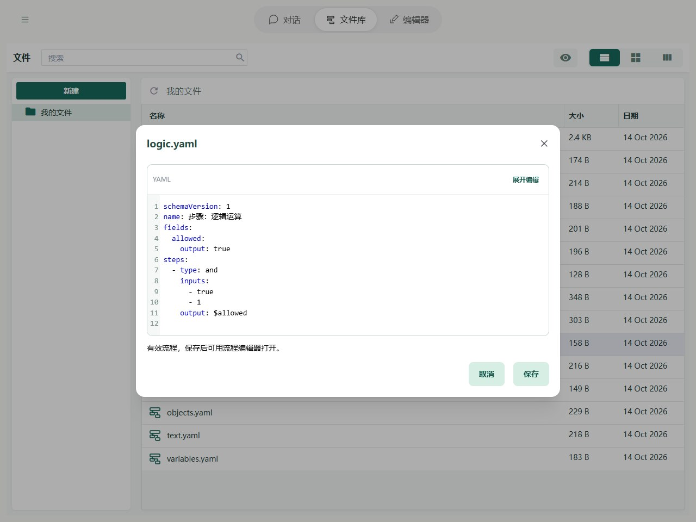

# 步骤：逻辑运算

当一个判断需要同时考虑几个条件时，可以使用逻辑步骤。例如，“年龄达标”并且“已经报名”，才能参加活动。

| Editor 名称 | YAML 类型 | 含义 |
| --- | --- | --- |
| 全部满足 | and | 所有条件都成立，结果才是 true |
| 任一满足 | or | 至少一个条件成立，结果就是 true |
| 取反 | not | 把 true 变成 false，或把 false 变成 true |

结果保存为 `true`（成立）或 `false`（不成立），供后面的条件或循环使用。

## 在 Editor 中操作

添加「全部满足」，输入填写列表 `[true, 1]`，保存到 allowed。这里的 true 和非零数字 1 都表示成立，因此最终得到 true。实际流程可以填写 `[$ageOk, $registered]`，组合两个判断结果。


图中显示本章示例的实际字段与步骤。先导入下方示例，再在 Editor 中打开；修改参数后运行或逐步观察。

## YAML 与基本示例



截图对应以下完整流程；可以复制代码，也可以使用本页末尾的导入按钮。

```yaml
schemaVersion: 1
name: 步骤：逻辑运算
fields:
  allowed:
    output: true
steps:
  - type: and
    inputs:
      - true
      - 1
    output: $allowed
```

不额外传输入时，预期输出为 `{allowed: true}`。

## 规则与常见问题

- **怎样填写多个条件？** “全部满足”和“任一满足”的 `inputs` 接收列表，例如 `[$ageOk, $registered]`；“取反”的 `input` 只接收一个值。
- **非 true / false 的内容怎样判断？** 规则与[流程控制](control.md)相同。例如 `0` 表示不成立，`1` 表示成立。
- **空列表是否表示不成立？** 把空列表本身当作一个条件时，它仍表示成立。判断列表有没有内容，应先用 [array.length](../tools/basic.md#array-length)取得数量，再比较数量是否大于 `0`。

完整路径边界见[字段与路径参考](operands.md)，失败定位见[运行与调试](../debugging/guide.md)。
