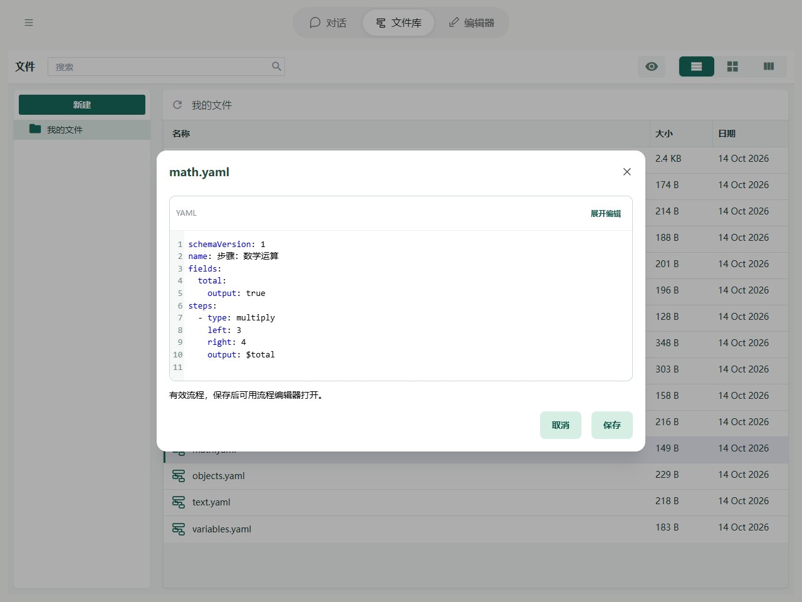

# 步骤：数学运算

数学步骤用来计算数量、价格或分数。每个步骤取两个值进行计算，再把结果保存到指定字段。

| Editor 名称 | YAML 类型 | 例子 |
| --- | --- | --- |
| 加法 | add | 2 + 3 = 5 |
| 减法 | subtract | 5 − 2 = 3 |
| 乘法 | multiply | 3 × 4 = 12 |
| 除法 | divide | 12 ÷ 3 = 4 |

YAML 中，`left` 是左边的值，`right` 是右边的值，`output` 是保存结果的字段。两边都可以填写数字，也可以引用字段。

## 在 Editor 中操作

添加「乘法」，左值填数字 3，右值填数字 4，保存到 total。也可以将任一侧切换为字段，例如 $price 与 $quantity。


图中显示本章示例的实际字段与步骤。先导入下方示例，再在 Editor 中打开；修改参数后运行或逐步观察。

## YAML 与基本示例



截图对应以下完整流程；可以复制代码，也可以使用本页末尾的导入按钮。

```yaml
schemaVersion: 1
name: 步骤：数学运算
fields:
  total:
    output: true
steps:
  - type: multiply
    left: 3
    right: 4
    output: $total
```

不额外传输入时，预期输出为 `{total: 12}`。

## 规则与常见问题

- **还没有值的字段**：计算时按 `0` 使用，字段本身仍保持未设置。
- **填写了文字**：能转成数字的文字会参与计算，例如 `"3"`；不能转换的文字会报 `INVALID_NUMBER`。直接填写数字更容易检查。
- **除数为 0**：会报 `DIVISION_BY_ZERO`，需要修改右边的值。
- **取整、绝对值或随机数**：使用“调用”步骤选择 [math 工具](../tools/basic.md)。这些工具要求输入真正的数字，文字 `"3"` 需要先转换。

完整路径边界见[字段与路径参考](operands.md)，失败定位见[运行与调试](../debugging/guide.md)。
