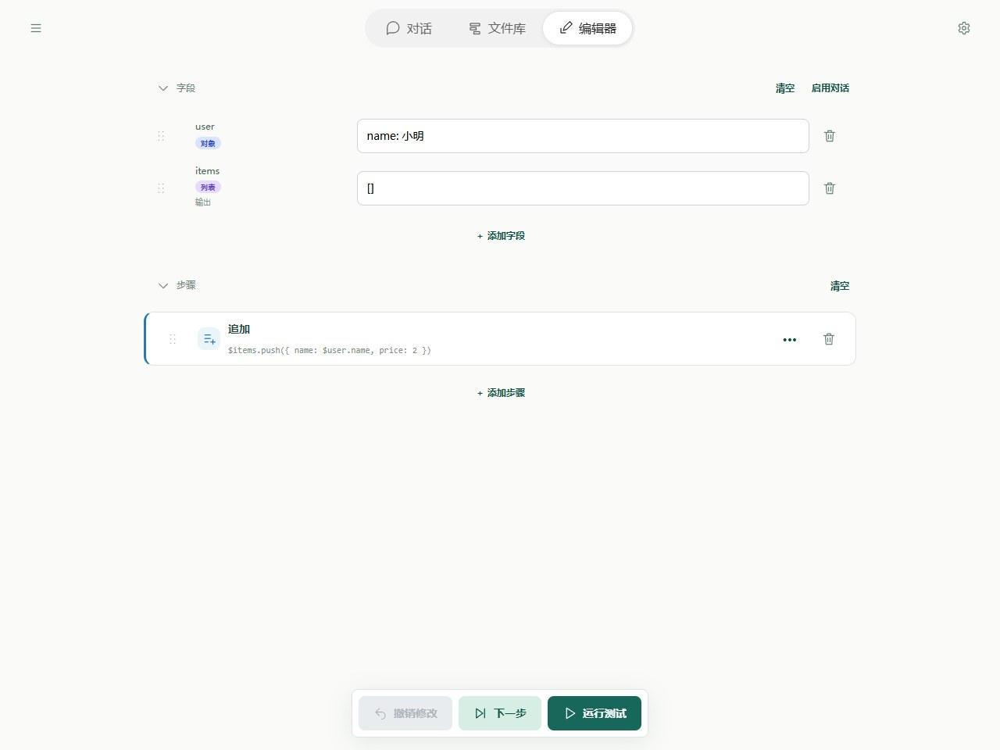
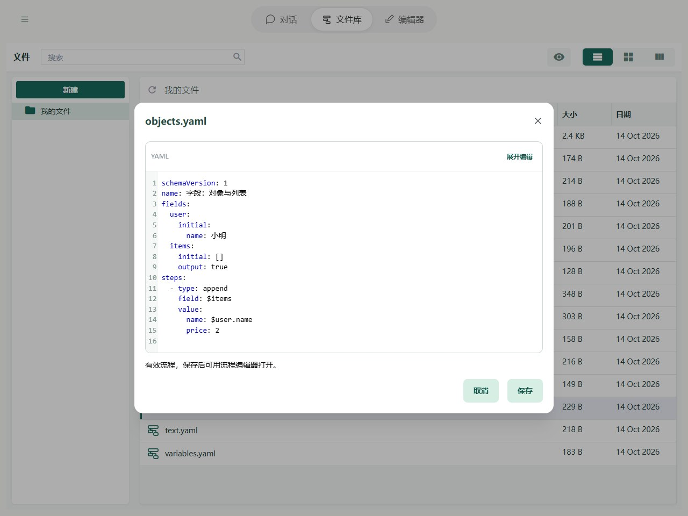

# 字段：对象与列表

一个字段不只可以放一句话或一个数字，也可以放多项内容：

1. **对象**：把一件事的多项信息放在一起，每项都有名字。例如 `{name: 小明, age: 18}` 保存一个人的姓名和年龄。
2. **列表**：把同类内容依次放在一起。例如 `[苹果, 香蕉]` 保存两种水果。

读取内部内容时，对象使用名字，列表使用位置。例如 `$user.name` 读取姓名；`$items[0]` 读取列表第一项，`$items[1]` 读取第二项。方括号里的位置从 `0` 开始数。

## 在 Editor 中操作

将 user 默认值填写为 `{name: 小明}`，items 填写 `[]`。在「追加」的写入内容中填写 `{name: $user.name, price: 2}`，保存到 items。输入框自动识别对象与列表；运行后在 items 的值中查看第一项。



图中显示本章示例的实际字段与步骤。先导入下方示例，再在 Editor 中打开；修改参数后运行或逐步观察。

## YAML 与基本示例



截图对应以下完整流程；可以复制代码，也可以使用本页末尾的导入按钮。

```yaml
schemaVersion: 1
name: 字段：对象与列表
fields:
  user:
    initial:
      name: 小明
  items:
    initial: []
    output: true
steps:
  - type: append
    field: $items
    value:
      name: $user.name
      price: 2
```

不额外传输入时，预期输出为 `{items: [{name: "小明", price: 2}]}`。

## 规则与常见问题

- **读取列表中某一项的信息**：`$items[0].name` 读取第一项的 name。本例运行后得到“小明”。
- **把字段放入对象**：步骤输入中的 `{name: $user.name, price: 2}` 会读取已有姓名，再和固定价格一起组成新对象。字段默认值中的 `$` 则保留为普通文字。
- **修改一项内容**：写入 `$user.name` 只改姓名，保留其他信息；写入整个 `$user` 则替换整个对象。中间结构不存在时，写入会自动准备它。
- **对象和字段分组的区别**：对象是一个字段里的数据；[字段分组](groups.md#字段分组)只是整理编辑器中的展示，不会把字段合成对象。

需要处理特殊名字、动态位置或较大的列表时，再查阅下面的路径参考。

完整路径边界见[字段与路径参考](operands.md)，失败定位见[运行与调试](../debugging/guide.md)。
