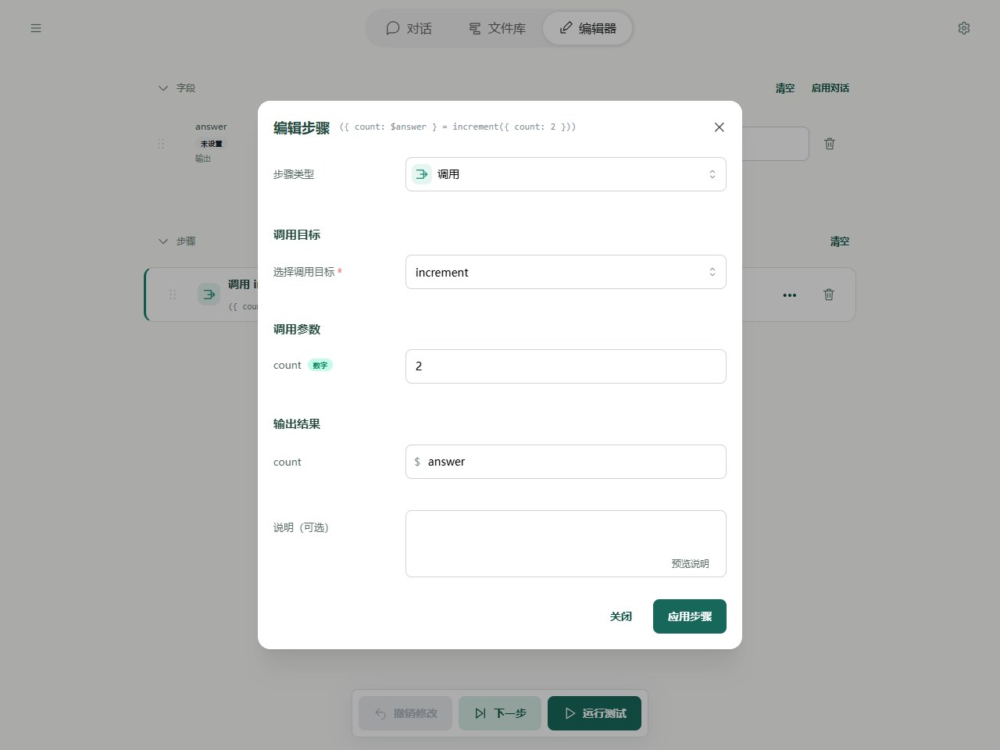
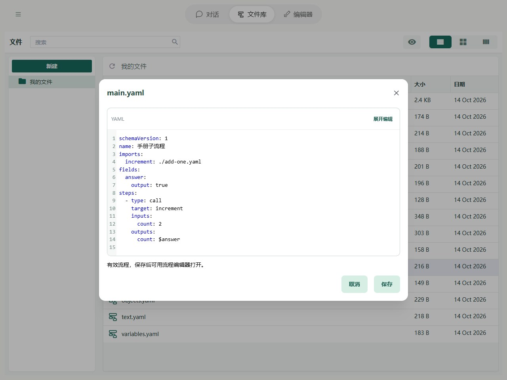

# 子流程与调用

如果同一组操作要反复使用，可以把它保存成另一个流程文件，作为“子流程”来调用。例如，主流程负责处理任务，子流程专门负责翻译一段文字。

调用它的流程称为“父流程”。父流程把需要的内容传给子流程，等待它完成，再接收结果。每次调用都会从子流程的开头执行，使用这次传入的内容。

使用子流程需要三步：

1. 保存子流程文件，给要接收的字段勾选“输入”，给要返回的字段勾选“输出”。
2. 在父流程的 `imports` 中填写子流程路径，并给它起一个调用时使用的别名。
3. 添加“调用”步骤，选择这个别名，填写输入和结果保存位置。

## 在 Editor 中操作

先导入本页末尾的两文件示例，再打开 main.yaml。点击调用步骤，目标 increment 来自本文件 imports；count 填 2，将子流程返回的 count 保存到父流程 answer。



imports 是文件级依赖，可在 Library 的源码编辑器中检查或修改相对路径。子流程的显示名称与调用别名不同，移动文件后检查相对路径是否仍有效。



## 完整例子

`add-one.yaml`：

```yaml
schemaVersion: 1
name: 加一子流程
fields:
  count:
    input: true
    output: true
    initial: 0
steps:
  - type: add
    left: $count
    right: 1
    output: $count
```

同目录的 `main.yaml`：

```yaml
schemaVersion: 1
name: 调用加一
imports:
  increment: ./add-one.yaml
fields:
  answer:
    output: true
steps:
  - type: call
    target: increment
    inputs:
      count: 2
    outputs:
      count: $answer
```

运行 main 得到 `{answer: 3}`。可导入本章「子流程调用」示例；CLI 将两份文件下载或保存到同一文件夹后执行 `soyori run ./main.yaml --json`。

## 来源和作用域

别名 increment 仅在 main 中有效，不是全局工具名；子流程必须声明自己的 imports。name 只是显示名称，不参与目标查找。工具名与本流程 imports 别名冲突时运行前报错，不存在优先级。

Editor 的子流程 imports 从 Library 解析相对文件路径；CLI 还支持本地及 HTTP(S) 来源。相对引用以导入方文件或重定向后的最终 URL 为基准。远程流程不能引用本地文件。Core 接收宿主链接好的 LoadedFlow 图，不自行读取文件或网络。

## 输入输出

以本页例子为例：

- `inputs` 中的 `count: 2` 把数字 2 交给子流程的 count 字段。省略时使用子流程的默认值 0；也可以引用父流程已有的字段，将其中的内容传入。
- `outputs` 中的 `count: $answer` 把子流程完成后的 count 保存到父流程的 answer。本例子流程加 1，因此 answer 得到 3。
- 只有勾选“输入”的子流程字段可以接收参数，只有勾选“输出”的字段可以返回结果。

用 `output: $childResult` 可保存完整输出对象，不能同时写 outputs。只有标记 output 的字段返回。缺失输出属性回写 undefined，数据不自动 JSON 序列化。

父子字段容器独立，但引用对象可共享；修改同一对象的内部会互相可见。没有隐式深克隆。

## 进阶：单步与调用栈

执行 call 的一步创建子实例并入栈，下一步才执行内部节点。子流程最后一步完成后自动提交输出并出栈。父流程等待期间停在 call 位置。

调用栈由根到当前栈顶；每次调用都有 invocationId，重复调用同一个流程也不同。通过 source、flowName、path 定位文件与节点，通过 childInvocationId 关联子调用。默认最大调用深度为 32，包含根。

子流程失败会使等待中的祖先失败，保留实际出错位置与调用栈；不会自动重试或恢复。完整定位方法见 [调试](../debugging/guide.md)。
