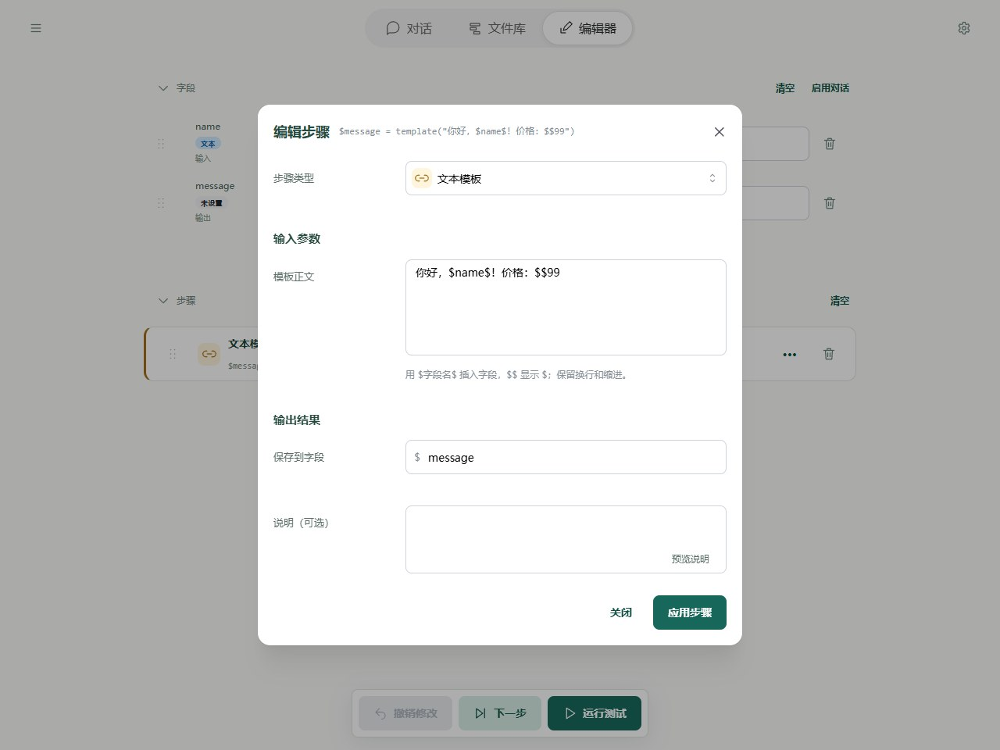
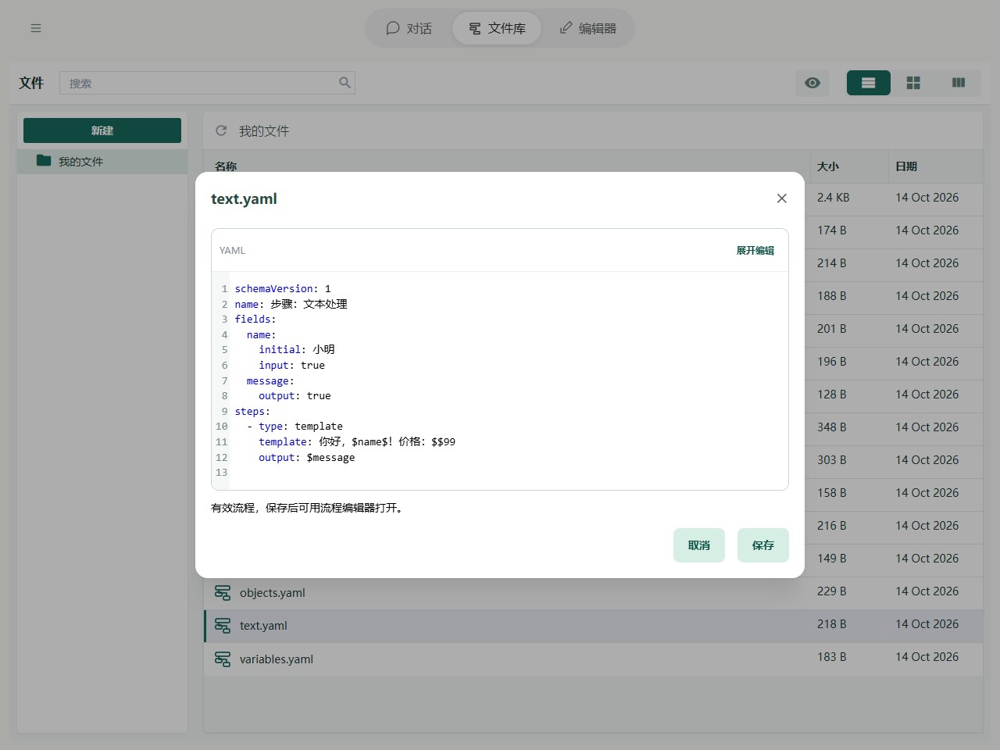

# 步骤：文本处理

“文本模板”把固定文字和字段里的内容拼成一段话，适合生成翻译要求、提示词或回复。例如，模板 `你好，$name$！` 中的 `$name$` 会被换成 name 字段里的名字。

YAML 中，这个步骤的类型名是 `template`。

## 在 Editor 中操作

添加「文本模板」，正文填写「你好，$name$！价格：$$99」，结果保存到 message。模板输入框中可以选择字段插值；普通文字值输入框不会执行插值。



图中显示本章示例的实际字段与步骤。先导入下方示例，再在 Editor 中打开；修改参数后运行或逐步观察。

## YAML 与基本示例



截图对应以下完整流程；可以复制代码，也可以使用本页末尾的导入按钮。

```yaml
schemaVersion: 1
name: 步骤：文本处理
fields:
  name:
    initial: 小明
    input: true
  message:
    output: true
steps:
  - type: template
    template: 你好，$name$！价格：$$99
    output: $message
```

不额外传输入时，预期输出为 `{message: "你好，小明！价格：$99"}`。

## 规则与常见问题

| 想做什么 | 写法 | 结果 |
| --- | --- | --- |
| 把字段插入一句话 | 模板正文中写 `你好，$name$！` | name 为“小明”时得到“你好，小明！” |
| 将整个字段交给步骤 | 普通步骤输入中写 `$name` | 读取“小明” |
| 在模板里显示美元符号 | 模板正文中写 `$$99` | 得到 `$99` |

普通步骤输入中的 `你好，$name$！` 只是一段原文，不会替换名字；需要拼文字时使用“文本模板”。

未设置的字段插入后不显示内容；数字、true / false 和 null 会变为文字，对象和列表会显示成 YAML。不能转成文本的数据会报 `INVALID_TEXT`。

要去掉文字两端空白、拆分文字或替换内容，可通过“调用”步骤使用 [text.trim、text.split 和 text.replace](../tools/basic.md)。

完整路径边界见[字段与路径参考](operands.md)，失败定位见[运行与调试](../debugging/guide.md)。
