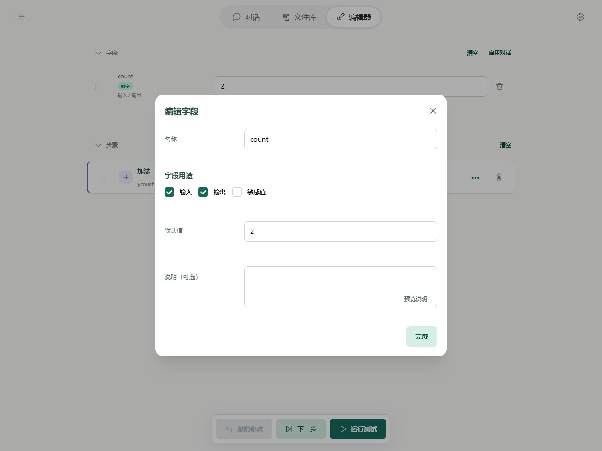
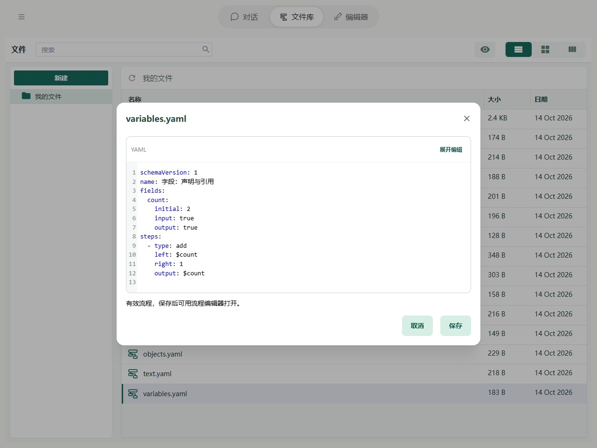

# 字段：变量

变量用来保存和传递流程运行中的内容，例如用户输入、查找到的资料或 AI 的回复。先准备字段，再让步骤通过字段名使用它。

## 声明

声明就是先创建一个字段，给它起名字，并按需要填写默认值。

在编辑器的“字段”区域点击“添加字段”，填写名称。例如创建 `count`，默认值填 `2`；勾选“输出”，就能在流程结束时看到它的结果。



在 YAML 中，字段写在 `fields` 下：

```yaml
fields:
  count:
    initial: 2
    output: true
```

`count:` 就是字段名，声明时不加 `$`，也不用另外填写 `name`；下面的 `initial` 是默认值。需要从流程外传入内容时，可以再设置 `input: true`。

创建字段时不用另外声明类型，编辑器会根据它当前保存的内容自动识别。类型为什么有用、怎样识别，见[字段类型](types.md)。

## 引用

引用就是告诉步骤：“去这个字段里，取出它当前保存的内容。”

在步骤输入中填写 `$count`，就会读取 `count` 的当前值；填写 `count` 则只是文字，不会读取字段。

例如，让 count 加 1，再把结果存回 count：

```yaml
- type: add
  left: $count
  right: 1
  output: $count
```

1. `left: $count`：读取 count 当前保存的数字。
2. `right: 1`：使用固定数字 1。
3. `output: $count`：把计算结果存回 count。

如果 count 开始是 `2`，执行后就变成 `3`。这里同时用到了变量引用 `$count` 和常量 `1`。

需要直接写出以 `$` 开头的文字时，步骤输入用 `$$` 转义，例如 `$$count` 得到文字 `$count`。文本模板中的引用另用 `$count$`，用法见[文本处理](text.md)；对象属性和列表位置的引用见[字段与路径参考](operands.md)。

## 完整示例



截图对应以下完整流程；可以复制代码，也可以使用本页末尾的导入按钮。

```yaml
schemaVersion: 1
name: 字段：声明与引用
fields:
  count:
    initial: 2
    input: true
    output: true
steps:
  - type: add
    left: $count
    right: 1
    output: $count
```

不额外传输入时，预期输出为 `{count: 3}`。

## 规则与常见问题

- **默认值和当前值**：默认值是流程开始时准备的内容，当前值是此刻字段里的内容。步骤会改变当前值，不会改写默认值。测试时手动修改当前值也一样，点击“设置为默认值”才会保存为下次使用的默认内容。
- **输入和输出**：勾选“输入”，允许对话、CLI 命令或调用它的父流程传入内容；勾选“输出”，流程结束时才会把这个字段放进最终结果。两者可以同时勾选，也可以都不勾选。内部字段仍可被步骤读写。
- **未设置和空值**：“未设置”（`undefined`）表示还没有内容；`null` 则是明确填入的空值。
- **字段没有声明**：步骤引用的新字段名也会被识别，但不会自动成为输入或输出。初学时建议先创建字段，再在步骤中引用，便于检查名字有没有写错。

完整路径边界见[字段与路径参考](operands.md)，失败定位见[运行与调试](../debugging/guide.md)。
