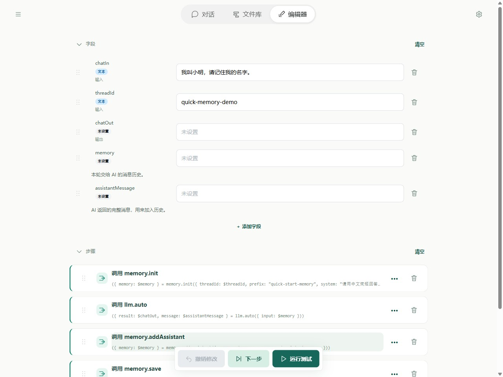
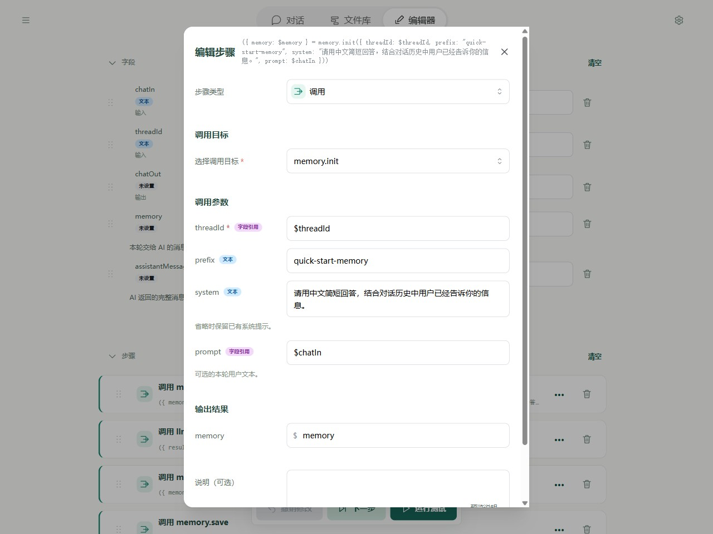
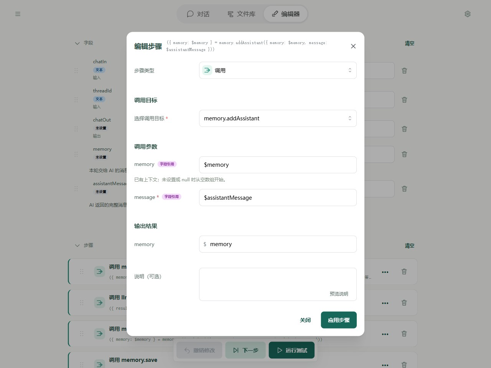
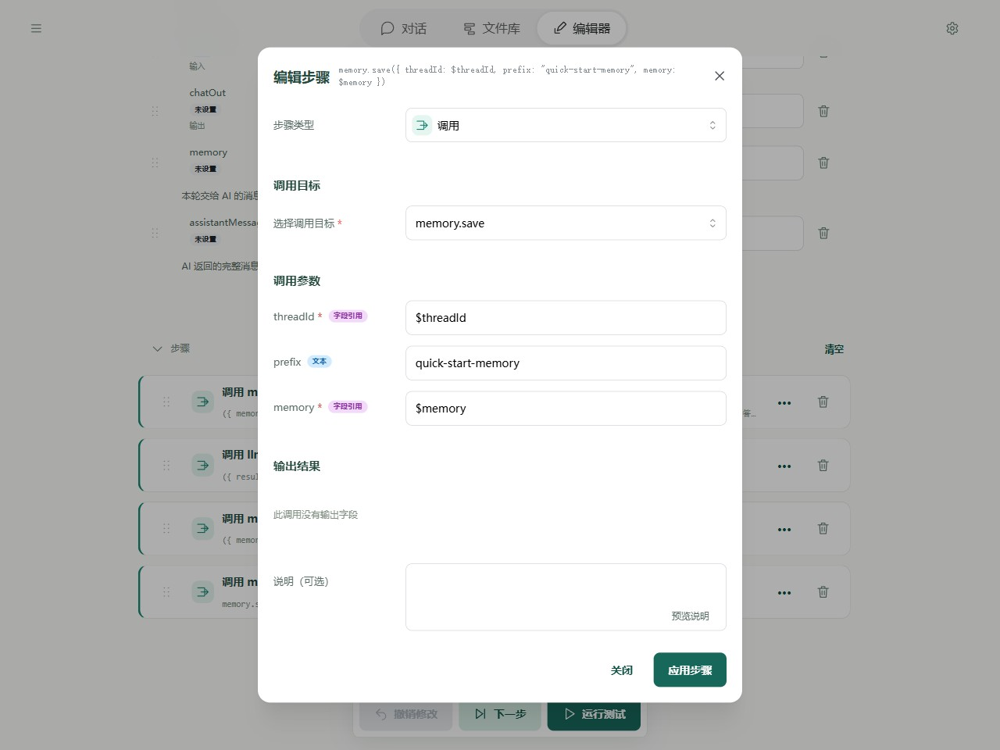
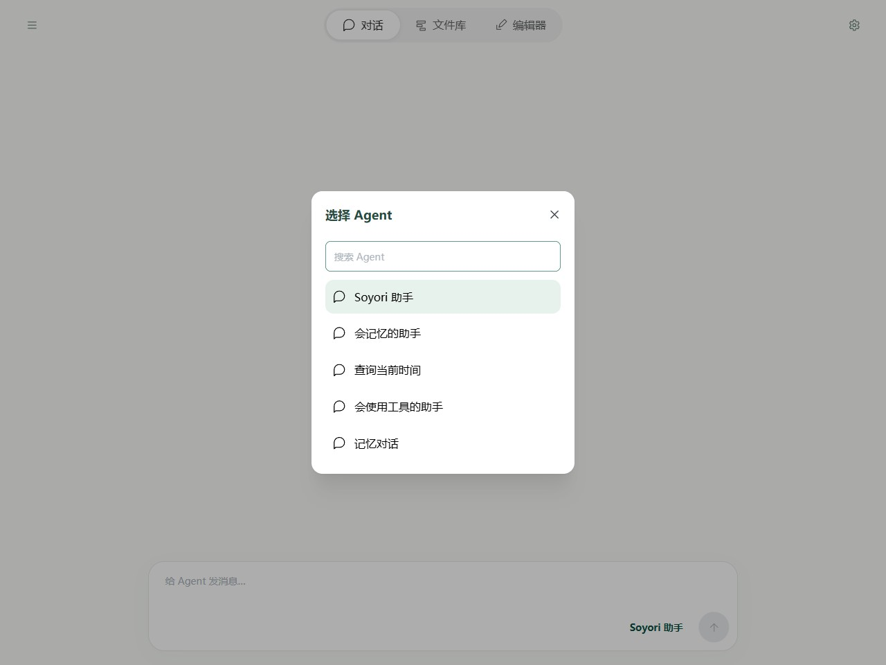

# 快速入门 2：使用记忆

这一课做一个**会记住你名字的助手**：第一轮告诉它“我叫小明”，第二轮问“我叫什么名字？”，让它根据之前的消息回答。

先完成[电脑端](quick-start.md)、[手机端](quick-start-mobile.md)或 [YAML + CLI](quick-start-cli.md)入门，准备好模型连接。本课先不添加搜索、时间等工具，让你看清记忆是怎样工作的。

## 1. 记忆为什么需要读取和保存

每次发消息，流程都会重新运行。要让 AI 知道前面聊过什么，需要把之前的消息和这次的问题一起交给它。

这一课只做四件事：

1. **读取记忆**：取回这段对话之前保存的消息，加入本轮问题。
2. **交给 AI**：让模型阅读这些消息并回答。
3. **加入回复**：把 AI 本轮的完整回复放进消息历史。
4. **保存记忆**：存好更新后的历史，下一轮再读取。

这里的记忆是一份消息列表，不是让模型永久学会你的信息。对话页面显示的聊天记录也不会自动成为模型记忆，需要由流程完成上面四步。

## 2. 新建流程和字段

在文件库新建流程，名称填 **会记忆的助手**。按第一课的方式，先清空默认步骤，再清空字段。已有默认模板也带记忆，本课从空白搭建，便于理解每一步。

添加下面五个字段。名称按表格原样填写，不加 `$`；除表中注明的项目，其他设置留空。

| 名称 | 用途勾选 | 默认值 | 保存什么 |
| --- | --- | --- | --- |
| chatIn | 输入 | `我叫小明，请记住我的名字。` | 本轮用户说的话 |
| threadId | 输入 | `quick-memory-demo` | 对话编号，用来找到同一份记忆 |
| chatOut | 输出 | 留空 | 给用户看的回复 |
| memory | 都不勾选 | 留空 | 交给模型的完整消息历史 |
| assistantMessage | 都不勾选 | 留空 | 模型本轮返回的完整消息 |



`threadId` 可以理解为一份聊天笔记的编号。相同编号读取同一份笔记，不同编号各用各的。在 Editor 测试和 CLI 中，本课手动使用 `quick-memory-demo`；在对话页面，这个编号由页面自动提供。

## 3. 按顺序添加四个调用步骤

每次点击“添加步骤”，类型选择“调用”，再搜索并选择对应工具。

### 第一步：memory.init，读取记忆并加入问题

| 表单位置 | 填写内容 |
| --- | --- |
| threadId | `$threadId` |
| prefix | `quick-start-memory` |
| system | `请用中文简短回答，结合对话历史中用户已经告诉你的信息。` |
| prompt | `$chatIn` |
| 输出结果 → memory | `memory` |

system 是给助手的固定要求；prompt 是这次的用户消息。工具会先读取旧历史，再加入这次的问题；第一次没有历史时，会从空白开始。



prefix 是这类记忆的保存前缀，本课统一填写 `quick-start-memory`。它与 threadId 一起确定保存位置，例如 `quick-start-memory/quick-memory-demo`。最后一步保存时要使用相同前缀。

### 第二步：llm.auto，让模型阅读历史

| 表单位置 | 填写内容 |
| --- | --- |
| input | `$memory` |
| 输出结果 → result | `chatOut` |
| 输出结果 → message | `assistantMessage` |

连接参数沿用第一课的配置，**tools 留空**。

第一课交给模型的是一段提示词；这次交给它的是一份消息历史。result 是给用户看的回答，message 则保留完整模型消息，下一步要把它加入历史。

### 第三步：memory.addAssistant，把回复加入历史

| 表单位置 | 填写内容 |
| --- | --- |
| memory | `$memory` |
| message | `$assistantMessage` |
| 输出结果 → memory | `memory` |

memory 输入是当前的整份记忆，message 输入是 AI 这一次返回的完整回复。把输出的 memory 保存回同名字段，下一步才能使用更新后的记忆。



### 第四步：memory.save，保存更新后的历史

| 表单位置 | 填写内容 |
| --- | --- |
| threadId | `$threadId` |
| prefix | `quick-start-memory` |
| memory | `$memory` |

这个工具没有需要接收的输出，保存完成即可。只读取、不执行这一保存步骤，下一轮就不会读到本轮新增的消息。



## 4. 运行两轮，检查是否记住名字

先在 Editor 中测试：

1. 保持 chatIn 为“我叫小明，请记住我的名字。”，threadId 为 `quick-memory-demo`，点击“运行测试”，等待完成。
2. 将 chatIn 的**当前值**改为“我叫什么名字？”，threadId 保持不变，再点击“运行测试”。
3. 查看 chatOut，正常情况下，助手会结合历史回答你叫“小明”。具体措辞可能不同。

想看清读取过程，可以在第二轮先点击“下一步”，只执行 memory.init。此时 memory 中应包含第一轮的问题和回复，以及第二轮的新问题；确认后再继续运行。

**判断记忆是否接对，先看 memory 是否包含旧消息。** 历史已经传入但模型没有正确回答时，还需要检查模型表现，不能只根据一句回复断定存储失效。

也可以切到对话页，点击输入框右下角、发送箭头左侧的 Agent 名称，选择“会记忆的助手”。在**同一段对话**中依次发送上面两句话。这里会使用页面自己的 threadId，因此不会自动接着 Editor 的 `quick-memory-demo` 测试历史聊。



新建另一段对话会分配另一个编号，不会读取刚才那段对话的记忆。

## 5. YAML + CLI 写法

本课使用新版 memory 接口。已发布的 npm 0.1.0 仍使用 messages；新版发布前，CLI 需使用本项目源码构建的版本。在项目目录运行 `pnpm build` 后，可用 `pnpm cli` 替代下文的 `soyori`；示例文件路径请按实际保存位置填写。

使用下面的完整 YAML 创建 `memory-chat.yaml`；也可以用本页末尾的按钮导入示例，再从文件库下载。CLI 安装见[第一课](quick-start-cli.md)。

```yaml
schemaVersion: 1
name: 会记忆的助手
description: 读取历史、回答问题、追加完整回复，再保存，供同一对话下一轮使用。
fields:
  chatIn:
    input: true
    initial: 我叫小明，请记住我的名字。
  threadId:
    input: true
    initial: quick-memory-demo
  chatOut:
    output: true
  memory:
    description: 本轮交给 AI 的消息历史。
  assistantMessage:
    description: AI 返回的完整消息，用来加入历史。
steps:
  - type: call
    target: memory.init
    inputs:
      threadId: $threadId
      prefix: quick-start-memory
      system: 请用中文简短回答，结合对话历史中用户已经告诉你的信息。
      prompt: $chatIn
    outputs:
      memory: $memory
  - type: call
    target: llm.auto
    inputs:
      input: $memory
    outputs:
      result: $chatOut
      message: $assistantMessage
  - type: call
    target: memory.addAssistant
    inputs:
      memory: $memory
      message: $assistantMessage
    outputs:
      memory: $memory
  - type: call
    target: memory.save
    inputs:
      threadId: $threadId
      prefix: quick-start-memory
      memory: $memory
```

在文件所在目录，使用相同的存储目录和 threadId 连续运行两次：

```powershell
soyori run ./memory-chat.yaml --storage-dir ./tutorial-data --set-string threadId=quick-memory-demo --set-string "chatIn=我叫小明，请记住我的名字。" --timeout 10m --json
soyori run ./memory-chat.yaml --storage-dir ./tutorial-data --set-string threadId=quick-memory-demo --set-string "chatIn=我叫什么名字？" --timeout 10m --json
```

第二次结果中的 chatOut 应能回答“小明”。模型文字不固定。`--storage-dir` 指定这次练习的数据位置，两条命令要保持一致；浏览器的记忆不会自动同步到 CLI。

## 6. 换一份记忆与常见问题

- **开始全新的测试**：Editor / CLI 更换 threadId，例如 `quick-memory-demo-2`；对话页面点击“新对话”。旧记忆仍保留，只是这次不再读取它。
- **重置字段不等于删除记忆**：“重置到默认值”清除的是当前测试现场，之前由 memory.save 保存的数据仍在。
- **确实要删除本课 CLI 记忆**：执行 `soyori storage delete quick-start-memory/quick-memory-demo --storage-dir ./tutorial-data`，删除后无法通过该条记录找回历史。网页存储独立，删除方式见[存储工具](tools/storage.md)。
- **历史没有保存**：确认流程成功执行到 memory.save；读取和保存的 prefix、threadId 必须一致，memory.save 的 memory 输入必须是 `$memory`。
- **历史越来越长**：这份入门流程不会自动压缩历史。超过模型可读长度时，先换一个新编号继续练习，再按需要设计摘要或裁剪。

接下来阅读[快速入门 3：使用工具](quick-start-tools.md)，让助手根据真实工具结果回答。完整接口见[记忆工具](tools/memory.md)。
