# 快速入门：Editor（手机端）

从新建流程开始，做一个**单轮翻译助手**：填写中文 → 拼合提示词 → 调用模型 → 得到英文。

本教程使用手机竖屏界面，步骤与 [电脑端 Editor 入门](quick-start.md) 相同。手机顶部通常只显示图标，下方截图会对应说明。

## 1. 准备模型（可选）

**不填写模型连接信息，也可以运行。** 没有已有 API 配置时，默认使用本地 **Qwen3-1.7B-ONNX**（`onnx-community/Qwen3-1.7B-ONNX`）。权重约 **1.44 GB**。本地推理使用设备 GPU，浏览器和设备须支持 WebGPU 与 shader-f16。

> **本地模型：下载与加载是两件事。**
>
> **下载**：首次使用需要下载模型文件，耗时取决于网速。文件会缓存在浏览器中；缓存仍在时，不需要重新下载。
>
> **加载**：将已下载的模型读入内存并初始化，**可能需要等待几分钟**。每次刷新浏览器，或关闭网页后重新打开，下一次使用本地模型时都需要重新加载。同一次打开中，加载成功后会复用；在对话、文件库、编辑器之间切换不会重新加载。

想直接使用本地模型，可以跳到第 2 步；若关闭过 **允许按需下载**，需先在设置中重新打开。

想使用自己的 API 模型，先点击左上角菜单，再点击抽屉底部的 **设置**。下图展示菜单与设置入口：

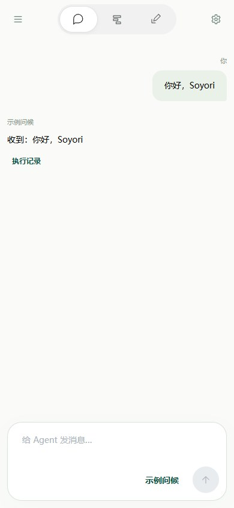

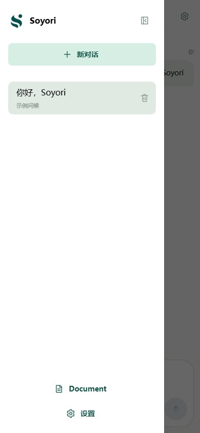

在设置的 **Soyori 助手** 区域，为 OpenAI 或兼容服务填写 **API Key、Base URL、模型 ID**，填写后自动保存。模型 ID 使用服务实际支持的名称；已有连接可直接使用。

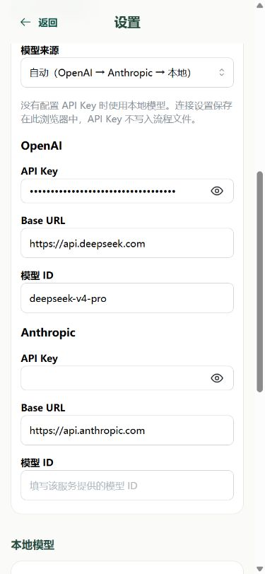

## 2. 新建流程

点击顶部中间的 **文件库图标**。再点击搜索框左侧的 **目录图标**，展开目录面板。

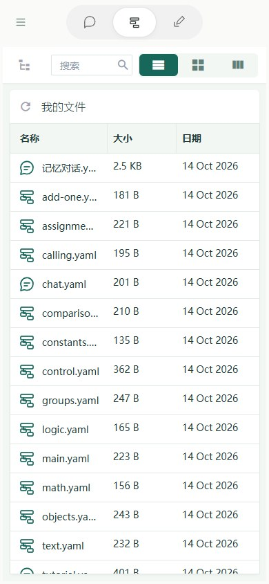

在面板中找到 **新建**，点击 **新建 → 新建流程**。新流程保存在当前目录；这一课使用 **我的文件** 根目录。

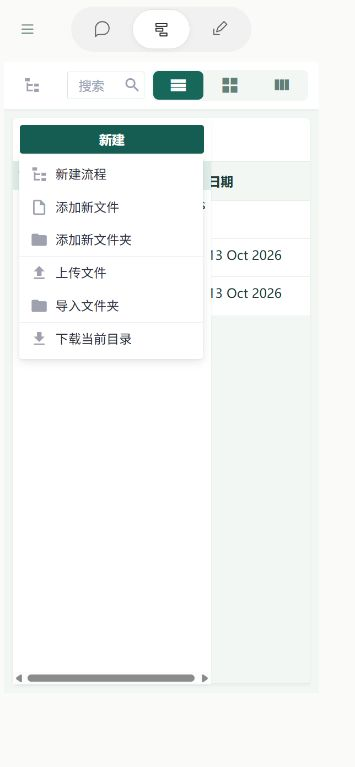

填写 **流程名称**：`我的手机翻译助手`。**说明（可选）** 可以填写 `输入中文，翻译成英文。`，也可以留空。

点击 **保存**，会自动进入编辑器。名称用于在文件库识别这个流程，说明用于介绍它的用途。

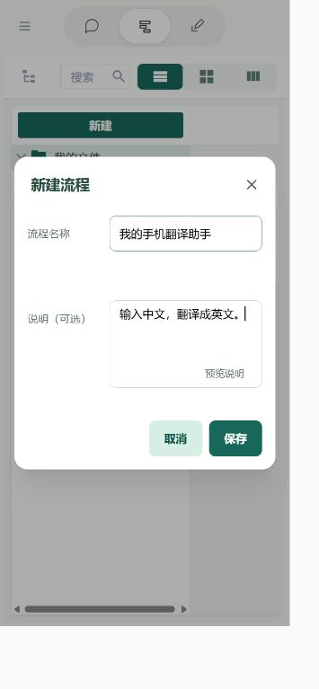

## 3. 清空默认内容

新建流程自带记忆和工具循环。这一课只做一次翻译，先清空默认内容，从头搭建。

手机上的字段和步骤上下排列。先轻点 **字段** 标题将它折叠，便于看到下面的 **步骤**；仍看不到时向下滑动。

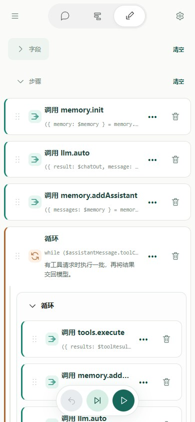

1. 在 **步骤** 标题右侧点击 **清空**，再点击 **确认清空**。
2. 在 **字段** 标题右侧点击 **清空**，再点击 **确认清空**。

**先清步骤，再清字段**：步骤还在引用字段时，字段不能直接清空。只清空刚新建的这个流程。

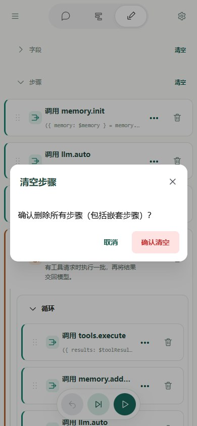

完成后，轻点 **字段** 标题重新展开。字段和步骤都应为空：

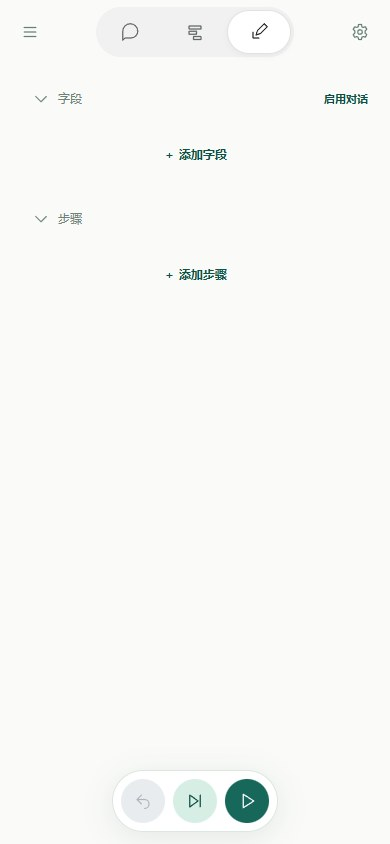

## 4. 创建三个字段

### 4.1 输入：chatIn

在 **字段** 中点击 **＋ 添加字段**：

- **名称**：`chatIn`。
- **字段用途**：勾选 **输入**。
- **默认值**：`今天的天气很好。`。

点击 **完成**；若按钮在屏幕外，在弹窗内向下滑动。这个字段保存用户要翻译的原文；默认值让第一次运行就有内容可用。

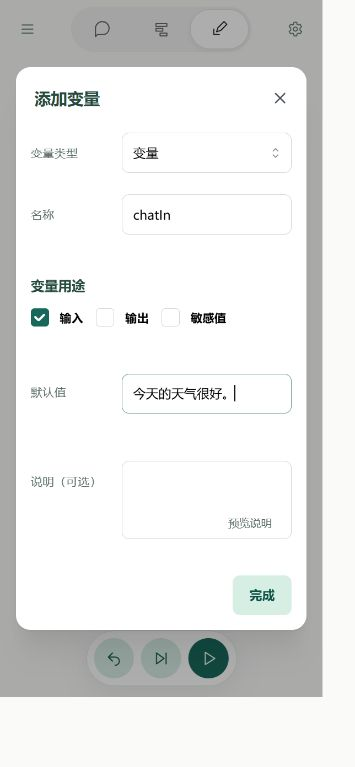

### 4.2 中间值：prompt

再次点击 **＋ 添加字段**，名称填写 `prompt`，输入和输出都不勾选，默认值留空，点击 **完成**。

它保存完整提示词，由第一个步骤生成，再交给模型。

### 4.3 输出：chatOut

再次点击 **＋ 添加字段**，名称填写 `chatOut`，勾选 **输出**，默认值留空，点击 **完成**。

它保存模型回复。此时应有以下三个字段：

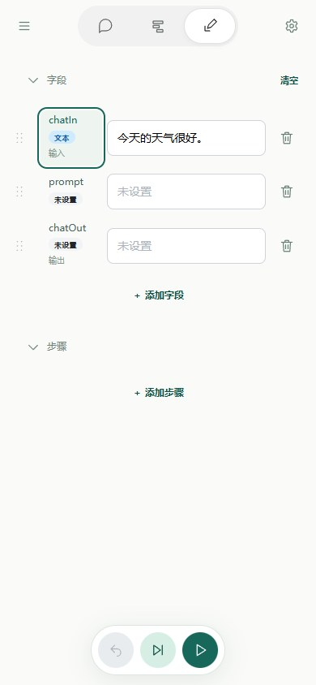

## 5. 拼合提示词

在 **步骤** 中点击 **＋ 添加步骤**，将 **步骤类型** 选为 **文本模板**。

**模板正文** 填写：

```text
把下面的中文翻译成英文，只返回译文：
$chatIn$
```

**保存到字段** 填写 `prompt`，在弹窗内向下滑动，点击底部 **应用步骤**。

`$chatIn$` 会被替换成原文。这样把“翻译要求”和“用户输入”拼成一段完整文字，保存到 `prompt`。

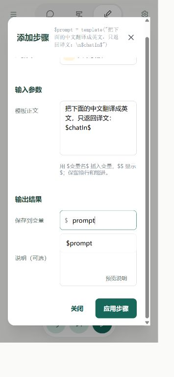

## 6. 调用模型

再次点击 **＋ 添加步骤**，将 **步骤类型** 选为 **调用**。在 **选择调用目标** 中搜索 `llm.auto`，选择 **llm → auto**。

- **input**：填写 `$prompt`，读取上一步生成的提示词。
- **输出结果 → result**：填写 `chatOut`，保存模型回复。

model、apiKey 和其他参数留空，使用默认模型或设置中的连接。点击 **应用步骤**。

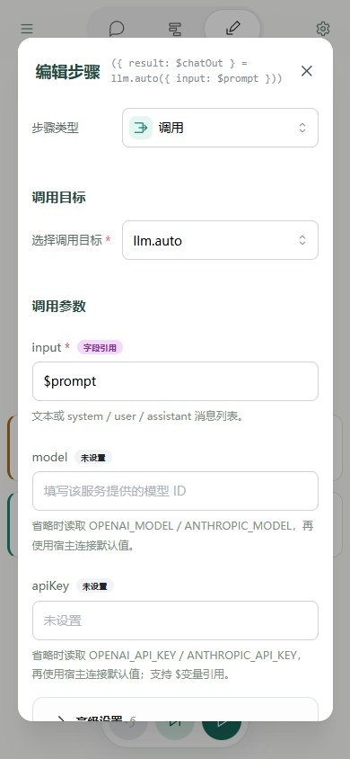

在弹窗内向下滑动，找到 **输出结果 → result**；继续向下滑动即可找到 **应用步骤**。

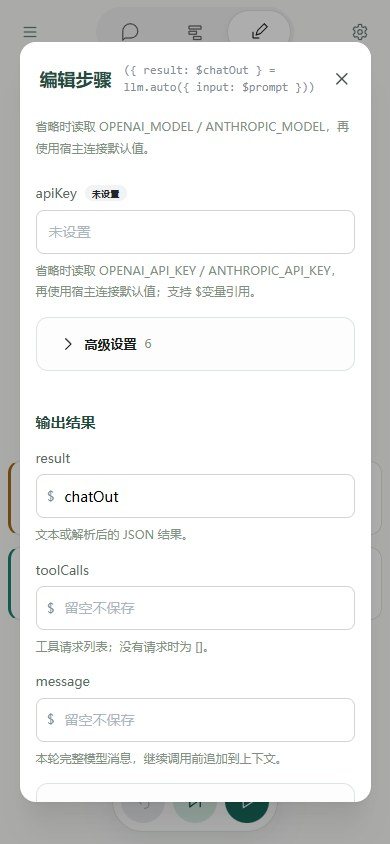

> **注意引用写法**：文本模板中的 `$chatIn$` 前后都有 `$`；模型 input 的 `$prompt` 只在开头有 `$`。

## 7. 运行并查看结果

确认步骤顺序是 **文本模板 → 调用 llm.auto**。在字段中保持 `chatIn` 为 `今天的天气很好。`，点击底部右侧的 **绿色 ▶ 运行图标**（运行测试）。

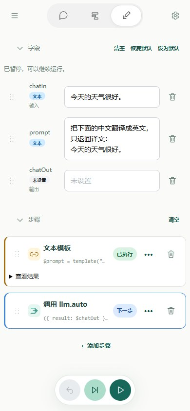

如果 **字段** 处于折叠状态，轻点标题展开；向上滑动回到字段，等待完成后查看：

- `prompt` 显示拼合后的完整提示词。
- `chatOut` 显示英文译文，例如 `The weather is very nice today.`。

模型措辞可能不同；失败时查看错误信息并检查模型连接。

> **请等待本地模型加载完成。** 即使模型文件已经下载，刷新或重新打开网页后仍需重新加载，可能需要几分钟；下载耗时则取决于网速。

也可以先点“下一步”执行模板，检查 prompt，再继续调用模型。下图只执行了模板步骤，chatOut 尚未生成；完整运行后才会出现译文。

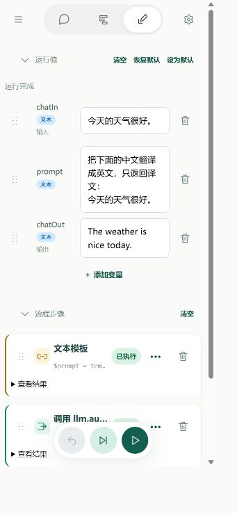

## 8. 修改后再运行

点击 **文本模板** 步骤，把正文中的“英文”改为“日文”，点击 **应用步骤**，再点击底部 **绿色 ▶ 运行图标**。

这次 `chatOut` 应为日文，例如 `今日はとてもいい天気です。`。也可以修改字段里的 `chatIn`，翻译另一句话；不需要改模型步骤。

字段设置和步骤表单确认后会自动保存。直接修改字段面板中的当前值只用于测试；希望下次打开仍使用它时，点击“设置为默认值”。你已从零创建并运行了自己的翻译流程。接下来学习[快速入门 2：使用记忆](quick-start-memory.md)，再进入[快速入门 3：使用工具](quick-start-tools.md)。后两课的字段与步骤操作相同，手机长表单向下滚动后确认即可。
