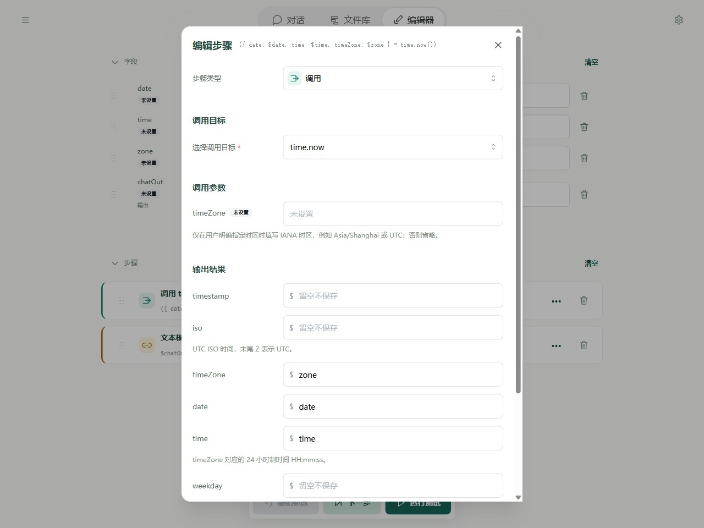
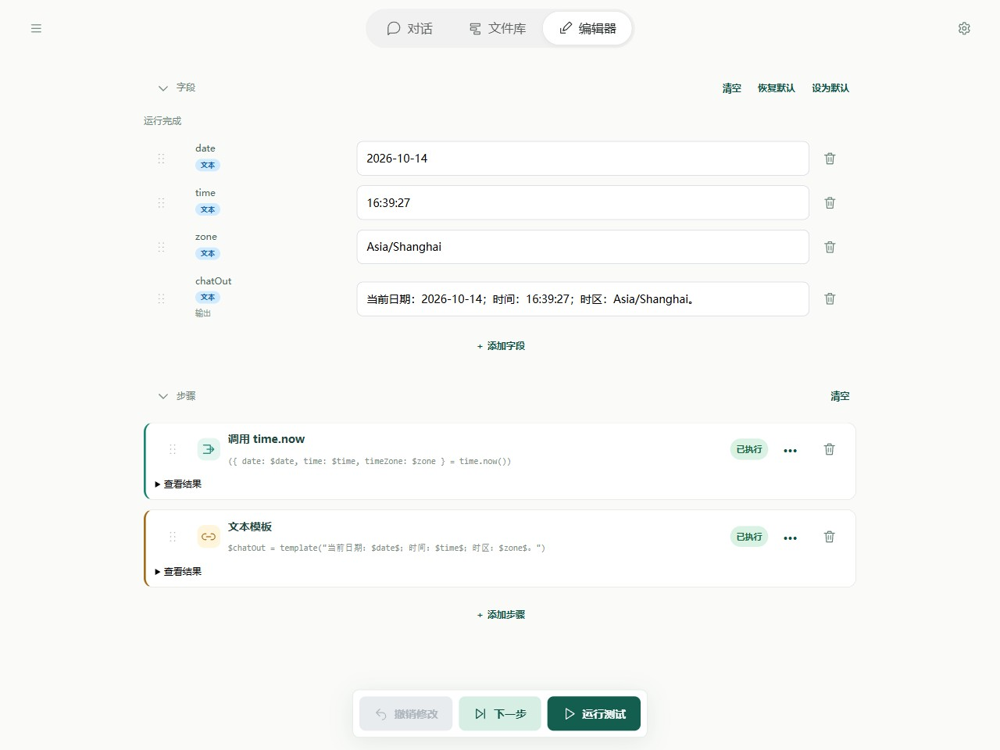
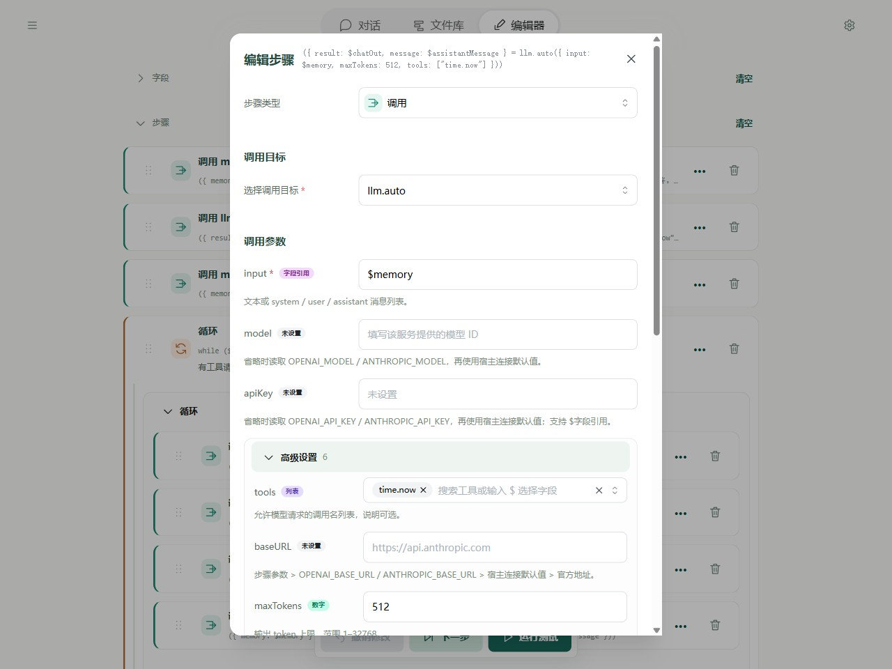
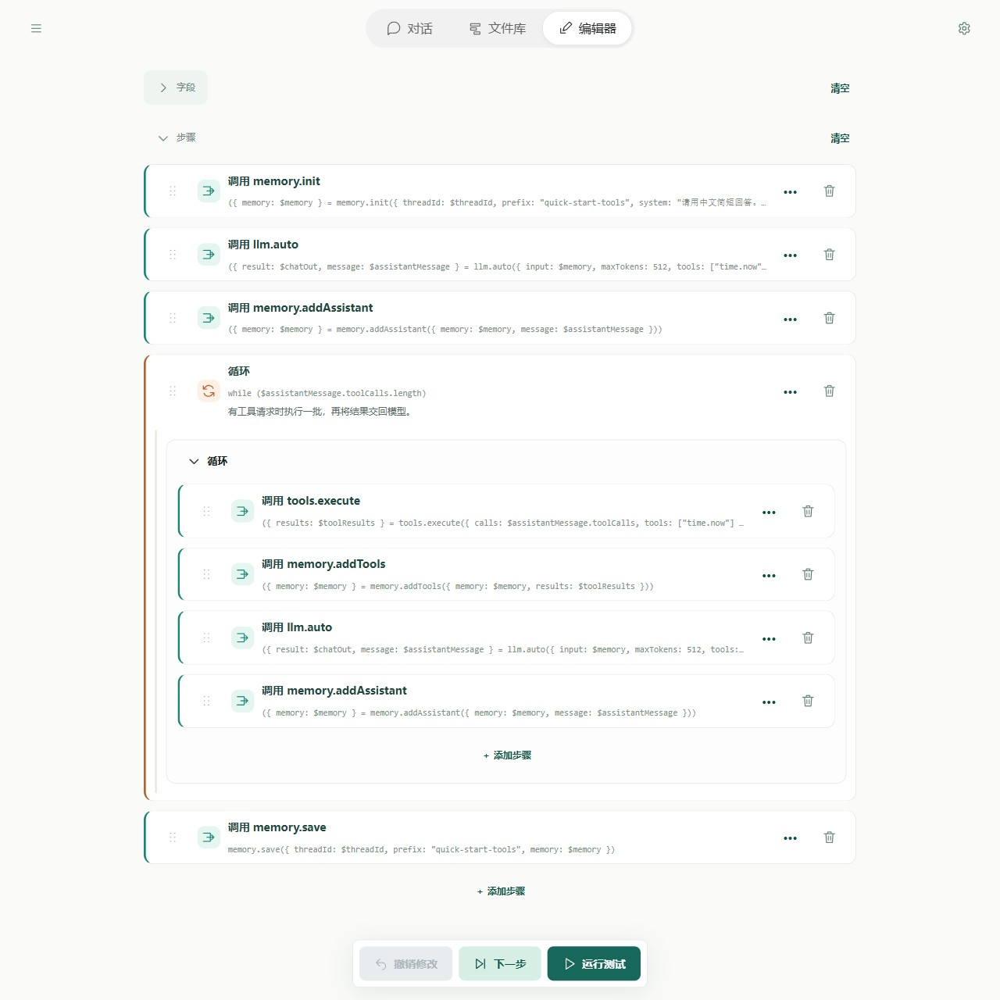

# 快速入门 3：使用工具

这一课让流程查询**真实的当前日期和时间**。先练习直接调用工具，再在[第二课的记忆助手](quick-start-memory.md)中加入“让 AI 自己决定何时查询”的能力。

工具可以理解为一项具体能力，例如查看时间、搜索网页或读取数据。工具负责真正执行操作；模型负责理解问题和组织回答。只在提示词里写“请查询时间”，不会自动完成查询。

## 1. 先做一个不需要模型的时间流程

在文件库新建流程 **查询当前时间**，先清空默认步骤，再清空字段。

添加四个字段，默认值都留空：

| 字段 | 用途 |
| --- | --- |
| date | 保存工具返回的日期，输入和输出都不勾选 |
| time | 保存工具返回的时间，输入和输出都不勾选 |
| zone | 保存工具使用的时区，输入和输出都不勾选 |
| chatOut | 勾选输出，保存最后要展示的文字 |

### 第一步：调用 time.now

点击“添加步骤”，选择“调用”，搜索 `time.now` 并选中。

timeZone 留空，使用运行设备的时区。在“输出结果”中填写：

| 返回名称 | 保存到字段 |
| --- | --- |
| date | `date` |
| time | `time` |
| timeZone | `zone` |

其余输出不需要填写。点击“应用步骤”。返回名称由工具规定；右侧保存到哪个字段，由你选择。



### 第二步：用模板组织文字

添加“文本模板”，正文填写：

```text
当前日期：$date$；时间：$time$；时区：$zone$。
```

“保存到字段”填 `chatOut`，点击“应用步骤”。

### 运行并查看结果

点击“运行测试”。date、time 和 zone 会得到工具实际返回的值，chatOut 会将它们拼成一句话。每次运行的时间会变化，时区取决于运行设备。



这一段不使用 AI，也不需要模型密钥。你已经完成了“选择工具 → 填写输入 → 保存结果 → 使用结果”。

## 2. 直接调用的完整 YAML

将下面内容保存为 `time-tool.yaml`，或从本页末尾导入“直接查询时间”示例。

```yaml
schemaVersion: 1
name: 查询当前时间
description: 直接调用时间工具，再用模板展示真实返回的日期、时间和时区。不需要 AI 模型。
fields:
  date: {}
  time: {}
  zone: {}
  chatOut:
    output: true
steps:
  - type: call
    target: time.now
    inputs: {}
    outputs:
      date: $date
      time: $time
      timeZone: $zone
  - type: template
    template: 当前日期：$date$；时间：$time$；时区：$zone$。
    output: $chatOut
```

在文件所在目录执行：

```powershell
soyori run ./time-tool.yaml --json
```

结果中的 chatOut 是这次运行取得的真实时间。可以先完成这个练习，再继续下面的 AI 工具调用。

## 3. 让 AI 自己决定是否调用工具

如果你希望用户问时间时才查询，就需要把工具交给模型选择。过程是：

1. 把用户问题和允许使用的工具名称交给模型。
2. 模型提出工具请求，例如“调用 time.now”。**这时还没有执行。**
3. 流程使用 tools.execute 真正执行请求。
4. 把工具结果加入消息历史，再请模型根据结果回答。
5. 如果模型还有请求，就再做一轮；没有请求时，保存记忆并结束。

下面延续第二课的四步流程。建议从本页末尾导入 **AI 使用时间工具** 示例，打开 `tool-agent.yaml`，先对照查看；想自己搭建时，可复制第二课的流程，改名为 **会使用工具的助手**，按下面三处修改。

### 修改一：准备工具结果字段，并开放时间工具

保留第二课的五个字段，再添加 `toolResults`，默认值留空，输入和输出都不勾选。它保存工具真正执行后的结果。

在 memory.init 中，将 system 改为：

```text
请用中文简短回答。需要当前日期或时间时，必须调用 time.now，不能猜测。根据实际工具结果回答；其他问题正常回答。
```

将读取和保存记忆的 prefix **都**改为 `quick-start-tools`，threadId 默认值改为 `quick-tools-demo`，避免把本课测试与上一课混在一起。

打开第一个 llm.auto 步骤，input 仍为 `$memory`。在“高级设置”的 tools 中只选择 `time.now`；result 保存到 chatOut，message 保存到 assistantMessage。不同模型的工具选择表现可能不同，需要所选模型支持工具请求。



### 修改二：在加入回复之后，保存记忆之前插入循环

外层步骤应为：

```text
memory.init
llm.auto
memory.addAssistant
循环：还有工具请求时继续
memory.save
```

添加“循环”，判断条件填 `$assistantMessage.toolCalls.length`。

这段写法的意思是“模型这次提出了几个工具请求”。数量为 0 时不进入循环；还有请求时执行循环体。无需手动计算数量。

在循环体里依次添加四个“调用”步骤：

| 工具 | 输入 | 输出结果保存位置 |
| --- | --- | --- |
| tools.execute | calls 填 `$assistantMessage.toolCalls`；tools 只选择 `time.now` | results → `toolResults` |
| memory.addTools | memory 填 `$memory`；results 填 `$toolResults` | memory → `memory` |
| llm.auto | input 填 `$memory`；tools 只选择 `time.now` | result → `chatOut`；message → `assistantMessage` |
| memory.addAssistant | memory 填 `$memory`；message 填 `$assistantMessage` | memory → `memory` |



**两处 llm.auto 都要填写同样的 tools。** tools.execute 里的 tools 也填相同列表，限定实际执行目标。本课只用一个时间工具，等理解后再增加其他能力。

tools.execute 返回的是执行结果，memory.addTools 负责把它转换成模型可读的消息。不要跳过这一步，也不要手动填写一份“工具成功”的结果来代替实际执行。

### 修改三：保留最后的保存步骤

最后的 memory.save 仍填写 `$threadId`、`$memory` 和本课前缀 `quick-start-tools`。模型完成回答后，把本轮问题、回复和工具结果一起保存，下一轮才可以继续使用。

## 4. 测试 AI 是否真的使用了工具

运行前，沿用前两课准备好的模型连接。

在对话页选择“会使用工具的助手”，发送：

```text
请使用时间工具查询现在的日期和时间。
```

展开本轮执行记录，检查是否实际出现 `time.now` 请求和工具结果。也可以在 Editor 中运行，查看 toolResults；它应包含 time.now 的实际返回数据。

**不要只看回复里有没有时间。** 如果模型直接编了一个时间，而 toolResults 没有本次调用结果，就没有完成这次练习。

再发一句“谢谢”，模型可以直接回答，不必每轮都查询时间。是否提出请求由模型决定，具体回复文字不会完全相同。

## 5. AI 使用工具的完整 YAML

将下面内容保存为 `tool-agent.yaml`。本页末尾另有这一流程的独立导入按钮。

```yaml
schemaVersion: 1
name: 会使用工具的助手
description: 延续记忆入门，只允许查询当前时间；有工具请求时执行，再把结果交回 AI。
fields:
  chatIn:
    input: true
    initial: 请使用时间工具查询现在的日期和时间。
  threadId:
    input: true
    initial: quick-tools-demo
  chatOut:
    output: true
  memory:
    description: 交给模型的完整消息上下文。
  assistantMessage:
    description: 模型本轮返回的消息，包含文本和工具请求。
  toolResults:
    description: 本批工具调用的成功结果或错误。
steps:
  - type: call
    target: memory.init
    inputs:
      threadId: $threadId
      prefix: quick-start-tools
      system: 请用中文简短回答。需要当前日期或时间时，必须调用 time.now，不能猜测。根据实际工具结果回答；其他问题正常回答。
      prompt: $chatIn
    outputs:
      memory: $memory
  - type: call
    target: llm.auto
    inputs:
      input: $memory
      maxTokens: 512
      tools:
        - time.now
    outputs:
      result: $chatOut
      message: $assistantMessage
  - type: call
    target: memory.addAssistant
    inputs:
      memory: $memory
      message: $assistantMessage
    outputs:
      memory: $memory
  - type: while
    condition: $assistantMessage.toolCalls.length
    description: 有工具请求时执行一批，再将结果交回模型。
    body:
      - type: call
        target: tools.execute
        inputs:
          calls: $assistantMessage.toolCalls
          tools:
            - time.now
        outputs:
          results: $toolResults
      - type: call
        target: memory.addTools
        inputs:
          memory: $memory
          results: $toolResults
        outputs:
          memory: $memory
      - type: call
        target: llm.auto
        inputs:
          input: $memory
          maxTokens: 512
          tools:
            - time.now
        outputs:
          result: $chatOut
          message: $assistantMessage
      - type: call
        target: memory.addAssistant
        inputs:
          memory: $memory
          message: $assistantMessage
        outputs:
          memory: $memory
  - type: call
    target: memory.save
    inputs:
      threadId: $threadId
      prefix: quick-start-tools
      memory: $memory
    outputs: {}
```

CLI 在文件所在目录执行：

这份 Agent 示例使用新版 memory 接口，npm 0.1.0 尚不支持；当前请使用[第二课所述的源码构建版 CLI](quick-start-memory.md#5-yaml-cli-写法)。本课前面的直接调用 time.now 示例不受影响。

```powershell
soyori run ./tool-agent.yaml --storage-dir ./tutorial-data --set-string threadId=quick-tools-demo --set-string "chatIn=请使用时间工具查询现在的日期和时间。" --timeout 10m --json
```

需要查看执行过程时，可加上 `--trace tool-run-001.jsonl --trace-values`；每次换一个新的 trace 文件名。记录会包含本次练习的数据，使用方法见[运行与调试](debugging/guide.md)。

## 6. 常见问题

- **找不到工具**：先在调用步骤的选择器中搜索准确名称。本课使用两端都有的 time.now；并非所有网页助手工具都能在 CLI 使用，见[平台支持](tools/contract.md)。
- **模型没有提出请求**：检查两处 llm.auto 的 tools 列表，以及问题是否明确要求查询；确认所选模型支持工具调用。可先运行第 1 节的直接调用流程，分清是工具本身失败，还是模型没有选择它。
- **执行失败或结果对不上**：检查 tools.execute 的 calls 是否为 `$assistantMessage.toolCalls`，memory.addTools 的 results 是否为 `$toolResults`。用完整消息传递请求，保留模型生成的请求编号，不要自己改编号。
- **循环一直不结束**：循环内必须重新调用模型，并把新 message 写回 assistantMessage；一直引用第一轮请求会不断重复。也应检查模型是否持续重复提出请求。
- **想增加其他工具**：先阅读[工具总览](tools/reference.md)，理解输入和返回，再把工具名称同时加入两处 llm.auto 和 tools.execute 的 tools 列表。

回顾[第二课的记忆流程](quick-start-memory.md)，或者继续查阅[模型与工具循环](agents/models.md)。
