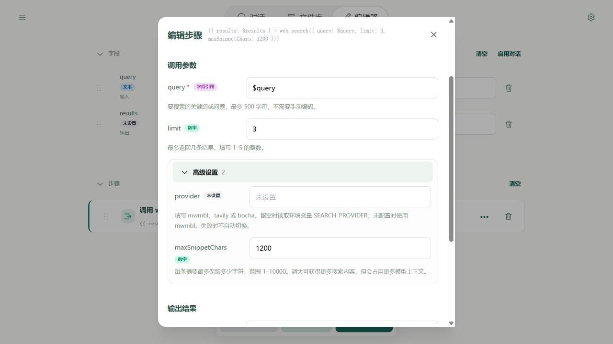

# 时间与网络

本章逐个说明当前工具。CLI 与 Editor 共享本章接口，实际平台差异见[工具调用约定](contract.md)。

## 使用前先了解

- **查询时间**：time.now 默认使用设备时区，无效时区报 TIME_INPUT。
- **请求网址**：web.fetch 默认使用 GET 读取，不填写 body；需要发送数据时按接口要求选择其他 method。默认等待最多 10 秒，可通过 timeoutMs 调整到 1–60000 毫秒。请求体和解压后响应各最多 2 MiB。
- **检查结果**：HTTP 状态 4xx / 5xx 也会正常返回，表示服务拒绝或处理失败，需要检查 status 和 body。连接失败、超时等才会使调用报错。
- **浏览器限制**：有些服务不允许网页直接访问，会受跨域规则（CORS）限制；不能靠修改流程绕过。网页请求不支持 CONNECT / TRACE / TRACK，GET / HEAD 不能带 body。
- **搜索资料**：web.search 的 query 最多 500 字符，limit 默认 3，可填 1–5。返回标题、链接和摘要，需要全文时再读取对应链接。

以下 YAML 是单个工具的**步骤片段**，不能直接作为流程文件运行。把它放进完整流程的 `steps` 下，并准备 answer 输出字段。完整写法和结果保存方式见[如何阅读工具说明](reference.md#如何阅读工具说明)。

## time.now

读取当前日期和时间。默认使用运行设备的时区；需要其他地区的时间时，填写 timeZone，例如 Asia/Shanghai 表示上海时区。

| 参数 | 类型 | 是否必填与默认值 | 说明 |
| --- | --- | --- | --- |
| timeZone | string | 可选 | 仅在用户明确指定时区时填写 IANA 时区，例如 Asia/Shanghai 或 UTC；否则省略。 |

返回：timestamp 为 Unix 毫秒；iso 为 UTC；date/time 为返回时区的日期及 24 小时制时间；weekday 周一 1 至周日 7。

命名输出属性：`timestamp`、`iso`、`timeZone`、`date`、`time`、`weekday`。可用 outputs 分别映射；也可用 output 保存完整对象。

```yaml
- type: call
  target: time.now
  inputs: {}
  output: $answer
```

## web.fetch

访问一个网址，取得服务返回的数据或网页源码。适合请求天气等服务接口；它不会像浏览器那样执行网页脚本，也不会自动把 HTML 源码整理成文章正文。

| 参数 | 类型 | 是否必填与默认值 | 说明 |
| --- | --- | --- | --- |
| url | string | 必填 | HTTP(S) 地址 |
| method | string | 可选；默认 "GET" | HTTP 方法，省略为 GET |
| headers | JSON | 可选 | 请求头对象，值必须是字符串，例如 {"Content-Type": "application/json"}。浏览器受 CORS 和请求头限制。 |
| body | JSON | 可选 | 对象或数组自动编码为 JSON；字符串原样发送；未设置则不发送。 |
| timeoutMs | integer | 可选；默认 10000 | 请求超时毫秒数 |

返回：{url, status, headers, body}；url 是最终地址，HTML body 为文字，空响应为 null。

命名输出属性：`url`、`status`、`headers`、`body`。可用 outputs 分别映射；也可用 output 保存完整对象。

```yaml
- type: call
  target: web.fetch
  inputs:
    url: https://example.com
  output: $answer
```

<a name="web-search"></a>

## web.search

通过选定的搜索服务查找标题、链接和摘要，适合发现后续要读取的页面。支持 Mwmbl、Tavily 和博查；步骤参数相同，密钥从运行环境自动读取。

| 参数 | 类型 | 是否必填与默认值 | 说明 |
| --- | --- | --- | --- |
| query | string | 必填 | 搜索文字 |
| limit | integer | 可选；默认 3 | 最多返回几条搜索结果；填写 1–5 的整数 |
| provider | string | 可选；高级设置 | mwmbl、tavily 或 bocha；留空时使用环境变量 SEARCH_PROVIDER，未配置时使用 mwmbl |
| maxSnippetChars | integer | 可选；默认 240；高级设置 | 每条摘要最多保留多少字符，范围 1–10000；例如 1200。较长摘要占用更多模型上下文 |

返回：{results: [{title, url, snippet}]}；无匹配为 []，时效不保证。

命名输出属性：`results`。可用 outputs 分别映射；也可用 output 保存完整对象。

```yaml
- type: call
  target: web.search
  inputs:
    query: Soyori
    limit: 3
  output: $answer
```

## 配置搜索服务

先选一家服务，填写对应的两项环境变量即可，不需要一次填写所有 Key。

| 服务 | SEARCH_PROVIDER 的值 | 需要填写并勾选“敏感值”的 Key |
| --- | --- | --- |
| 博查 | bocha | BOCHA_API_KEY |
| Tavily | tavily | TAVILY_API_KEY |
| Mwmbl，免 Key 体验 | mwmbl | 无 |

例如先测试博查：

1. 打开 Editor 中的测试流程，点击顶栏右上角的环境图标。
2. 添加 `SEARCH_PROVIDER`，值填 `bocha`，可以取消“敏感值”。
3. 添加 `BOCHA_API_KEY`，值填你申请的真实 Key，保留“敏感值”。环境会自动保存。
4. 回到步骤，选择 `web.search`，填写 query，再点击“运行测试”。不需要先用 env.get 读取 Key，也不要把 Key 填进搜索词或流程字段。

希望所有流程都能使用时，改在“设置 → 全局环境变量”填写。文件测试环境和对话环境分别覆盖全局；在 Editor 文件里填的配置不会自动用于对话。图文入口见[Editor 环境](../environment/editor.md)。

高级设置中的 provider 可以单独指定本步骤的供应商；留空才读取 SEARCH_PROVIDER。该值区分大小写，例如填写 `bocha`，不能填“博查”。配置后服务出错会明确失败，不会切换到其他供应商。



浏览器需要搜索接口允许跨域访问。出现网络或 CORS 错误时，环境变量不能绕过浏览器限制。CLI 没有浏览器跨域限制。

2026-10-14 实际配置 Key 后的 Editor 验证：博查和 Tavily 均已完成真实搜索。测试使用同一关键词“Node.js 官方文档”，各取前三条结果；它只验证本机当前浏览器的调用，不代表各地区访问状况或整体搜索质量。


Key 缺失时报 SEARCH_CONFIG，并提示缺少哪个变量；HTTP 401/403 通常需检查 Key、权限或余额，429 需检查额度或频率。服务错误不会作为“没有搜索结果”返回，也不会将接口错误正文里的凭据回显。

下面的完整流程读取你配置的供应商，输出搜索结果，不调用模型。可以用本页“导入示例”直接打开：

```yaml
schemaVersion: 1
name: 测试搜索服务
fields:
  query:
    input: true
    initial: Soyori AI Agent
  results:
    output: true
steps:
  - type: call
    target: web.search
    inputs:
      query: $query
      limit: 3
      maxSnippetChars: 1200
    outputs:
      results: $results
```
