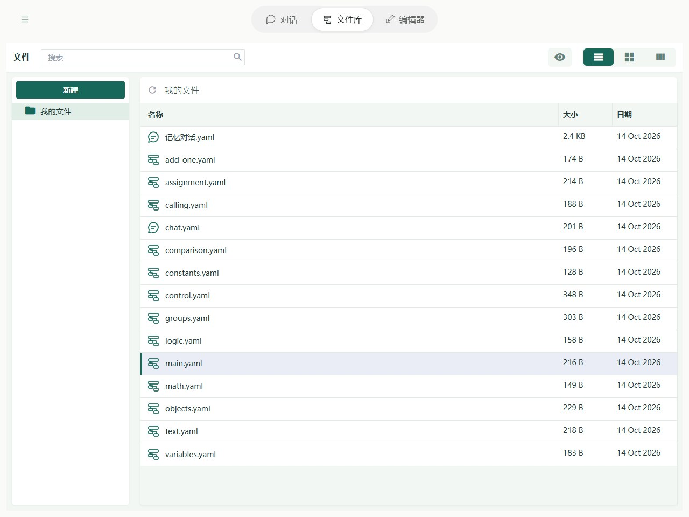
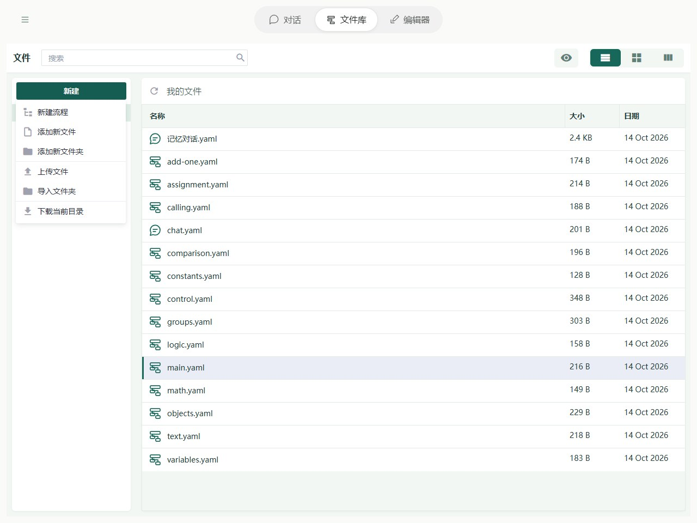

# 文件库：文件、上传与下载

文件库（Library）用来保存和整理流程、脚本及其他文件。打开有效的流程文件后，可以进入编辑器（Editor），用字段和步骤表单修改、测试它。

## 文件保存在哪里

文件保存在当前浏览器为这个站点提供的本地数据库（IndexedDB）中。刷新页面后仍可读取，但不会自动出现在电脑文件夹里。清除站点数据、更换浏览器或站点地址后，可能无法读取原来的文件；需要备份时下载文件或导出工程包。

文件可以放进文件夹，例如 `agents/main.yaml` 表示 agents 文件夹里的 main.yaml。可以创建、复制、移动、重命名和删除；复制时重名会自动添加后缀，移动时遇到同名文件则报错，不会覆盖。

## 浏览文件与文件夹

左侧目录选择位置，右侧查看文件；上方搜索按文字定位文件。电脑右键、手机文件操作菜单可打开、下载、复制、移动、改名或删除。进入目录后新建或上传，保留文件之间的相对组织。

手机将目录与文件区域分开显示，使用文件库顶部的目录入口切换位置，再用文件操作菜单选择动作。文件较多时先搜索；新建和导入操作使用当前目录。

## 流程文件

扩展名为 `.json`、`.yaml` 或 `.yml` 的文件，内容符合流程格式时，才会被识别为流程。普通配置或格式有误的文件仍会保留，可以打开源码检查；保存文件成功并不代表它能作为流程运行。

文件名、流程 `name` 和导入别名不同。修改已保存流程的名称不会自动改文件名；移动文件也不会重写引用，必须检查所有受影响的 `imports` 和脚本导入。

## 脚本与其他文件

.js/.mjs 可用源码编辑器查看和修改，再由流程的 script.run 导入。仅保存脚本不会自动执行；新建脚本文件时必须由流程显式 import 或调用。普通 JSON 配置、文字和二进制也可以保存，普通 ZIP 保持原文件。

脚本的 input/result、路径和平台区别见[脚本开发](scripts/development.md)。配置 JSON 与有效流程 JSON 是不同文件，不能只根据扩展名判断。

## 编辑与运行

识别出的流程可以使用步骤表单编辑，也可以打开源码。步骤表单提交修改时保存到 Library；源码支持行号、语法高亮和诊断，需要确认保存。全屏代码编辑仍是同一份草稿，退出全屏不等于保存。

Editor 内运行使用该编辑会话的流程；助手 `flow.inspect` 和 `flow.run` 读取 Library 中的已保存文件。让助手检查前先保存，避免两端比较不同版本。运行现场与文件持久化分开，不支持刷新恢复现场。

## 上传与导入

在当前目录使用新建菜单创建流程、文件、文件夹或导入文件夹；文件上传使用文件库提供的上传入口。选择多个文件可成批导入，选择文件夹会保留相对路径。新建流程默认含记忆与显式工具循环，入门练习可清空后从简单步骤开始。

## 下载与导出工程

上传文件夹保留相对路径。文件名以 `.soyori.zip` 结尾的工程包会自动解包；普通 `.zip` 原样保存。下载目录或工作区得到 `.soyori.zip`，保留目录结构和文件字节。

同路径冲突拒绝整批导入，不静默覆盖。单次导入上限 100 MiB，工程包解压后最多 100 MiB、5000 条。恶意路径会拒绝。把工程包解压到磁盘后，可用 CLI 运行入口流程；浏览器专属工具不会因此在 CLI 出现。

## 用流程开始对话

具有 `chatOut` 输出的流程可用于对话。推荐声明 `chatIn`、`threadId` 为输入；Chat 宿主在运行副本中补齐这两个输入，不修改已保存文件。每轮先保存用户消息，再传入 `chatIn`、`threadId`；成功后追加回复。失败保留用户消息。原始记录存于 `threads/<threadId>`，历史如何进入模型由流程决定。

内置助手和新建聊天模板不同：助手模型由设置选择，新建模板的节点仍可编辑。对话历史不是文件库的一类文件，管理方式见[对话与 thread](editor/chat.md)。原始记录与流程记忆见[存储](agents/storage.md)。

Soyori 改名兼容：新导出的工程包使用 `.soyori.zip`，导入同时识别旧 `.agentp.zip`；普通 ZIP 仍原样保存。浏览器已有数据库与缓存标识保留，避免文件和下载缓存失联。
